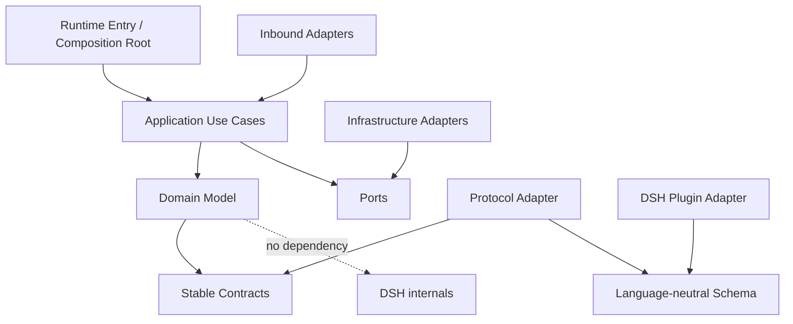
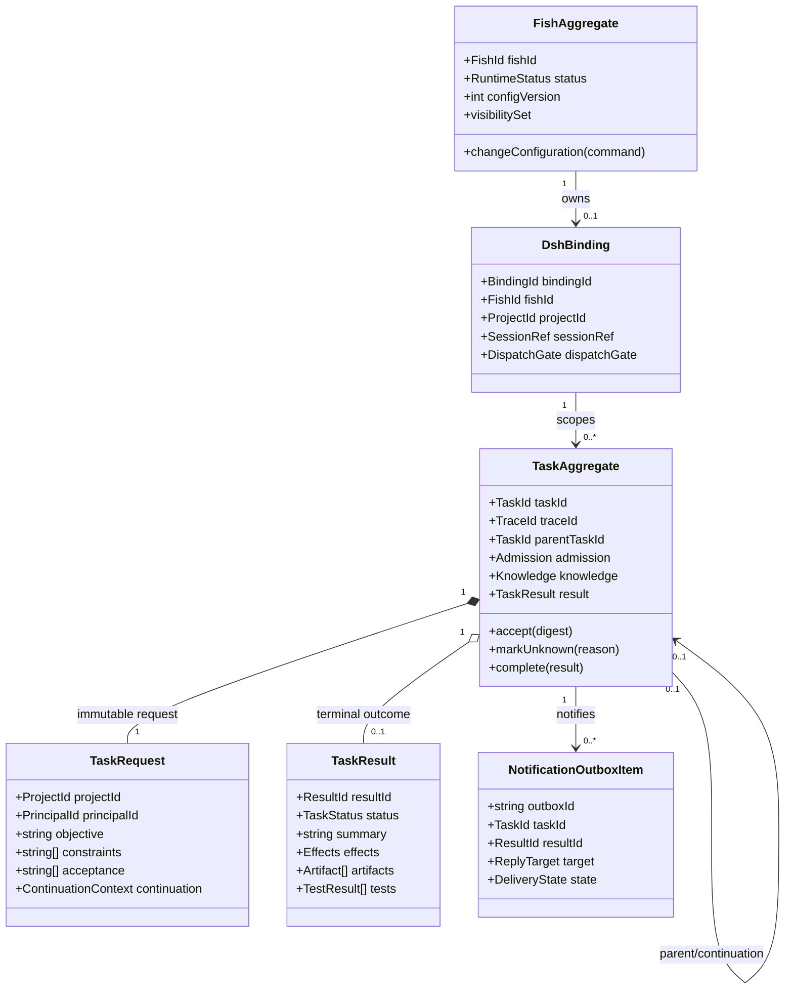
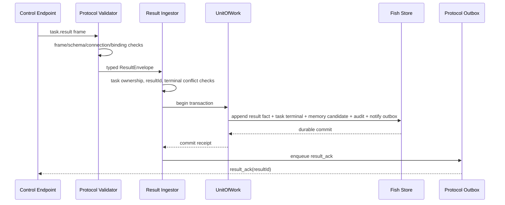
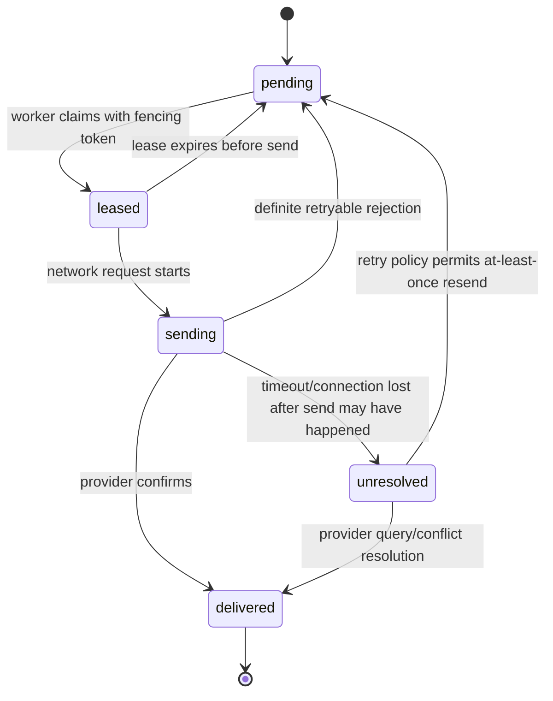

# Fishbowl 独立运行与 DSH 控制系统
# 详细设计说明书

版本：0.1-draft<br>
日期：2026-11-03<br>
状态：实现级设计草案，待评审；未实现<br>
需求基线：[详细 SRS](srs-detailed.md)<br>
架构基线：[详细总体设计](overall-design-detailed.md)<br>
协议参考：[任务协议](task-protocol-design.md)、[插件状态机](dsh-control-state-machine.md)<br>
验证依据：[DSH 任务验证](dsh-task-validation.md)

## 0. 文档目的和适用范围

总体设计说明系统有哪些模块、模块如何组合；本文进一步说明模块内部的数据结构、操作契约、处理算法、持久化顺序、错误映射和测试断言，供后续 implementation plan、接口评审和代码实现使用。

本文不是生产代码，也不把待评审 Schema 或 DSH API 假设冻结为事实。关键设计状态：

| 状态 | 含义 |
|---|---|
| Confirmed | 用户已确认，设计/实现必须遵守 |
| Proposed | 详细设计建议，需评审后冻结 |
| Unverified | 设计依赖 DSH/渠道能力，需实测后实现 |
| Deferred | 后续能力，首期不实现 |

## 1. 实现约定和现状约束

当前仓库是 Node.js ES module 项目，`package.json` 要求 Node.js >=22.18；`tsconfig.json` 使用严格类型检查、NodeNext、ES2023 和 erasable syntax。项目已有 TypeScript 的 `being`、`affect`、`memory`、`schedule`，也保留若干 JavaScript 包，包括 `bridge-qq`、`adapter-dsh`、`app` 等。

因此详细设计采用渐进整理：新增核心模块优先 TypeScript；现有 JS 按需迁移；不全量重写。Node.js 当前可直接运行部分 `.ts` 测试/脚本的能力属于现有工具链特征，不替代 build/package 和正式运行约定。未来 Rust 迁移以协议、事件 Schema、provider ports 和行为测试为兼容依据，不在首期维护双实现。

### 1.1 编码和模块规范

- 生产代码使用 ESM；跨包 import 走包出口或明确的接口模块，不跨包读取内部路径。
- TypeScript 开启 strict；公共类型只导出不可变数据合同。
- 入站 JSON 一律运行时验证，TypeScript 类型不作为信任边界。
- 错误采用稳定 `code` + 安全 `message` + 内部 cause，不把堆栈发给用户或远端。
- 时间存 UTC ISO 8601；排序用 ledger sequence/monotonic cursor，不依赖跨机墙钟。
- ID 使用 UUIDv7 或 UUIDv4（方案待定）；格式全系统固定，不能把随机 ID 的时间排序当作严格因果顺序。
- 目录/包名按职责拆分；不要仅为未来 Rust 抽取大量微服务。

## 2. 目标部署包和目录设计

### 2.1 目标源码目录

```text
packages/
  runtime/                         # Composition Root, lifecycle, worker supervision
  contracts/                       # shared domain-neutral identifiers and JSON types
  control-protocol/                # protocol schemas, validation, canonical encoding
  task/                             # Task aggregate, use cases, task projections
  scheduler/                        # per-fish queues, leases, priorities, aging
  policy/                           # authorization and disclosure rules
  model-provider/                   # main generative model ports/adapters
  decision-provider/                # typed decision port and Jev adapter
  ledger/                           # append-only event store and projections
  memory/                           # existing memory package; enrich provenance
  being/                            # existing identity and being package
  affect/                            # existing affect domain
  audit/                             # audit events, redaction, query
  channel-core/                     # normalized ingress/outbound contracts
  bridge-qq/                         # existing QQ bridge, gradually adapt
  adapter-dsh/                       # Fish side control client/capability adapter
  social/                            # fish-to-fish conversations and budgets
  admin/                             # admin commands, configuration use cases
  app/                               # current package; split only as work requires

apps/
  fishbowl-runtime/                  # executable entry point and composition root

plugins/
  dsh-control/                       # DSH-hosted JS/TS plugin; separate install artifact

schemas/
  fish-control/0.1/                  # protocol JSON schemas and vectors
  fish-events/1/                     # persisted event schemas

test-fixtures/
  protocol/                          # canonical JSON/hash cross-runtime vectors
  behavior/                          # state transition input/output scenarios
```

该目录是目标结构建议，不表示本轮立即新建全部 package。迁移一个现有模块时需保持现有 exports 和测试可用，并通过层检查。

### 2.2 依赖方向



禁止 Domain 导入 QQ SDK、DSH API、Jev SDK、文件数据库 SDK 和 Node socket 类型。运行时能力通过 application ports 注入。

## 3. 标识、值对象和序列化

### 3.1 标识类型

逻辑类型建议：

```ts
type FishId = string & { readonly __brand: 'FishId' };
type PrincipalId = string & { readonly __brand: 'PrincipalId' };
type ProviderId = string & { readonly __brand: 'ProviderId' };
type BindingId = string & { readonly __brand: 'BindingId' };
type ProjectId = string & { readonly __brand: 'ProjectId' };
type TaskId = string & { readonly __brand: 'TaskId' };
type MessageId = string & { readonly __brand: 'MessageId' };
type ResultId = string & { readonly __brand: 'ResultId' };
type TraceId = string & { readonly __brand: 'TraceId' };
```

品牌类型只用于编译期区分。反序列化必须运行时校验 UUID/长度/字符集后再构造。`taskId`、`messageId`、`resultId` 和 `traceId` 不复用。

### 3.2 时间与序列

领域事件有 `occurredAt` 和 ledger 分配的 `sequence`。远端 sentAt 仅供诊断，不能决定任务状态覆盖。每个 binding 的任务事件按 Plugin 本地 sequence 排序；Fish ledger 有独立 sequence，跨端只以 taskId/traceId 关联。

### 3.3 规范化 JSON 和摘要

协议请求按 schema version 定义固定键顺序，数组保持顺序，省略字段按 Schema 明确规则处理；不做 trim 或 Unicode normalization。拒绝孤立 UTF-16 surrogate。固定序列化后以 UTF-8 bytes 计算 SHA-256。必须保存规范化请求或等价证据，不能只信发送端摘要。

版本化 canonicalizer 应有固定向量：输入对象、规范 JSON 字节、SHA-256。Node.js 与未来 Rust 实现对每个向量产生逐字节一致结果。

## 4. 领域模型和聚合

### 4.1 Fish Aggregate

Fish Aggregate 管理单鱼领域状态：

```text
FishAggregate
  identity: FishIdentity
  runtimeStatus: enabled | paused | archived
  configurationVersion: integer
  modelBinding: ModelBinding
  memoryNamespace: FishId
  visibility: Set<FishId>
  socialBudget: SocialBudgetPolicy
  grants: GrantReference[]
```

Aggregate 不包含网络连接对象、SDK client、文件句柄或 DSH Session 实例。配置更新通过 `FishConfigurationChanged` 事件生效；情绪/人格/记忆不由普通配置 patch 覆盖。

### 4.2 DSH Binding Aggregate

```text
DshBinding
  bindingId, fishId, providerId
  projectId, sessionRef
  protocolVersion, adapterVersion
  capabilities[], authorizationPolicyRef
  connectionState, lastReadyAt
  dispatchGate: open | frozen | disabled
```

首期一 Fish 一个 DSH binding；一个 DSH session 仅允许一个 Fish。绑定重建生成新 bindingId。Secret 不存 aggregate，只保存 secret reference/version。

### 4.3 Task Aggregate

```text
TaskAggregate
  identity: { taskId, traceId, parentTaskId? }
  ownership: { fishId, principalId, bindingId, projectId }
  request: TaskRequest
  requestDigest: Sha256
  origin: { channel, conversationId, platformMessageId, replyTargetRef }
  admission: submitting | accepted | rejected | unresolved
  knowledge: pending | unknown | terminal
  businessResult?: TaskResult
  notification: pending | sending | delivered | unresolved
  timestamps: createdAt, acceptedAt?, terminalAt?
  revision: integer
```

Aggregate 不存 DSH transcript、内部思考和工具结果全文。必要时仅保存 DSH 本地审计引用，且需要明确是否允许跨边界暴露该引用。

### 4.4 TaskRequest 和 TaskResult

```ts
interface TaskRequest {
  projectId: ProjectId;
  principalId: PrincipalId;
  objective: string;
  constraints: readonly string[];
  acceptance: readonly string[];
  continuation: ContinuationContext | null;
}

type TaskStatus = 'succeeded' | 'failed' | 'cancelled' | 'needs_input';
type TestStatus = 'passed' | 'failed' | 'not_run';

interface TaskResult {
  resultId: ResultId;
  status: TaskStatus;
  summary: string;
  effects: {
    certainty: 'reported' | 'unknown';
    changes: readonly string[];
    rollbackPerformed: boolean;
  };
  artifacts: readonly { kind: string; ref: string }[];
  tests: readonly { name: string; status: TestStatus; detail: string }[];
  error: { code: string; message: string } | null;
  questions: readonly { id: string; prompt: string }[];
}
```

Runtime validation 规则：failed 必有 error；其余结果 error 必须为 null；needs_input 必须有非空 questions；其他状态 questions 为空；succeeded 不得包含 failed tests；所有状态必须包含 effects 和 summary；artifact ref 必须是授权 project 的安全相对引用。

### 4.5 UML 领域类关系



一条 Fish 首期最多一个 DshBinding；绑定可在生命周期内关联多个 Task。TaskRequest 创建后不可原地修改；修改目标必须创建新 taskId。TaskResult terminal 后不可被另一个结果覆盖。

## 5. Application Use Case 设计

### 5.1 Use Case 清单

| Use Case | 输入 | 主要步骤 | 输出 |
|---|---|---|---|
| `AcceptIngressMessage` | ChannelEnvelope | 验证、principal 映射、去重、持久入队 | QueueItemId |
| `ProcessFishTurn` | WorkItem lease | 上下文、Policy、Model/Jev、能力选择 | Reply/TaskIntent/Question |
| `CreateAndSubmitTask` | TaskIntent + origin | 权限、binding、taskId、ledger、submit outbox | Admission result |
| `HandleTaskControlMessage` | validated protocol message | correlation、状态转换、持久事件 | response/outbox event |
| `ReceiveTaskResult` | task.result | schema、归属、去重、ledger、memory/outbox | result_ack |
| `RequestTaskCancellation` | taskId + principal | 权限、cancelId、控制 outbox | cancel requested state |
| `ContinueNeedsInputTask` | parentTaskId + answer | caller/question/project 验证，new child task | child taskId |
| `DeliverNotification` | Outbox lease | 渠道调用、结果记录、重试/unknown | Delivery status |
| `StartSocialConversation` | fish pair + intent | mutual visibility、budget、queue | conversationId |
| `ApplyAdminCommand` | admin principal + command | authorize、validate、append config event | new config version |

### 5.2 Use Case 事务规则

Application service 负责事务边界和事件追加；Domain Aggregate 负责不变量；Adapter 负责外部请求/响应转换。事务服务不得在数据库事务锁持有期间等待网络、模型或 DSH 调用。

## 6. Scheduler 和队列详细算法

### 6.1 WorkItem

```ts
interface WorkItem {
  eventId: string;
  fishId: FishId;
  kind: 'user_message' | 'task_result' | 'fish_message' | 'scheduled_job' | 'admin_event';
  priority: number;
  enqueuedSequence: bigint;
  enqueuedAt: string;
  payloadRef: string;
  attempt: number;
}
```

payloadRef 指向加密/受控存储，队列索引不重复存完整私聊或任务结果正文。

### 6.2 每 Fish Worker 获取流程

1. 从该 fishId 的队列选取最高有效优先级 item。
2. 先应用运行配置、principal 和事件状态校验。
3. 通过原子 compare-and-set 获得 `workerLease(fishId, ownerInstance, leaseUntil, fencingToken)`。
4. 事务中将 item 标为 processing 并增加 fencingToken。
5. 执行 handler；所有状态写入必须带当前 fencingToken。
6. 成功则事务写事件并将 item acked；失败则记录 attempt/error 并计划退避或 dead-letter。
7. 释放 lease；若进程崩溃，lease 到期后由新 worker 接管未 ack item。

Lease fencing token 防止旧 worker 在 lease 过期后继续写入。单进程部署可先用内存调度配持久事件；多进程场景需共享存储锁。

### 6.3 优先级与防饥饿

优先级建议：用户消息 > DSH 结果/管理事件 > 鱼间消息/自主计划。为遵守“结果不得饥饿”，TaskResultEvent 等待超过 `resultMaxWait` 后提升为用户消息同级或使用独立保留配额。具体阈值为 Proposed，需通过工作负载测试确定。

### 6.4 去重和失败

- 入站消息以 channelType+platformMessageId 去重。
- 内部事件以 eventId 去重。
- queue ack 与业务事件提交在同一事务；不能先删除再处理。
- 短暂错误用指数退避；永久 Schema/权限错误转 dead-letter 并告警。
- 单条失败后 worker 处理下一 item，不保留 Fish 全局锁。

## 7. Control Protocol 编解码和连接

### 7.1 Transport Port

```ts
interface ControlTransport {
  listen(handler: (socket: AuthenticatedSocket) => Promise<void>): Promise<void>;
  close(): Promise<void>;
}

interface AuthenticatedSocket {
  connectionId: string;
  peerBindingId?: BindingId;
  send(frame: Uint8Array): Promise<void>;
  close(code: number, reason: string): Promise<void>;
  readonly incoming: AsyncIterable<Uint8Array>;
}
```

Transport 只做 TLS/WebSocket/IPC、帧大小和連線生命週期；它不讀寫任務 aggregate。Handshake handler 在認證完成後建立 ConnectionContext。

### 7.2 Inbound Pipeline

```mermaid
flowchart LR
  Bytes[Frame bytes] --> Limit[Frame limit]
  Limit --> UTF8[Strict UTF-8]
  UTF8 --> JSON[Duplicate-key-aware JSON parse]
  JSON --> Schema[Version + type schema]
  Schema --> Fence[connectionId fencing]
  Fence --> Binding[binding scope]
  Binding --> Auth[principal/capability/project auth]
  Auth --> Replay[message/task idempotency]
  Replay --> UseCase[Application use case]
  UseCase --> Commit[Durable event/store]
  Commit --> Outbox[Response outbox]
```



解析失败在业务事务前终止。accepted/result/cancel ack 等必须由 Application layer 在持久提交后创建。协议处理器不得在网络回调里直接 mutate in-memory projection。

### 7.3 Connection Context

```ts
interface ConnectionContext {
  connectionId: string;
  bindingId: BindingId;
  providerId: ProviderId;
  fishId: FishId;
  negotiatedVersion: '0.1';
  capabilities: ReadonlySet<string>;
  authorizedProjects: ReadonlySet<ProjectId>;
  connectedAt: string;
  generation: bigint;
}
```

Context 来自服务端 Binding Registry 和握手校验，不能直接信任 hello body 中自报的 fishId/project list。connection generation 递增，旧 generation 的消息和 outbox ack 失效。

### 7.4 WebSocket 会话处理

每连接一个 reader loop 和 writer queue。reader 验证 frame 后按 taskId 分发到并发受限 application queue；对同 binding 的 task 事件通过 partition key 串行化。writer 从 durable outbox 发包。ping/pong 与任务队列分开，防止大帧阻塞心跳；必须限制发送 buffer 防止慢客户端导致内存增长。

## 8. Fish Task Manager 详细处理

### 8.1 创建任务算法

1. 接收经过 Policy 和 Agent 校验的 TaskIntent。
2. 规范化 objective/constraints/acceptance；检查非空和长度。
3. 解析当前 Fish、principal、binding 和 project；检查授权快照版本。
4. 生成 taskId、traceId 和 requestDigest。
5. 在 Fish ledger 事务中追加 TaskCreated、AuthorizationDecision、ReplyTargetBound、TaskSubmitQueued。
6. 返回给 Agent “任务已提交请求排队”；不声称 Plugin 已 accepted。
7. Submit outbox dispatcher 发送 task.submit。
8. 收到 accepted/rejected/result 后通过统一状态机事务更新任务。

taskId 一经持久化不可更换。网络 retry 使用同一 canonical request 和 taskId。

### 8.2 Submit Outbox

字段：`outboxId, bindingId, taskId, messageId, payloadDigest, state, attempt, nextAttemptAt, leaseToken`。发送前获取 lease；只有明确未发送可立即重试，发送结果不明时优先 query。若 query 暂不可用，按同 taskId 同内容重发是允许的，因为 Plugin admission 必须幂等。

### 8.3 Admission 转换表

| 当前状态 | 输入 | 新状态 | 处理 |
|---|---|---|---|
| submitting | accepted，digest 匹配 | accepted/pending | 保存接收事实，向原用户发送已提交提示 |
| submitting | rejected | rejected | 保存稳定错误码；只有无执行接收证据 |
| submitting | result 先到且任务归属正确 | accepted/terminal | 保存结果，推导已接收；允许网络乱序 |
| submitting | transport timeout | unresolved/pending | query 或同 ID retry，不生成新 taskId |
| accepted/pending | 重复 accepted | 不变 | 幂等 ack |
| terminal | accepted/query pending 迟到 | 不变 | terminal 不降级 |
| terminal | 同 resultId 重复 | 不变 | 重新 ack，不重复 memory/outbox |
| terminal | 新 resultId 不同内容 | 不变 + alert | 拒绝覆盖，进入审计核对 |

### 8.4 Result Ingestor 算法

```text
validate(connection, binding, task ownership)
validate(result schema and path refs)
if resultId already committed:
    verify same payload digest
    enqueue result_ack
else if task already has terminal result:
    reject conflicting terminal, audit protocol violation
else:
    append TaskResultReceived and derived outbox intent atomically
    append MemoryCandidate with DSH provenance (if policy allows)
    append Audit event
    commit
    enqueue result_ack
```

MemoryCandidate 是否立即变长期记忆由 Memory policy 决定，但执行结果事实必须作为 task history 保存。回传文本按 untrusted external data 处理，不执行里面的指令。



若任意 durable 写入失败，不发送 result_ack。连接在 commit 后断开时，Plugin 会重投相同 resultId；Fish 的 unique index 命中后只重发 ack，不重复创建通知或记忆事件。

## 9. Plugin Task Store 和 Dispatcher

### 9.1 本地表/记录结构建议

若采用关系型存储：

```text
bindings(
  binding_id PK, fish_id, provider_id, project_id, session_ref,
  protocol_version, config_version, state, created_at, updated_at
)

tasks(
  binding_id, task_id, request_digest, canonical_request,
  admission, execution_state, business_status,
  message_id NULL, turn_id NULL, result_id NULL,
  created_at, updated_at, revision,
  PRIMARY KEY(binding_id, task_id), UNIQUE(binding_id, message_id)
)

task_outbox(
  outbox_id PK, binding_id, task_id, message_id, result_id NULL,
  payload, state, attempt, next_attempt_at, acked_at NULL
)

task_events(
  sequence PK, binding_id, task_id, event_type, payload, recorded_at
)
```

具体存储技术待选；要求唯一约束、原子提交、崩溃安全和备份。若采用 append-only 文件，必须有 record length/checksum、fsync 策略、尾部损坏截断/隔离和重建索引测试。

### 9.2 Accept Task 事务

1. 验证已认证 connection context 和 binding scope。
2. 验证 principal/project/能力授权及 continuation 父任务。
3. canonicalize request 并计算 digest。
4. 查询 `(bindingId, taskId)` 唯一键。
5. 同键同 digest：回原 accepted，若 terminal 则确保 result outbox pending。
6. 同键异 digest：返回 ID_CONFLICT，保持原记录不变。
7. 检查帧、文本、队列和 session 容量。
8. 在一个事务内写 TaskRecord queued、canonical request、TaskAccepted event。
9. 事务提交后才发送 task.accepted。
10. Dispatcher 只能读取已 durable queued 状态。

### 9.3 取得执行槽和派发

建议独占锁键为 `bindingId/sessionRef`。锁记录带 owner instance、lease expiry 和 fencing token。获取锁后再读 DSH active session 状态；如人工回合正在运行，释放/续 lease 并保留 queued。

派发步骤：

1. 生成唯一 DSH `messageId`，并持久 DispatchIntent。
2. 注册 `agent/inbox/claimed`、`session/event` listener；订阅范围限制到目标 Agent/session。
3. 先建立内存 correlation map，并确保可恢复信息已持久化。
4. 调用 `agent.followup({ id: messageId, role: 'user', content: ... })`。
5. 若同步 claimed 回调发生，写入事件队列；不要等待 followup 返回值。
6. claimed 的 message.id 与预期一致才建立 TurnLink；不一致则 quarantine/unknown。
7. 监听对应 turnId 的 terminal reason 和最终 assistant message；将内部事件送本地 settle queue。
8. settle handler 校验 turn end、输出结构、活动 session 归属和 cancellation state。
9. 一个原子事务写 terminal TaskRecord、ResultRecord、PluginOutbox。
10. 事务提交后释放 session lease，并由 outbox sender 发最终结果。

任何一步的 DSH 证据不充分，都不得猜测下一条 assistant 消息属于该任务。

### 9.4 Listener 和同步回调死锁规则

DSH 事件可能在 `followup` 调用栈内同步触发。Listener 只做轻量捕获：验证 event shape、复制不可变字段、写入内部 event queue 后立即返回。不能在事件回调中同步等待获得同一把 TaskStore/Dispatcher 锁，否则 followup 等 listener、listener 等锁会死锁。持久事件的异步 writer 由单独 serial executor 处理。

## 10. DSH Result Extractor

### 10.1 输入

`ResultExtractor` 输入是由 Correlator 证明属于 task 的：`taskId/messageId/sessionRef/turnId/turnEndReason/finalMessage`。它不接收未关联的全局“最新消息”。

### 10.2 解析步骤

1. 确认 DSH terminal event 对应映射 turnId。
2. 确认 assistant final message 是 terminal 回合的最后非工具调用输出。
3. 拒绝 Markdown fence、额外前后文字、多个 JSON 对象和重复键。
4. 解析 JSON 并运行结果 Schema 校验。
5. 交叉校验 status 与 turn end reason、error/questions/tests 约束。
6. 校验 artifact 相对路径并去除工作区根路径泄漏。
7. 对 message/error 内容做敏感信息脱敏和长度上限。
8. Plugin 生成 resultId，计算结果 digest，保存终态。

### 10.3 状态交叉检查

- Model JSON status=cancelled 但没有本任务 cancel request/stop proof：不得 cancelled。
- DSH turn aborted 但模型 JSON succeeded：不能 succeeded；按 abort evidence failed 或 unknown。
- status succeeded 且 tests 有 failed：RESULT_INVALID。
- status needs_input 且 questions 为空：RESULT_INVALID。
- status failed 且 error 为空：RESULT_INVALID。
- output 缺失但 turn completed：不能从文本日志生成成功，按设计中的 invalid/unknown 处理。

结构化 assistant JSON 是 Proposed/Unverified。若后续 DSH 提供更可靠的结构化 final-result API，只替换 Extractor，不改变外部协议。

## 11. 取消控制器

### 11.1 取消输入和状态

`CancelCommand { taskId, cancelId, requestedBy, reason, traceId }`。`cancelId` 在 Fish 提交前持久化；同 cancelId 重复请求幂等。Plugin 维护 `cancelState=none|requested|confirmed|unresolved`，不把 command received 当作取消成功。

### 11.2 算法

1. 读取 task aggregate 和 active DSH mapping。
2. 若 terminal，返回 `already_terminal` 和现有 resultId。
3. 若 queued 且 dispatch intent 不存在，在串行事务中移出队列、写 cancelled result。
4. 若 dispatch intent 存在，先核对 inbox messageId；只有能精确 remove 且证明未运行时才 cancelled。
5. 若 running，验证当前 active agent/session/turn 精确属于 task。
6. 若 API 无原子 fencing/synchronization，返回 unresolved，不调用宽泛 cancel。
7. 若具备精确能力，持久 cancel_requested 后调用 cancel(... keepInbox:true)。
8. 继续观察目标 turn terminal；仅有结束证据后生成 cancelled。
9. 完成事件先于取消确认时，原终态获胜。

### 11.3 能力协商

`task.cancel.queued` 和 `task.cancel.running` 应是两个 capability。未验证 running cancel 时，Plugin 不上报该 capability，Fish UI/Agent 不应声称支持运行取消。

## 12. Needs-input Continuation

### 12.1 Fish child-task 构造

输入包括父任务、原结果 questions、原始请求、用户 answer 和已授权项目。Fish 对答复者重新鉴权；管理员批准的代答身份可通过显式 grant。创建 `ContinuationContext`：

```text
parentTaskId
originalObjective
questions[{id,prompt}]
answers[{questionId,answer}]
completedEffects
remainingObjective
```

`completedEffects` 只能来自已持久 DSH result，Fish 不允许模型自行改写已完成影响。新任务使用新 taskId 和新 requestDigest。parentTaskId + canonical answer digest 建唯一索引以抑制重复续接。

### 12.2 Plugin 验证

Plugin 要验证 parentTaskId 存在、同 binding/project/principal、状态为 needs_input，question IDs 与原结果相符，completedEffects 摘要与原结果一致，answer 非空且 Schema 合法。任一条件不可核实则拒绝 CONTINUATION_UNVERIFIABLE；不把原任务重新入队。

## 13. Persistence Ports 和事务语义

### 13.1 Fish 端接口

```ts
interface TransactionRunner {
  run<T>(fn: (tx: UnitOfWork) => Promise<T>): Promise<T>;
}

interface UnitOfWork {
  events: EventRepository;
  tasks: TaskRepository;
  queue: QueueRepository;
  outbox: OutboxRepository;
  memory: MemoryRepository;
  audit: AuditRepository;
}
```

Application service 使用 UnitOfWork 让任务事件与派生 outbox 在同一事务。Provider 网络调用绝不放在事务 callback 内。

### 13.2 事务边界表

| 事务 | 原子写入 | 事务后执行 |
|---|---|---|
| 入站消息接受 | ingress dedup + ledger event + queue item | 通知 worker |
| 创建 DSH task | TaskCreated + auth decision + origin + submit outbox | 网络发 submit |
| accepted 处理 | admission event + task projection + user ack outbox | 发提交确认回复 |
| 结果接收 | result fact + terminal task + memory candidate + notify outbox + audit | 发 result_ack |
| Plugin accepted | TaskRecord queued + canonical request + dedup index | 发 accepted、通知 dispatcher |
| Plugin dispatch intent | dispatch event + messageId + state revision | 注册监听并 followup |
| Plugin terminal | terminal TaskRecord + result + plugin outbox + audit | 释放锁并发送 result |
| QQ delivery outcome | outbox status + audit | 下一条发送 |

### 13.2.1 Outbox 状态机



`unresolved` 处理取决于外部 provider 是否支持幂等键或查询。无此能力时，可能重复投递是明确的 at-least-once 限制；不能把不确定发送状态直接当失败。

### 13.3 文件存储要求（如选文件型）

文件方案必须避免同一文件并发覆盖，使用单 writer/锁；原子替换采用临时文件+flush+rename；追加 ledger 有 checksum/record length；启动时检查最后完整记录；索引可重建。对于多进程或高写入量，优先评估 SQLite 等具备事务和唯一约束的嵌入式数据库。最终技术选择需基准和备份验证。

## 14. 错误类型和协议映射

### 14.1 内部错误结构

```ts
interface AppError {
  code: StableErrorCode;
  category: 'transport' | 'protocol' | 'authorization' | 'admission' | 'execution' | 'uncertainty' | 'delivery' | 'storage';
  retryable: boolean;
  safeMessage: string;
  correlationId: string;
  cause?: unknown;
}
```

cause 只保留在受限内部诊断；网络响应和用户回复只发 code、安全文案和可公开的摘要。

### 14.2 层级和处理

| 类别 | 示例 | 重试语义 | 任务语义 |
|---|---|---|---|
| Transport | socket closed、TLS failure | 连接指数退避；submit 需 query/同 ID 重发 | task 可能 unresolved |
| Protocol | unsupported version、invalid JSON | 通常不重试原帧 | 不隐式改变已有 task |
| Authorization | project denied、unauthorized | 权限改动后由用户重新提交 | rejected before accepted |
| Admission | queue full、session busy | 有上限的同 ID retry 或排队 | 未执行确认需明确 |
| Execution | tool error、blocked、max tokens | 不自动重新执行 | failed terminal 或 unknown |
| Uncertainty | lost turn evidence、dispatch crash | 只 query/reconcile | unknown，冻结 binding |
| Delivery | result/QQ send timeout | durable outbox retry | task terminal 不变 |
| Storage | ledger unavailable、corrupt tail | 恢复/人工介入 | 不 ack 不接受新高风险工作 |

### 14.3 拒绝码补充

传输/协议：`UNSUPPORTED_VERSION, INVALID_MESSAGE, FRAME_TOO_LARGE, STALE_CONNECTION`。授权：`UNAUTHORIZED, PROJECT_DENIED, CAPABILITY_DENIED, BINDING_UNAVAILABLE`。接收：`ID_CONFLICT, QUEUE_FULL, SESSION_BUSY, PAYLOAD_TOO_LARGE, STORAGE_UNAVAILABLE`。续接/结果：`CONTINUATION_UNVERIFIABLE, RESULT_INVALID, RESULT_TOO_LARGE`。执行：`EXECUTION_ERROR, EXECUTION_BLOCKED, EXECUTION_LIMIT, EXECUTION_ABORTED`。

## 15. Audit 和安全过滤实现

### 15.1 Audit Event

```ts
interface AuditEvent {
  eventId: string;
  schemaVersion: number;
  traceId: TraceId;
  parentId?: string;
  taskId?: TaskId;
  fishId?: FishId;
  actor: { kind: string; id: string };
  component: string;
  action: string;
  target?: { kind: string; id: string };
  inputDigest?: string;
  outcome: 'accepted' | 'rejected' | 'succeeded' | 'failed' | 'unknown';
  errorCode?: string;
  durationMs?: number;
  retryCount?: number;
  occurredAt: string;
}
```

### 15.2 Redaction Pipeline

先按字段 allowlist 构造 audit DTO，再执行 secret pattern scrub、渠道身份脱敏、路径脱敏、长文本截断/摘要，最后持久化。禁止把通用 request body 整体序列化到 audit。审计与日志至少分开 retention、权限和查询 API。

### 15.3 Result Trust Boundary

DSH result 是外部执行端提供的数据。Fish 将其作为报告事实而不是用户指令执行；字段 Schema、项目 artifact ref、消息长度和敏感信息均验证。模型总结结果时要保留来源标注，不能删除“DSH 报告”“测试未运行”等限定。

## 16. Provider 详细接口

### 16.1 Main Model Provider

```ts
interface ModelProvider {
  readonly providerId: string;
  generate(input: ModelRequest, signal: AbortSignal): Promise<ModelResponse>;
  health(): Promise<ProviderHealth>;
}
```

请求字段包括 model、messages/context、allowed tools、response format、max tokens 和 trace reference。Response 包含 text/tool intents、finish reason、usage、provider version。Agent 必须验证每个 tool intent，provider 不执行本地工具。

### 16.2 DecisionProvider / Jev

```ts
interface DecisionProvider {
  decide(input: {
    schemaId: string;
    state: JsonValue;
    questions: readonly DecisionQuestion[];
    traceId: TraceId;
  }, signal: AbortSignal): Promise<DecisionResponse>;
}
```

Jev 适配器负责 API key、endpoint、timeout、retry budget、typed response decode 和 model/version/usage。API key 来自 SecretProvider。低 confidence/错误由调用方按 schema 配置为升级主模型、澄清用户或默认保守分支。不可把 confidence 数值当概率保证。

### 16.3 Jev Decision Schema 版本

每个决策流程有稳定 question names、类型、选项和 schemaId，如 `intent-routing.v1`、`risk-triage.v1`。修改选项或语义必须 bump version 和更新样例集；保留评估记录，不在 API response 到来后动态改变可选项。

## 17. Configuration Schema

### 17.1 Fish Runtime 配置

```text
runtime:
  stateDirectory
  listenAddress
  maxFishWorkers
  gracefulShutdownTimeout
storage:
  backend
  backupDirectory
  ledgerSyncPolicy
channels:
  qq: enabled, adapterSettingsRef, rateLimits
models:
  primary: providerId, modelId, secretRef, timeout, limits
  jev: enabled, providerId, modelId, secretRef, decisionThresholds
dshBindings[]:
  fishId, bindingId, providerId, projectId, sessionRef,
  endpointPolicy, secretRef, capabilityAllowlist
scheduler:
  perFishConcurrency=1, queueLimits, priorityPolicy, agingThresholds
social:
  timezone, dailyConversationLimit, messageLimit, tokenLimit, maxTurns
retention:
  memoryPolicy, auditPolicy, taskTombstonePolicy, resultArchivePolicy
```

所有建议值可被管理员显式设置，但安全约束不可被普通配置关闭。Secret 值不出现在配置导出、审计或 UI 页面。

### 17.2 DSH Plugin 配置

```text
connection:
  fishEndpoint
  authSecretRef
  tlsPolicy
  reconnectBackoff
binding:
  bindingId, fishId, projectId, workspaceRootRef, sessionRef
limits:
  maxFrameBytes, queueCapacity, objectiveBytes, maxQuestions, maxArtifacts
execution:
  dedicatedSessionRequired
  maxTurnDuration
  approvalTimeout
  allowRunningCancel
storage:
  backend, directory, retention, fsyncPolicy
capabilities:
  task.submit, task.query, task.cancel.queued, task.cancel.running
```

未实测可靠运行取消前 `allowRunningCancel` 默认为 false；未配置可强制执行的执行/审批时限，binding readiness 显示 degraded。

## 18. QQ Adapter 详细设计

当前 `bridge-qq` 使用 OneBot v11 client/pipeline。迁移到 Runtime 时保留其平台协议职责，加入 Outbound Port 和身份映射；平台 event handler 只调用 `IngressPort.accept`，不得直接改 being/memory store。

### 18.1 入站处理

1. 验证 OneBot event 类型和平台签名/连接信任。
2. 规范化 user/group/private 身份。
3. 根据 channel account + platform user 映射 principalId。
4. 根据 conversation/Fish routing policy 解析 fishId。
5. 生成 replyTarget（private/group/reply message thread），记录引用而不是交给 DSH。
6. 以 platformMessageId 幂等接受，进 per-fish queue。

### 18.2 出站处理

1. 取 Fish Outbox item 并校验 fish/principal/replyTarget 仍有效。
2. 调用 OneBot send API。
3. 保存 platform message ID 和 delivered 状态。
4. 对 timeout/unknown 状态检查平台可用查询能力；不支持时标记可能重复。
5. 不改变 TaskAggregate 的 terminal status。

## 19. 生命周期、健康检查和操作手册要求

### 19.1 Health Check 聚合

Readiness 和 liveness 分离：

- liveness：进程 event loop、核心服务未崩溃。
- readiness：ledger 可写、worker 可运行、配置有效。
- DSH capability health：各 binding 独立展示，不使 Fish Runtime unready。
- degraded：Jev/DSH/QQ 某项不可用但其他能力工作。

### 19.2 管理诊断命令

最小 CLI/管理 API 可提供：

```text
fish status
fish binding list
fish binding inspect <bindingId>
fish task inspect <taskId>
fish task reconcile <taskId>     # 只读取/核对，不自动重放
fish outbox list/retry <outboxId>
fish audit query --trace <traceId>
fish backup create/verify
```

`reconcile` 的人工决定需要专门授权、输入证据和审计；不能有不带确认的 `force-replay`。

## 20. 备份、恢复和升级

### 20.1 备份

备份至少包含 Fish ledger、memory、配置非秘密部分、task/outbox、审计和版本元数据。Secrets 用单独密钥系统备份。备份一致性快照不得只复制正在写入的文件；恢复演练要验证 schema migration、queue rebuild、task query 和 result dedup。

### 20.2 升级

1. 停止新危险操作，drain 已接收入站。
2. 保存版本、schema 和 backup manifest。
3. 运行可重复/事务化的迁移。
4. 验证 ledger tail、projection、task uniqueness 和 binding。
5. Plugin 与 Fish 分别协商 protocol version。
6. 不兼容时保留只查询/补投能力，不静默丢弃旧 outbox。
7. 升级失败进入只读/恢复模式，不自动删除数据库回滚用户历史。

## 21. 模块交互及接口分配

| 调用方 | 被调用方 | 接口 | 调用方式 | 写权限 |
|---|---|---|---|---|
| QQ Adapter | Ingress Application | `accept(envelope)` | async command | 不写领域存储 |
| Queue Worker | Message Use Case | `process(workItem)` | per fish serial | 通过 UoW 追加事件 |
| Agent | ModelProvider | `generate(request, signal)` | network async | 无 |
| Agent | DecisionProvider | `decide(state, schema)` | optional network async | 无 |
| Agent | Policy | `authorize(intent)` | sync/pure where possible | 无 |
| Task Manager | Task Repository/Ledger | create/transition | transaction | Fish Runtime only |
| Task Outbox | Protocol Client | submit/query/cancel | durable async | 只更新 outbox |
| Protocol Endpoint | Result Ingestor | `receive(result)` | queued command | worker transaction |
| Result Ingestor | Memory/Audit/Outbox | append candidate/events | same UoW | Fish Runtime only |
| Plugin Dispatcher | DSH Adapter | `dispatch(task)` | serial per session | Plugin store |
| DSH Adapter | DSH Agent | followup/cancel/events | host API | DSH owns execution |
| Plugin Outbox | Fish Endpoint | accepted/result | durable async | Plugin store only |

## 22. 详细测试规格

### 22.1 契约测试

每个 protocol message fixture 包含：valid example、minimum valid、maximum boundary、unknown field、wrong version、bad ID、duplicate JSON key、oversize payload。Fish 和 Plugin 对同一 fixture 必须给出相同 validation result/code。

### 22.2 状态机属性测试

至少断言：

- terminal 不会回到 pending。
- 同一 taskId 只关联一个 canonical request digest。
- taskId/messageId/resultId namespace 不混用。
- 一个 DSH session 最多一个 active remote task。
- 未证明 dispatch 时不重复 followup。
- result ack 前必须存在 durable result event。
- 取消结果必须有目标 task 停止证据。
- needs_input child 必须引用合法 parent 且不覆盖 parent。
- result delivery 状态不改变业务 terminal。

### 22.3 Chaos/崩溃用例

状态转换每个 commit 边界前后 kill process；重启后比对 task event、inbox、turn、result、outbox，断言只能得到可证明状态或 unknown。测试不能把人工确认 mock 成自动事实。

### 22.4 DSH 适配验收

分层报告：

1. CLI rc.2 scripted probe：已有证据范围。
2. Desktop rc.5 API compatibility：启动、plugin activation、session event。
3. Controlled LLM integration：结构化结果和审批。
4. Persistence/recovery：重复、断线和进程崩溃。
5. Human concurrency/cancel：专用 session、人工插入、精确取消。
6. QQ E2E：原身份、授权、任务结果、outbox 和记忆。

各层通过不能自动宣称下层/上层通过。

## 23. 设计决策和未决项

| 主题 | 当前详细设计 | 状态/下一步 |
|---|---|---|
| Fish 主体语言 | TypeScript/Node.js | Confirmed |
| DSH 适配器语言 | 宿主兼容 JS/TS | Confirmed direction |
| 主协议传输 | Plugin 主动 WebSocket/WSS；本机 IPC 可选 | Proposed |
| 协议版本 | 严格版本化 JSON v0.1 草案 | Proposed |
| Fish 持久化后端 | transactional store，优先评估 SQLite | Proposed, benchmark |
| Plugin 持久化后端 | DSH 可用本地事务 store | Unverified |
| 运行中 DSH cancel | capability gated，默认不声明 | Unverified |
| 结构化最终结果 | 关联 turn final assistant JSON | Unverified |
| 会话排他 | 专用 session + native occupancy evidence | Unverified |
| 人工插入检测 | DSH API/事件 | Unverified |
| Jev | optional provider，失败可降级 | Deferred pending evaluation |
| Rust | 后续逐模块迁移 | Deferred, no date |

## 24. 实现前退出条件

详细设计进入实施前至少完成：

1. 用户评审并确认详细 SRS 和总体设计中的需求边界。
2. 协议字段、accepted/result/unknown/cancel 和 needs_input 流程冻结。
3. rc.5 DSH Plugin 激活及专用 session 验证。
4. 确认 DSH 对人工输入、claimed、turn end 和恢复 evidence 的可观察能力。
5. 确认运行中取消是否支持；不支持时明确降级范围。
6. 真实模型结构化最终结果实验，确定非法输出处理。
7. 选定 Fish 与 Plugin 的持久化方案并验证 crash consistency。
8. 确认管理员身份、密钥管理、QQ 身份映射和项目授权模型。
9. 用本文件生成分阶段实施计划和测试计划。

## 25. 文档变更规则

本详细设计不能覆盖用户已确认的业务规则。任何影响协议、领域状态、权限、会话所有权、记忆披露或错误语义的修改，必须同步修改 `srs-detailed.md`、`overall-design-detailed.md`、本文件、`task-protocol-design.md`、`dsh-control-state-machine.md` 和 `conversation-log.md`。未验证能力必须保持显式标注，不能通过删除风险文字伪造验收完成。
