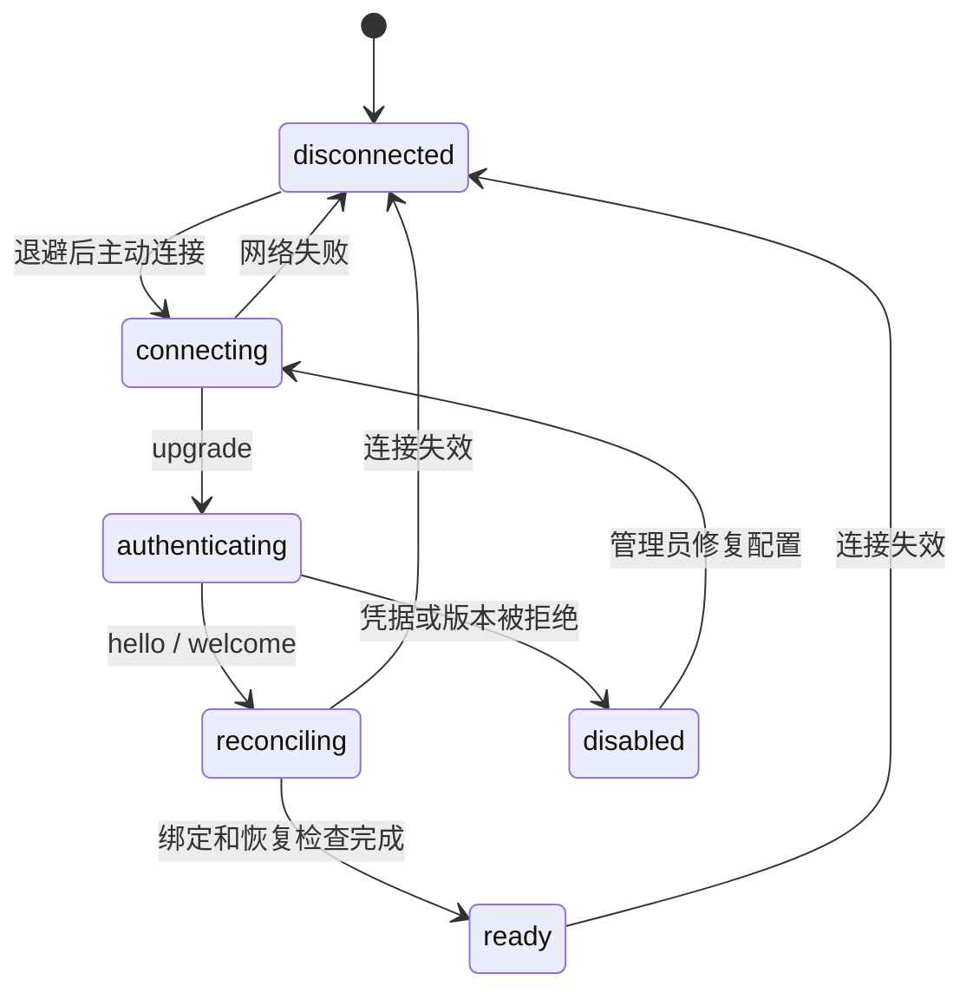
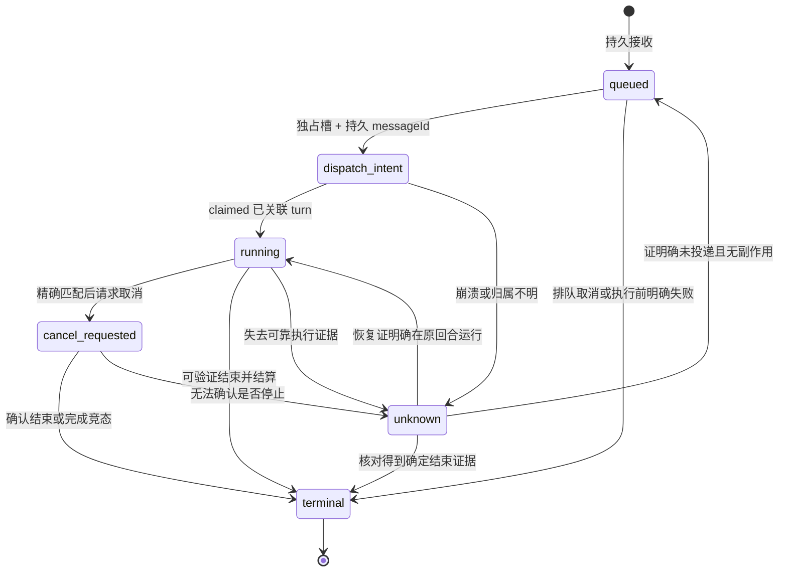

# DSH Control Plugin 状态机与持久化设计

日期：2026-11-03。状态：**设计草案，待评审，未实现**。协议字段见 [task-protocol-design.md](task-protocol-design.md)，已核实 API 见 [dsh-task-validation.md](dsh-task-validation.md)。下述插件状态是 DSH 执行端本地状态，不向 Fish 逐步推送。

## 1. 插件组件

| 组件 | 负责 | 不承担 |
|---|---|---|
| Connection | 主动连接、认证、握手、连接隔离、重连 | 推断执行是否成功 |
| TaskStore | 接收、幂等、派发意图、映射、最终结果、结果 outbox | 写 Fish 状态 |
| Dispatcher | 每绑定串行、会话占用检查、精确取消、恢复核对 | 决策任务内部工具步骤 |
| DshAdapter | message→turn 关联、结束原因、结果校验 | 将 DSH 中间事件发给 Fish |

所有本地任务转换通过同一串行写入入口；存储锁保证同一 provider/binding 不被多个插件进程同时执行。任务终态与结果 outbox 必须是一个可恢复提交单元。采用追加记录时须可验证最后一条记录完整性、恢复投影并处理尾部中断，不能把半条写入当作 accepted。

## 2. 连接状态

ready 只开放任务边界协议；本地存在 unknown 时仍可查询、取消核对、结果补投，但该绑定不得派发新任务。断线不改变任务状态，已接受任务继续在 DSH 执行。重连先核对记录并补投结果，不重新构造旧 taskId 的模型消息。

## 3. 插件任务状态

terminal 持有一个不可变结果，业务状态为 succeeded/failed/cancelled/needs_input。outbox 是否被确认是另一维状态 `pending/acked`，不把发送失败变为任务失败。

unknown 不是终态，也不等于重试。只有证明 message 未入 inbox、未被 claimed、无关联会话执行且没有副作用，才能恢复 queued；当前 API 能否提供足够完整证据尚未通过集成验证。无法证明时停留 unknown、冻结该绑定调度，并在本机提供人工核对入口；不得依据“查不到一条记录”就判断未执行。

## 4. 正常执行顺序

1. Fish 串行保存任务、授权和原回复目标，再发送 submit。
2. 插件验证版本、绑定、principal、project、容量、去重；持久记录 queued 和请求摘要后返回 accepted。
3. Dispatcher 获得本机会话锁，确认没有其他任务或人工回合；生成唯一 messageId，持久 dispatch_intent。
4. 在调用 followup **之前**订阅 claimed 和 session/event。listener 不等待 followup 返回的 ID，使用预先持久化的 messageId 过滤，同步 claimed 也必须记录。
5. 调用 `agent.followup(identifiedUserMessage)`；claimed 以精确 messageId 建立 task→session/turn 映射。followup 返回 void，不作为执行确认。
6. 只消费该映射的事件。assistant 中间消息不能结算；whenIdle 不能结算单个任务。turn/end 之后按照协议的结束原因与结构化结果矩阵生成终态。
7. 先持久 terminal + resultId + outbox，再释放执行槽并发送 result。Fish 持久入站事件后 ack；插件持久 ack 后停止自动补投。

DSH 事件回调不能并发修改本地账本。同步事件先进入同一串行事件入口；dispatcher 不得在仍持有该入口时阻塞等待回调完成，以免死锁。不可恢复的写盘失败必须关闭新接收/派发，并保留现有执行的核对状态，不能确认一个未保存的结果。

## 5. 会话归属和人工输入

首期建议绑定专用的 DSH 执行会话，并在 DSH 本机 UI 明示其受远程委托占用。会话专用是调度约束，不改变 DSH 对执行过程的控制。

- 派发前会话有人工工作：保留 queued，不插入、不调用 cancel；容量满后拒绝新任务。
- 任务执行期间有人工输入：只有能证明不会混入受托 turn 才继续。无法确认归属则 unknown、停止后续远程派发，保留本地证据。
- 不以“下一个 turn”或“最新 assistant”猜测归属；映射必须由 claimed 的 messageId 建立。
- 未匹配 turn、恢复后的分叉或人工产生的最终文本，不作为远程任务结果。
- 无可靠独占/插入检测能力时，绑定不可宣称支持生产执行；仅约定“用户别输入”不满足并发安全验收。

已验证 claimed 可关联消息和 turn；**尚未验证**桌面插件能否可靠实施会话独占、检测所有人工输入或在恢复后完整枚举执行证据。需要针对 rc.5 实验；如无公开可用机制，明确列为上游接口需求，不用界面抓取或猜测事件顺序替代。

## 6. 取消竞态

| 当前事实 | 动作与结果 |
|---|---|
| 仍在插件 queued，尚未写 dispatch_intent | 在同一串行转换中移除队列、生成 cancelled |
| 已写 dispatch_intent，确定仅在 DSH inbox | 若 API 可原子定位并移除该 message，确认移除后 cancelled；否则 unknown，不能取消整个 Agent |
| 正在运行且 active turn 精确匹配 | 保存 cancel_requested，调用 cancel 并保留其他 inbox，等待结束证据 |
| active turn 已变成人工工作或其他任务 | 不调用 cancel；返回 unresolved 并核对 |
| completed 已先持久结算 | 原结果获胜，cancel_ack=already_terminal |
| cancel 调用返回但没有结束证据 | 仍未取消；不能释放执行槽或回 cancelled |

已核对 cancel 的 keepInbox 语义，但真实工具中途取消、inbox 移除与 claimed 竞态仍需测试。所有“检查当前 turn → 取消”的步骤必须与 DSH 调度变化有可验证的同步保证；单次先查后调用存在竞态，不能据此宣称安全。若当前 API 无同步保证，只允许安全取消尚未派发的任务；运行取消能力不应在 ready 中宣告可用，完整首期验收仍视为未通过。

## 7. 崩溃窗口与恢复

| 崩溃位置 | 重启处理 |
|---|---|
| queued 保存前 | 不应回 accepted；query 无记录只在账本连续性可靠时返回 not_found |
| queued 保存后、accepted 发出前 | 同 ID 请求返回原 accepted，不重复入队 |
| dispatch_intent 保存前 | queued 可正常调度 |
| dispatch_intent 后、claimed 映射保存前 | 可能已投递；用持久 messageId 核对 inbox/session，无法确定即 unknown |
| running 映射保存后 | 核对原 session/turn 的运行或结束证据，禁止新 followup 替代 |
| 结束事件发生、terminal 保存前 | 从同回合持久会话记录重建；证据不全即 unknown |
| terminal 保存后、Fish ack 前 | 补投相同 resultId 和内容 |
| Fish 已保存结果、ack 丢失 | Fish 去重并重新 ack，不重复生成业务事件 |
| Fish 已 ack、原渠道尚未送达 | Fish 自己的通知 outbox 恢复；DSH 无需知道 QQ 目标 |

不能以文件回滚时间、进程存活、心跳正常或 Agent idle 替代任务完成证据。恢复原任务不会开启新模型回合；管理员核对属于 DSH 本机操作，Fish 只收到 unknown 或最终结果。若要在不明副作用后重新执行，必须作为用户明确授权的新任务，并引用旧任务及风险，不能伪装幂等重试。

## 8. Fish 侧生命周期

Fish 保存两个独立维度：接收状态 `submitting/accepted/rejected/unresolved` 与结果知识 `pending/unknown/terminal`。结果可能先于 accepted 到达；验证任务关联并持久结果后，推导 accepted，不要求网络跨重连保持消息顺序。终态不能被迟到 accepted、snapshot 或 cancel_ack 降回等待。

等待 DSH 期间不占 Fish 消息回合；结果入 Fish 统一事件队列。建议用户事件和结果事件共享正常优先级按入队顺序处理，鱼间事件使用低优先级，防止连续用户消息永久压住结果。具体全局队列限额和 Fish 模型预算属于后续 Runtime 设计，不由 DSH 插件决定。

通知状态 `pending/sending/delivered/unresolved` 单独保存。结果 ack 与通知 delivered 分开；缺少渠道幂等能力时，发送窗口不确定要核对/标记可能重复，不能误称无重复保证。记忆仅保存委托和执行端报告，不保存内部执行过程。

## 9. 验证安排与可交付范围

先实现与 DSH 无关的协议校验、内存/文件 TaskStore 和状态转换测试，再用隔离 rc.5 插件实验验证真实接入。两者可分阶段交付，但协议核心通过不代表 DSH 接入可用。

最低故障注入：每个持久点前后崩溃；同步 claimed；结束事件重复；accepted/result 乱序；旧连接消息；队列满；相同 taskId 不同 payload；取消与 turn 切换竞态；人工插入；非法或超大结果；needs_input 后相同答复重投；存储被清空；通知已送达但确认丢失。

证据范围必须分开报告：现有 rc.2 脚本模型探针已通过；rc.5 桌面激活、真实模型与审批、会话排他、持久恢复及 QQ 组合用例尚未通过。满足全部集成门槛之前不接管用户真实代码工作区。
