# Fishbowl 独立运行与 DSH 控制系统
# 总体设计文档（详细版）

版本：0.2-draft<br>
日期：2026-11-03<br>
状态：详细总体设计草案，待评审；未实现<br>
需求基线：[详细 SRS](srs-detailed.md)<br>
配套资料：[协议草案](task-protocol-design.md)、[DSH 插件状态机](dsh-control-state-machine.md)、[DSH 可行性验证](dsh-task-validation.md)

## 0. 文档说明

本文将详细 SRS 转化为系统模块、边界、接口、数据流、部署和故障恢复设计。本文不是代码实现规格，也不代表所有协议细节、默认限额或 DSH 桌面 API 已获批准/验证。

设计约束状态：

| 标记 | 含义 |
|---|---|
| Confirmed | 用户已经确认，设计必须遵守 |
| Proposed | 形成了推荐实现方案，仍需评审 |
| Unverified | 目标明确，但当前环境/DSH API 尚未通过验证 |
| Deferred | 明确后置，不属于首期交付 |

本设计遵守的最高优先级边界：Fish 与 DSH 各自拥有 Agent；QQ 和 DSH 是 Fish 的独立能力；DSH 内部执行过程完全由 DSH 掌控并对 Fish 不可见；结果未知不盲目重跑；needs_input 结束原任务并由 Fish 创建新的关联任务。

## 1. 设计目标与质量属性

### 1.1 系统目标

Fishbowl 提供一个独立运行的 TypeScript/Node.js Fish Runtime，管理多条 Fish 的个体、消息、记忆、队列、模型和审计。通过 DSH Control Protocol 按需将被授权任务交给 DSH。DSH Plugin 主动连接 Fish，适配 DSH 内部 Agent/Session/Tool API，并把最终业务结果返回 Fish。

### 1.2 关键质量属性

| 质量属性 | 设计目标 | 主要机制 |
|---|---|---|
| 可用性 | DSH 断线时 Fish 自身仍可用 | DSH 是可选 provider；隔离连接健康和 Runtime 健康 |
| 一致性 | 任务边界、记忆、审计可重放 | Fish Runtime 唯一写入者；事件事实源 |
| 安全性 | 入口身份、项目和能力都可验证 | Policy + 插件二次校验 + binding 映射 |
| 可恢复性 | 崩溃不导致盲重跑或结果丢失 | 两端持久化、query、outbox、unknown reconciliation |
| 隔离性 | DSH 内部过程不进入 Fish | DSH Adapter 本地消费内部事件，只产生最终结果 |
| 可扩展性 | 增加入口、provider 或执行器时不改领域核心 | Ports and Adapters、语言无关协议 |
| 可维护性 | DSH 版本变化不扩散到 Fish 核心 | 所有 DSH 私有 API 封装在插件 |
| 可迁移性 | 未来可逐模块迁移 Rust | 版本化数据、协议 Schema、接口边界和行为测试 |

## 2. 系统上下文和信任边界

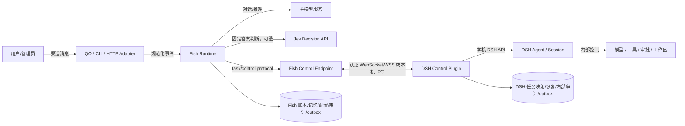

### 2.1 边界定义

| 边界 | 信任级别 | 允许流动的数据 | 明确禁止 |
|---|---|---|---|
| QQ → Fish | 外部不可信入口 | 消息、平台身份、会话 ID、回复目标 | 将显示名/文本当作授权事实 |
| 主模型/Jev → Fish | 概率性外部服务 | 生成文本或结构化建议、用量、错误 | 直接写账本或授予权限 |
| Fish → Plugin | 经认证控制通道 | taskId、traceId、principalId、projectId、目标和约束 | 私密 QQ 回复目标、任意 path、DSH 内部 API 名称 |
| Plugin → Fish | 经认证控制通道 | 接收/拒绝、查询快照、取消确认、最终结果、心跳 | 思考、工具调用、审批详情、逐步进度 |
| Plugin → DSH | DSH 本机信任域 | 经 DSH API 的任务消息和内部关联数据 | 直接依赖不稳定私有文件替代接口 |
| Fish 内部模块 | 同一 Runtime 边界 | 版本化领域事件和端口调用 | 外部回调并发修改 Fish 状态 |

### 2.2 连接方向与消息方向

DSH Plugin 主动拨出连接，Fish Runtime 接收连接；连接建立后为双向。Fish 通过已建立的通道发送 task.submit/query/cancel，Plugin 返回 accepted/rejected/snapshot/cancel_ack/result。物理拨出方向不决定业务消息方向。

首选长连接 WebSocket。部署在同机时可评估 loopback WebSocket 或等价 IPC；远程使用 WSS。Fish 不要求 DSH 在公网监听控制端口。

## 3. 系统容器和进程模型

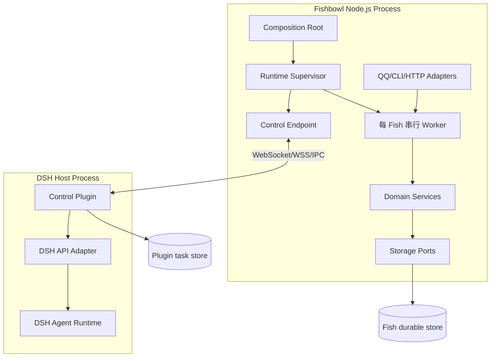

### 3.1 Fish Runtime 进程

单一 Runtime 进程可承载多个 Fish；每 Fish 的业务事件串行处理，不同 Fish 的 worker 可以并行。所有 worker 共享经过接口隔离的 Provider、协议连接、存储池和审计服务。入口 adapter 及远端事件不得直接调用 Domain Repository 写状态。

### 3.2 DSH Plugin 生命周期

Plugin 按 DSH 生命周期启动，但连接到 Fish 失败不应阻塞 DSH 原有功能。Plugin 保持本地任务执行责任：已接受任务即使 Fish 断线，也由 DSH 继续执行并持久最终结果。Plugin 退出时应停止新接收、释放本机锁、保留未确认 outbox 和 active task 恢复元数据。

## 4. 架构风格和依赖规则

### 4.1 推荐风格

Fish 使用模块化单体 + Ports and Adapters：首期不因未来 Rust 迁移而提前拆微服务。DSH Plugin 是宿主侧独立适配器。协议包和 schema 与 Node.js 领域对象解耦。

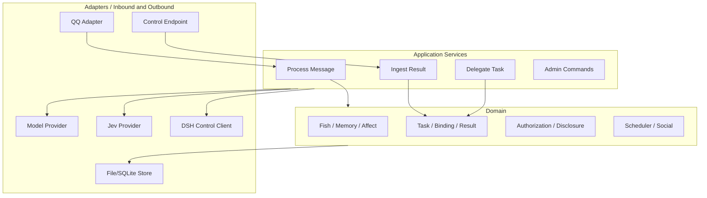

### 4.2 依赖规则

1. Domain 不导入 DSH 包、QQ SDK、TypeSafe SDK 或特定存储 SDK。
2. Application 层通过接口访问模型、决策模型、渠道、任务协议和存储。
3. Adapter 负责外部数据校验和协议映射，不持有业务规则的最终裁决权。
4. 只有对应 Fish worker/command handler 可提交 Fish 领域事件。
5. DSH Plugin 内部依赖可调用的 DSH API；依赖版本差异必须由 DshAdapter 封装。
6. 网络 Schema 使用显式 JSON 序列化，不传递类实例、Error 对象、函数、BigInt 或 undefined。

## 5. 模块清单与接口

### 5.1 Fish Runtime 模块

| 模块 | 主要职责 | 输入 | 输出/事件 | 依赖 |
|---|---|---|---|---|
| Composition Root | 读取配置，实例化模块、端口和生命周期 | 配置、环境 | Runtime 服务图 | 所有 adapter/infra |
| Runtime Supervisor | 启停、实例锁、优雅关闭、健康状态 | signal、admin action | runtime lifecycle event | Config、Queue、Storage |
| Channel Gateway | 验证并规范化 QQ/CLI/HTTP 事件 | 平台回调 | IngressEvent | Channel Provider |
| Ingress Identity Resolver | 将外部身份映射到 principalId/fishId | 平台身份、绑定 | InternalPrincipal | identity store、Policy |
| Per-Fish Scheduler | FIFO/priority、串行 worker、aging | IngressEvent、TaskResultEvent | WorkItem lease | Ledger、Queue Store |
| Agent Orchestrator | 组上下文、调用主模型、选择能力、结束回合 | WorkItem、Fish context | Reply、TaskIntent、Question | ModelProvider、Policy |
| Context Builder | 受控召回记忆、会话和能力上下文 | fishId、principal、message | ModelContext | Memory、DisclosurePolicy |
| ModelProvider Port | 主生成模型的统一抽象 | prompt/context/tools | ModelResponse/usage/error | Provider adapter |
| DecisionProvider Port | Jev 类固定答案判断 | state、question schema | TypedDecision、probability | Jev adapter |
| Capability Registry | 登记内建及远端能力、状态和 schema | Provider handshake | CapabilitySnapshot | DSH bindings |
| Authorization Policy | principal/fish/capability/project 判断 | principal、task、binding | allow/deny + reason | Grant store |
| Disclosure Policy | 控制记忆和私密消息是否进入上下文 | content provenance、audience | redacted content | Memory labels |
| Task Manager | 创建、提交、查询、取消、needs_input 续接 | TaskIntent/answer | Task state events | Protocol Client、Ledger |
| Protocol Client | 管理一条 Fish↔Plugin binding 的消息 | Protocol envelope | transport result | WebSocket client |
| Result Ingestor | 验证、去重、持久化结果和 ack | task.result/snapshot | TaskResultEvent | Task Manager、Ledger |
| Memory Service | 写入、检索、来源标记、归档 | MemoryCandidate/query | MemoryRecord | Memory Repository |
| Event Ledger | Fish 状态事实源、追加、重放和投影 | DomainEvent | durable commit/stream | Storage adapter |
| Audit Service | 脱敏、关联和追加审计 | AuditEvent | durable audit record | Audit Repository |
| Outbox Dispatcher | 发送 QQ 回复和协议消息，重试去重 | OutboxItem | delivery outcome | Channel/Protocol adapters |
| Social Service | 可见名单、鱼间会话、轮数和预算 | SocialIntent | SocialMessage events | Scheduler、Policy、Memory |
| Admin Service | 鱼运行配置、binding、权限和恢复工具 | AdminCommand | ConfigChanged/Audit | Admin Auth、repositories |
| Health/Diagnostics | 汇总 Runtime、存储、队列、binding、unknown | probes | HealthSnapshot | all subsystems |

### 5.2 DSH Plugin 模块

| 模块 | 主要职责 | 内部接口 |
|---|---|---|
| Plugin Bootstrap | 从 DSH 生命周期加载插件、恢复 TaskStore、获取单实例锁 | DSH plugin hooks |
| Connection Manager | 主动建连、认证、握手、重连、connectionId fencing | WebSocket transport |
| Capability Registry | 报告能力、schema、权限、DSH/plugin 版本和限制 | DSH API adapter |
| Binding Resolver | 将 binding/project/principal 解析到本机 session/workspace | Admin configuration |
| Protocol Validator | 验证 envelope、大小、类型、版本和授权 | Protocol schema |
| Task Store | 请求摘要、状态、dispatch intent、映射、result/outbox | Durable store |
| Session Lease Manager | 独占 session 执行槽并检测人工占用 | DSH session APIs |
| Dispatcher | 按序派发 queued task | Task Store、Session Lease |
| DSH Adapter | 将通用 request 转换为 DSH message，关联 messageId/turn | DSH Agent/Session API |
| Event Correlator | 只把精确 claimed/turn end 关联到对应 task | Local DSH event bus |
| Result Extractor | 解析结束回合最终结果并校验业务 Schema | Event Correlator |
| Cancellation Controller | 精确移除 queued inbox 或取消 active turn | DSH API |
| Reconciler | 恢复时核对 TaskStore 与 DSH inbox/session/turn | Store + DSH evidence |
| Plugin Outbox | 持久补投 accepted/result/snapshot | Connection Manager |
| Plugin Audit | 本地记录 DSH 内部执行和边界控制 | DSH logger/store |

### 5.3 端口接口草案

下列 TypeScript 形状只是逻辑接口示意，不是协议定稿：

```ts
interface ModelProvider {
  generate(input: ModelInput, signal: AbortSignal): Promise<ModelOutput>;
  health(): Promise<ProviderHealth>;
}

interface DecisionProvider {
  decide(input: DecisionInput, signal: AbortSignal): Promise<DecisionOutput>;
  health(): Promise<ProviderHealth>;
}

interface TaskGateway {
  submit(bindingId: string, request: TaskRequest): Promise<SubmitDisposition>;
  query(bindingId: string, taskId: string): Promise<TaskSnapshot>;
  cancel(bindingId: string, taskId: string, cancelId: string): Promise<CancelDisposition>;
}

interface EventStore {
  append(events: DomainEvent[]): Promise<CommitReceipt>;
  read(stream: StreamId, after?: EventCursor): AsyncIterable<DomainEvent>;
  loadProjection<T>(key: ProjectionKey): Promise<T>;
}
```

所有 Promise 的拒绝必须映射为稳定领域错误或 transport error。接口不得返回可变共享对象供其他模块直接修改。

## 6. Fish 模块内部结构

### 6.1 Composition Root 和生命周期

启动顺序建议：

1. 解析配置、密钥引用和状态目录。
2. 获取状态目录实例锁并检查版本迁移。
3. 打开存储、验证账本、重放投影。
4. 初始化审计和 outbox repository。
5. 恢复任务、队列和 result dedup 索引。
6. 初始化 Fish domain、Policy、Provider 和 adapter。
7. 启动每 Fish worker、QQ adapter 和 control endpoint。
8. 进入 accepting 状态；DSH 可不可用只影响 DSH capability。

关闭顺序：拒绝新管理/入口工作 → 持久化接收事件 → 停止派生新 DSH dispatch → flush ledger/outbox → 关闭网络和 provider → 释放实例锁。不得因 shutdown 删除未送达结果或取消已经由 DSH 接收的任务。

### 6.2 IngressEvent 规范化

各渠道转换为统一消息：

```text
IngressEvent {
  eventId, channelType, platformMessageId,
  conversationId, principalId, fishId,
  content, attachments[], receivedAt,
  replyTarget, traceId, sourceMetadata
}
```

适配器验证外部 callback，去除不可信 metadata，生成内部 ID。入口重复事件以 `(channelType, platformMessageId)` 去重。原始完整内容是否长期保存由隐私策略决定；审计可保存摘要和 payload digest。

### 6.3 Fish Agent Orchestrator

单轮 Agent 流程：

1. 从 Queue 获得一个 Fish WorkItem lease。
2. 使用 fishId、principal、conversation 和披露策略组装 context。
3. 若配置启用 Jev，调用有限问题集得到意图/路由/风险建议。
4. 执行程序硬权限检查，确定可用能力。
5. 调用主 ModelProvider 生成回复、澄清问题或 TaskIntent。
6. 对模型工具意图逐项做 Schema、Policy、授权和预算验证。
7. 对需要 DSH 的意图调用 Task Manager；非 DSH 消息直接回复。
8. 追加 Agent 回合状态、审计和记忆候选。
9. 将回复或“任务已提交”写入 outbox；释放 lease。

Agent 结束任务提交回合后不保持线程等待 DSH。DSH 结果是新 WorkItem，后续串行处理。

### 6.4 Context Builder 和披露

Context Builder 根据当前接收对象而非仅按鱼身份查询记忆。管道为：权限判定 → 检索候选 → 来源/敏感级别过滤 → audience disclosure → token budget 截断 → context provenance 标注。未通过披露策略的记忆不得进入主模型输入或 Jev state。

Fish 自己跨渠道记忆可召回，但向 QQ 群、私聊对象、另一条 Fish 或 DSH 插件披露必须分别校验。DSH request 只携带执行必需的目标、约束、验收标准和内部 principalId，不自动携带整段 Fish 记忆。

## 7. DSH Plugin 内部结构和调度

### 7.1 Plugin 本地持久化

建议 TaskStore 支持事务或原子追加，至少持久化：

```text
BindingRecord(bindingId, fishId, projectId, sessionRef, version)
TaskRecord(taskId, requestDigest, canonicalRequest, admission, state)
DispatchIntent(taskId, messageId, sessionRef, createdAt)
TurnLink(taskId, messageId, sessionRef, turnId, claimedAt)
ResultRecord(taskId, resultId, status, result, terminalEvidence)
OutboxRecord(messageId, taskId, resultId, payload, ackState, retryAt)
AuditRecord(eventId, taskId, traceId, action, evidenceDigest)
```

对每个 `(bindingId, taskId)` 建唯一索引；同一个 messageId 不得链接多个 task；同一个 active turn 不得链接多个远程 task。TaskRecord 和最终结果/outbox 的原子性是恢复关键。

### 7.2 Dispatcher 执行步骤

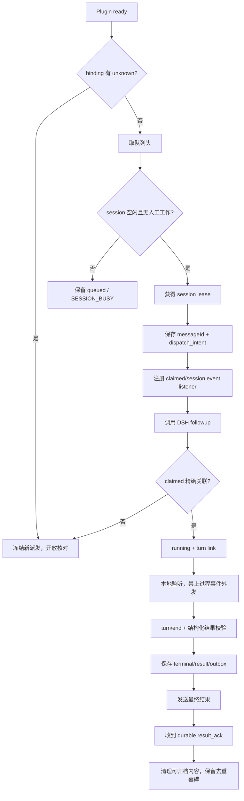

`agent.followup()` 返回 void，因此不是 accepted 或 claimed 证据。`agent/inbox/claimed` 可同步触发，监听必须提前注册。`whenIdle()` 观察整个 Agent，不可用于某个 task 结算。session lease 必须覆盖检查、dispatch、执行和 turn/end 结算。

### 7.3 事件隔离

Plugin 的 Event Correlator 可消费 DSH 内部 assistant/message、tool event 和 turn/end，以关联任务和提取最终结果，但分成两个逻辑通道：

- Local execution channel：可读取必要 DSH 事件，受本地审计和最小化策略约束。
- Remote protocol channel：只可发送 allowed protocol types。消息构造器不接收原始 DSH event 对象，避免意外泄漏。

这条边界应由类型和模块接口强制，而不只靠开发者约定。

## 8. Fishbowl Control Protocol Adapter

### 8.1 连接生命周期

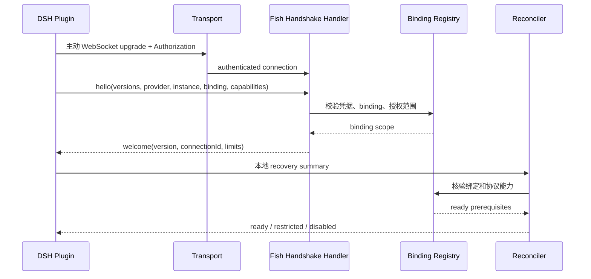

握手完成不意味着有权访问所有能力。能力清单和授权范围取交集后才可调用。协议版本不兼容时拒绝；不降级为 DSH 模型替代或隐式 prompt。

### 8.2 信封处理管线

每帧依序：字节限制 → UTF-8/JSON 严格解析 → 重复键检测 → Schema/版本 → connection fencing → binding/task scope → principal/capability/project authorization → replay/idempotency → 应用服务 → 持久响应/outbox。错误映射为稳定 code；认证失败不能回显凭据或内部栈。

### 8.3 连接 fencing 与替换

每次成功握手由 Fish 分配新 connectionId。connectionId 与 bindingId 持久关联，消息必须匹配当前有效会话。替换连接必须先使旧连接失效并审计；已接受任务和 outbox 属于 binding/task，不属于 socket，可由新连接恢复。

## 9. Task Manager 设计

### 9.1 Task Aggregate

Fish Task Aggregate 建议字段：

```text
taskId, traceId, parentTaskId
fishId, principalId, capabilityId, bindingId, projectId
canonicalRequest, requestDigest
origin(channel, conversationId, platformMessageId, replyTarget)
admission(submitting|accepted|rejected|unresolved)
knowledge(pending|unknown|terminal)
result(resultId, status, effects, artifacts, tests, error, questions)
notification(pending|sending|delivered|unresolved)
createdAt, acceptedAt, terminalAt, version
```

Aggregate 不保存 DSH 内部消息、思考、tool call 或 turn transcript。只保留审计所需的 DSH messageId/turn correlation reference（如确认可向 Fish 暴露且不含内部内容；默认优先仅保留 taskId 和摘要）。

### 9.2 提交事务边界

Fish 创建任务时，将 TaskCreated、AuthorizationGranted/Denied、NotificationTargetBound 等事件在一个 Fish ledger commit 中持久化，再由 TaskSubmit outbox 发包。这样网络写失败可以重试同 taskId；任务数据不会只存在 Agent 内存。

Plugin 收到 submit 后先验证并在本地持久化 queued/task digest，再回复 accepted。若插件存储失败，必须在 DSH followup 前返回 STORAGE_UNAVAILABLE。若 accepted 丢失，Fish query 或用同 taskId 相同请求重发；Plugin 返回原 admission，不重复执行。

### 9.3 结果接收事务边界

Fish 收到 result：

1. 校验连接、binding、taskId、resultId 和 result Schema。
2. 检查任务归属/父续接关系和已有终态。
3. 在一个持久事务中写入 TaskResultReceived、MemoryCandidateCreated（若有）、AuditRecorded、NotificationOutboxEnqueued。
4. 提交后才发 result_ack。
5. 重复 resultId 返回相同 ack；不同 resultId 尝试覆盖终态则拒绝并告警。

若 ledger 不支持事务，先写一条包含结果和关联标记的不可变事实事件，再由可重放投影派生 memory/outbox；ack 仍在事实事件耐久提交后发出。

## 10. 任务协议和结果适配

### 10.1 请求 Schema

请求对象：

```text
TaskRequest {
  projectId: ProjectId
  principalId: PrincipalId
  objective: NonEmptyText
  constraints: Text[]
  acceptance: Text[]
  continuation: null | ContinuationContext
}
```

规范化必须使用版本固定的字段顺序、UTF-8 编码和 SHA-256。拒绝重复 JSON 键、孤立 surrogate、无限数字、超过长度的文本、未知字段、绝对路径和 `..`。Fish 侧摘要用于端到端核对；Plugin 必须自行重新规范化计算。

### 10.2 结果生成

在当前 DSH API 证据下的候选方式是：插件向 DSH 任务上下文增加严格结果 schema 指令，等待关联 turn 结束后解析最后一条无工具调用的 assistant 文本。模型只提供业务字段，Plugin 生成 resultId，并将其与真实 turn/end 证据一起校验。

此方案仍为 Proposed/Unverified：真实模型 JSON 合规性、DSH 对结构化输出的支持和最终 assistant 识别需桌面集成验证。非法输出不能在插件内自行再次发起模型请求，也不能把自由文本总结为 succeeded；结算为 RESULT_INVALID/unknown impact，按任务协议返回明确 failed 或 unknown。

### 10.3 DSH 回合结算规则

| DSH 证据 | Result Extractor 行为 |
|---|---|
| turn completed + 合法结果 body | 使用 business status，但验证状态与结果字段相容 |
| turn completed + 无/非法 body | 不猜成功；标记结果无效和影响未知 |
| error/blocked/max-tokens + 结束确认 | 生成 failed，保留错误类别和影响不确定性 |
| aborted + 已确认针对本 task 的取消 | 仅在已证明不会继续运行时 cancelled |
| 意外 aborted + 已停止 | failed/EXECUTION_ABORTED，不伪装用户取消 |
| interrupted/forked/turn link 丢失 | unknown，冻结 binding 并进入 reconciliation |
| 最终消息出现但 turn 尚未 terminal | 暂存本地候选，不发送给 Fish |

模型文本不能越过 DSH terminal evidence。completed 仅是 DSH loop 完成，不代表业务 success。

## 11. 状态管理和并发模型

### 11.1 Fish 任务状态向量

不要把 admission、execution knowledge 和 delivery 合并成一个枚举：

```text
Admission: submitting | accepted | rejected | unresolved
Knowledge: pending | unknown | terminal
Business status (only at terminal): succeeded | failed | cancelled | needs_input
Notification: pending | sending | delivered | unresolved
```

约束：terminal business status 不降级；迟到 accepted 不能覆盖结果；unknown 不是终态；not_found 不是自动重试许可；通知失败不改变执行终态。

### 11.2 Plugin 任务状态

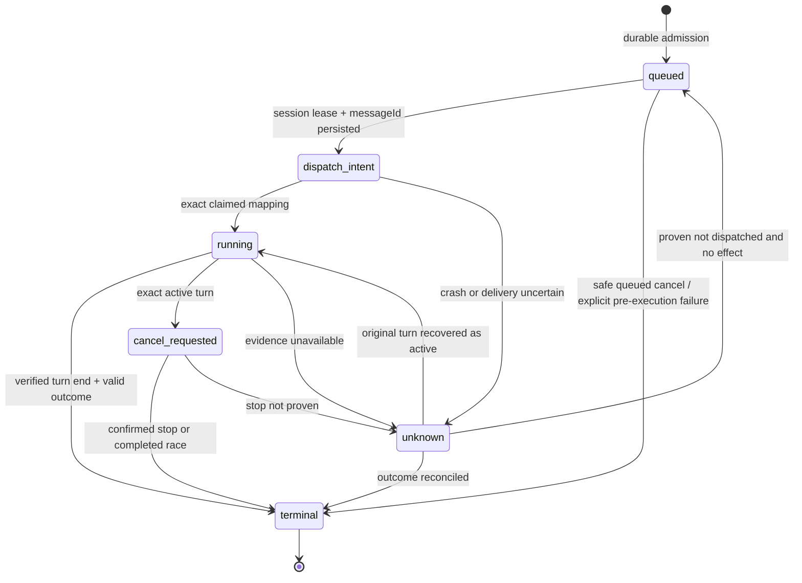

### 11.3 Fish 队列调度

每条 Fish 一个逻辑 FIFO/priority queue，一个 active worker lease。入站用户消息优先于鱼间消息；TaskResultEvent 有受保护优先级，采用 aging 避免被连续用户消息永久压住。每条 WorkItem 使用稳定 eventId 去重，失败重试次数和 dead-letter 状态受限。

结果事件处理器只负责持久接收、记忆/审计和排入通知，不等待 QQ API 完成。这样慢渠道不会阻塞 Fish 模型回合。不同 Fish 可由 worker pool 并行，但每 Fish 的 ledger append 仍串行化。

### 11.4 DSH 会话串行和人工输入

Plugin 每 binding/session 获取独占 lease。派发前检查 DSH session 无人工回合。远程任务执行期间只允许关联 turn 的消息参与结果识别。人工输入若可能混入同一 session，Plugin 必须能够检测并暂停后续派发；无法证明归属时 unknown。

此能力尚未通过桌面验证。首期应优先使用专用 DSH 执行 session，并在 UI/管理员配置中将其标为远程委托专用。若没有可靠的占用和插入检测能力，不能把“请用户不要输入”作为生产并发安全机制。

## 12. 取消设计

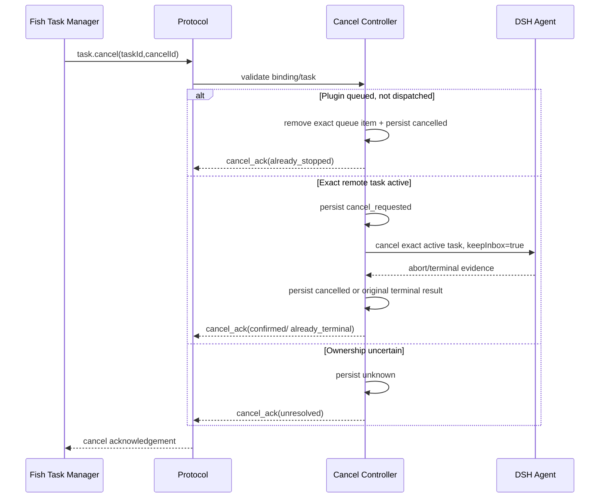

检查 active turn 与调用 cancel 之间若没有 DSH API 同步保证，存在竞态。此时运行中取消不进入 Plugin ready capability；只能安全取消尚未 dispatch 的任务，或返回 unresolved。绝不调用未绑定 task 的 whole-agent cancel。

## 13. 需要补充信息流程

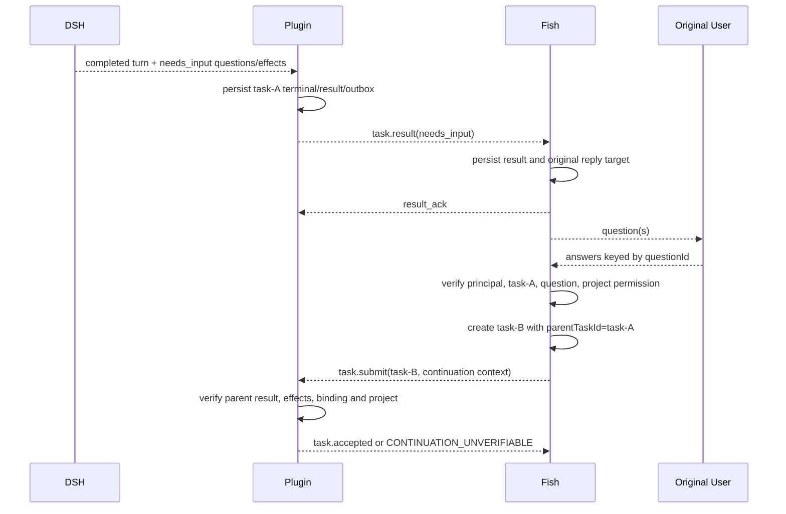

重复答复不能创建多个续接任务：Fish 在第一次发送前持久 task-B ID，并为 parentTaskId/question set 保存唯一续接索引。DSH 缺失父记录或 parent 未终态 needs_input 时拒绝续接。

## 14. 鱼间交流和多鱼调度

### 14.1 Social Service

Social Service 是 Fish Runtime 内部能力，不经过 DSH。职责包括 mutual visibility、交流开关、消息/会话/Token 预算、轮数和持续时间、用户旁观与插话、双方各自记忆写入。

### 14.2 交流上下文

发起方只能从自身记忆构造要发送内容。Disclosure Policy 删除私聊、私密记忆和配置。接收方只收到实际发出的消息与允许的公共状态，不能直接查询发起方记忆库。每个 Fish 对同一交流独立保存一份记忆事件。

### 14.3 预算与终止

预算种类至少分开计数：每日交流会话数、消息数、模型 Token。达到预算、管理员暂停、双方退出、最大轮数或超时必须终止；是否保留最后结束语预留预算属于待定策略。预算按配置时区重置，时区待评审。

### 14.4 设置权限

管理员可以配置 Fish 启停、模型、作息、可见名单、交流预算、DSH binding 和能力授权。默认不能直接改情绪、记忆和人格；若未来允许，应生成显式管理事件并参与账本重放。

## 15. 记忆、事件账本和存储设计

### 15.1 逻辑存储分区

| 存储分区 | 内容 | 所有者 | 访问规则 |
|---|---|---|---|
| Fish Event Ledger | Fish 状态事实、消息边界、任务边界、管理变更 | Fish Runtime | 单写者、追加、可重放 |
| Fish Projection Store | 当前状态、索引、队列投影 | Fish Runtime | 可从 ledger 重建 |
| Memory Store | 跨渠道记忆、来源、披露标签 | 每 Fish | 所有者可检索，披露另校验 |
| Fish Audit Store | Fish 模型、授权、任务边界、错误 | Fish Runtime | 追加写，按 trace 检索 |
| Fish Outbox Store | QQ 回复、DSH submit/result ack | Fish Runtime | 至少一次发送、幂等去重 |
| Plugin Task Store | DSH task map、dispatch intent、terminal result | Plugin | DSH 本机权限隔离 |
| DSH Audit Store | DSH 内部 Agent、Tool、Approval、Workspace | DSH/Plugin | 本机审计，不复制给 Fish |
| Plugin Outbox | accepted/result/snapshot 补投 | Plugin | 未 ack 不删除 |

### 15.2 事件事实源

```text
DomainEvent {
  eventId, schemaVersion, eventType,
  occurredAt, recordedAt,
  fishId, actor, source,
  traceId, parentId, payloadDigest, payload
}
```

Fish 的投影、任务状态和通知状态从事件派生。外部 API 回调先进入队列，然后由 Runtime worker 校验并追加事件。写入失败时不得返回 durable accepted/result_ack。

### 15.3 事务和幂等键

| 操作 | 幂等键 | 必须同一持久提交的内容 |
|---|---|---|
| QQ 入站 | channel + platformMessageId | IngressReceived + queue item |
| Task 创建 | bindingId + taskId | TaskCreated + authorization decision + reply target |
| Plugin 接收 | bindingId + taskId | request digest + canonical request + queued |
| DSH dispatch | taskId + messageId | dispatch intent + messageId |
| Plugin 结果 | taskId + resultId | terminal task + ResultRecord + outbox |
| Fish 结果入站 | taskId + resultId | result fact + memory candidate + notify outbox |
| QQ 通知 | resultId + replyTarget + channel | delivery intent and outcome |
| 续接任务 | parentTaskId + answer-set digest | one child task ID and continuation request |

### 15.4 保留和归档

未确认结果不可自动删除；taskId 墓碑须在 binding 生命周期保留以防旧请求重放。请求正文可按隐私和归档策略压缩或脱敏，但必须保留足以验证 digest、状态和副作用来源的记录。删除/重建 binding 需新 bindingId，旧任务报告不可核对而不是 not_found。

## 16. 通知 Outbox 设计

Fish 任务终态和 QQ 通知状态分离。Outbox item 包含 outboxId、taskId/resultId、channel、conversation、reply target、payload reference、attempt、nextAttemptAt、state。

发送状态：`pending → sending → delivered`；在超时/确认丢失时为 `unresolved`，根据平台能力 query 或以稳定幂等键重试。渠道没有幂等支持时允许用户看到重复回复，但 Fish 记忆/结果事件仍只写一次。禁止将结果自动改发其他对象。

结果接收后先保存原回复目标；不能依赖用户后来发消息的当前会话推导目标，防止并发任务串线。

## 17. 安全设计

### 17.1 身份和授权链

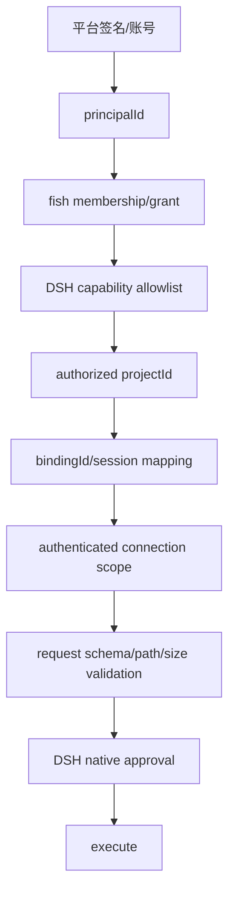

每一层独立检查和审计。LLM/Jev 输出不是 grant。转发消息、被 @ 文本和 prompt injection 不扩大权限。

### 17.2 密钥

凭据存储在 OS secret store 或权限受限配置。握手使用 Authorization header，不能写 URL query。日志只记录 credential identifier/fingerprint 的非敏感部分。支持轮换和撤销；撤销只停止后续命令，不改变已经接收的 DSH 任务状态。

### 17.3 路径和产物

协议只接受 projectId。Plugin 根据 binding 映射到允许工作区，DSH 自身工具仍执行路径检查。result artifact 使用项目内相对引用，规范化并检查 symlink/路径穿越风险；不自动下载任意 URL。大文件传输不在首期协议内。

### 17.4 数据最小化

发给 DSH 的信息：任务目标、约束、验收标准、已授权项目、必要 principal、续接上下文。默认不发送：QQ conversation ID、私聊回复目标、其他记忆、完整人格/情绪、未相关聊天记录、连接凭据。

## 18. 故障处理和恢复

### 18.1 故障分类

| 故障 | 对外状态 | 是否重试 | 行为 |
|---|---|---|---|
| Fish 尚未发送且本地持久失败 | 本地创建失败 | 同一事务可重试 | 不存在 DSH 执行 |
| 连接暂时失败，submit 未知是否送达 | submitting/unresolved | 先 query/同 ID 重发 | 禁止新 taskId |
| Plugin pre-accept storage failure | rejected STORAGE_UNAVAILABLE | 可配置有限重试 | 保证尚未 dispatch |
| accepted 后 DSH 明确失败 | terminal failed | 不自动重做 | 含错误和 effects certainty |
| DSH turn 或结果证据缺失 | unknown | 不执行 | 冻结 binding 并 reconcile |
| result 发送失败 | terminal + outbox pending | 自动限速重投 | 不改业务终态 |
| Fish result persistence 失败 | 未 ack | Fish 恢复后重发/Plugin 补投 | Plugin 保留 result |
| QQ 发送失败 | terminal + notification pending | 限速重试 | 原目标不变 |
| QQ 发送确认丢失 | notification unresolved | query 或幂等重试 | 可能重复须记录 |
| DSH Plugin 存储被删除 | binding unresolved/unknown | 不得 not_found 后重跑 | 新建 binding 并人工核对 |

### 18.2 恢复启动顺序

Plugin：获得单实例锁 → 校验 TaskStore 完整性 → 重建索引/队列 → 对 dispatch_intent/running/cancel_requested/unknown 核对 DSH session/inbox/turn → 恢复 outbox → 报告 recovery summary → 只有无阻塞 unknown 才开启新任务。

Fish：获取状态锁 → 验证 ledger → 重建投影、queue、task/outbox → 将之前 submitting 标记为 unresolved 等待 query → 启动 control endpoint/adapter → 恢复连接和查询 → 处理结果队列 → 继续普通消息。

### 18.3 不可自动修复的情形

无法证实 dispatch 是否发生、turn 是否仍运行、是否有文件副作用、结果是否真实属于该任务时，设置 `unknown`。Freeze scope 至少为该 binding 的新 DSH dispatch；普通 Fish 聊天可继续。管理员查看 DSH 本机审计/工作区后可以选择：确认仍运行、登记确定结果、确认未执行、或创建引用原任务的新授权任务。不得编辑旧终态伪造历史。

## 19. 部署视图

### 19.1 同机同用户

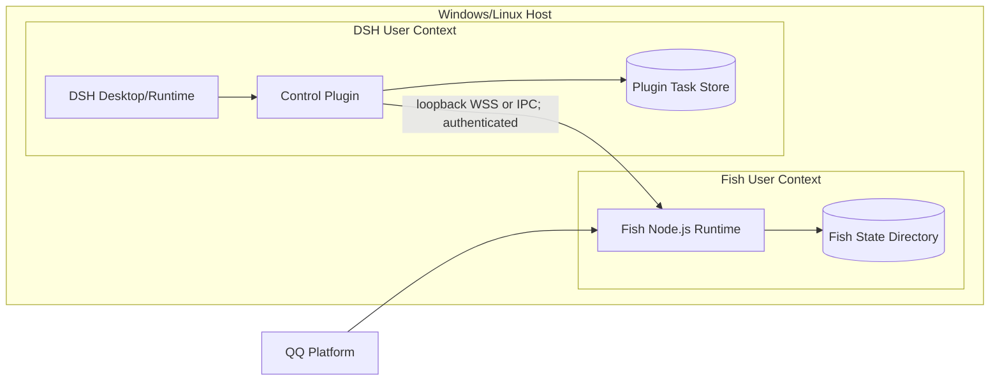

### 19.2 分机部署

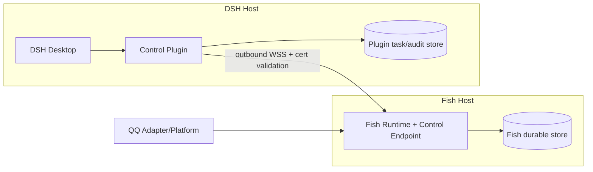

远程网络策略允许 Plugin 主动出站连接 Fish endpoint。若 Fish 地址位于 NAT 后，部署需要 VPN/反向代理/受控 relay；不开放无认证公网控制面。

### 19.3 管理界面

设置页通过 Admin Service 调用命令接口，不直接连接数据库。配置包括 Fish 状态、Provider、DSH binding、project mapping、能力 allowlist、可见对象、预算、审计与恢复。管理员认证机制仍待定，不得把本机 UI 可访问等同于管理员授权。

## 20. 配置设计

配置按敏感级别分区：

| 配置域 | 示例 | 存储/审计 |
|---|---|---|
| Runtime | 状态目录、监听地址、队列容量 | 版本化配置、变更审计 |
| Fish | 启用状态、作息、模型绑定、预算 | per-fish 配置版本 |
| Channel | QQ app config、回调配置、身份映射 | secret store + 非敏感配置审计 |
| Provider | Model/Jev endpoint、模型名、阈值 | key 放 secret store |
| DSH binding | providerId、bindingId、projectId、sessionRef | Fish/Plugin 双端核对 |
| DSH permissions | principal、capability、project allowlist | 管理员命令，强审计 |
| Social | mutual visibility、次数、Token 预算、时区 | 配置事件，可重放 |
| Retention | 记忆/审计/任务归档期限 | 显式管理配置 |

运行时配置不应把秘密复制进 Fish Event Ledger。配置变更事件记录 secret reference/version，而非 secret value。

## 21. 观测性与管理诊断

### 21.1 健康维度

```text
Runtime: starting | ready | degraded | stopping | failed
Storage: healthy | read_only | unavailable
Channel: connected | disconnected | rate_limited | degraded
DSH Binding: disconnected | authenticating | reconciling | ready | disabled
Task Admission: submitting | accepted | rejected | unresolved
Task Knowledge: pending | unknown | terminal
Task Status: succeeded | failed | cancelled | needs_input
Outbox: pending | sending | delivered | unresolved
Audit: healthy | degraded | unavailable
```

健康面板必须显示连接数、最后握手时间、能力版本、队列长度、active taskId（可脱敏）、unknown 数、最老 outbox age、存储写入健康和最后审计事件时间。不能将 DSH connection ready 展示为“所有任务正常”。

### 21.2 结构化指标

建议指标：`fish_queue_depth{priority}`、`fish_queue_wait_seconds`、`model_request_duration_seconds`、`dsh_connection_state`、`dsh_task_admission_total{outcome}`、`dsh_task_duration_seconds{status}`、`dsh_unknown_tasks`、`outbox_pending{channel}`、`audit_append_failures_total`。指标 label 不放用户文本、密钥、路径或私人身份。

### 21.3 日志和审计分离

操作日志服务进程诊断；Audit Store 保存业务可追溯事实。不能只依赖 console log 满足审计。日志使用 taskId/traceId 关联，敏感正文按策略摘要或脱敏。

## 22. 性能和容量设计

以下为初始建议值，评审前不构成 SLA：

| 参数 | 建议默认 | 限制策略 |
|---|---:|---|
| WebSocket heartbeat | 15 秒 | 在线检测而非任务状态 |
| 离线阈值 | 45 秒 | 标记 offline，保留任务 |
| 控制响应等待 | 10 秒 | query，不重跑 |
| 重连退避 | 1–30 秒 + jitter | 限速，outbox 保持 |
| 每 binding active task | 1 | 串行 DSH session |
| 每 binding queued tasks | 16 | 超限 reject QUEUE_FULL |
| 最大协议帧 | 256 KiB | 发送前/接收后均检查 |
| 最大 JSON 深度 | 16 | Schema validator 限制 |
| Objective 字符数 | 32 KiB | payload too large |
| Questions 数量 | 16 | 结果拒绝/截断前失败 |
| Artifact references | 128 | 仅项目相对路径 |

Feed 风暴通过 channel rate limit 和 per-principal queue 限制控制；队列满时应明确拒绝或提示，不能在内存中无限增长。任务执行时限由 DSH 本地落实；Fish 的网络 timeout 不改变执行事实。

## 23. 错误模型和降级

### 23.1 错误层级

1. Transport Error：连接超时、断开、TLS、帧错误。可能不知道对端是否已处理。
2. Protocol Error：版本、Schema、messageId、权限格式无效；不一定改变已有任务。
3. Admission Rejection：任务未 accepted，例如 PROJECT_DENIED、QUEUE_FULL。
4. Execution Failure：accepted 后 DSH 明确失败或阻止。
5. Result Uncertainty：无法证明是否投递、停止或完成；知识状态 unknown。
6. Delivery Error：任务有终态，但 QQ 或 result outbox 尚未送达。

### 23.2 降级规则

| 子系统不可用 | 降级方式 |
|---|---|
| Jev 不可用 | 规则/主模型接管；不影响权限硬规则 |
| 主模型不可用 | 消息明确失败或排队；不伪造回复 |
| DSH disconnected | 普通 Fish 能力照常；DSH 能力不可用并说明 |
| Fish ledger 不可写 | 停止新业务接收/高风险执行，保留诊断 |
| DSH TaskStore 不可写 | Plugin 不 accepted、不 followup |
| QQ 不可用 | 结果留在 Fish outbox |
| Audit 不可写 | 告警；高风险请求依配置拒绝 |
| Unknown task | 冻结该 binding 的新派发，其他 Fish 能力继续 |

## 24. 技术实现和目录建议

当前以 TypeScript/Node.js 为 Fish 主体。既有 JavaScript 按需迁移，不做全量重写。建议新增模块顺应现有 packages 风格：

```text
packages/
  runtime/                 lifecycle, composition, worker supervision
  agent/                   Fish orchestration and context building
  model-provider/          main ModelProvider port/adapters
  decision-provider/       Jev and typed-decision adapters
  channel-core/             normalized ingress/outbound contracts
  bridge-qq/                QQ adapter
  task/                     Task aggregate/use cases/recovery
  control-protocol/         language-neutral schema/canonicalization
  adapter-dsh/              Fish-side DSH capability client
  policy/                   authorization/disclosure/risk policy
  memory/                   memory ports, retrieval and provenance
  ledger/                   event append, replay, projections
  scheduler/                per-fish queue and priority aging
  social/                   fish-to-fish conversations and budgets
  audit/                    audit schema, redaction, query
  admin/                    configuration and admin commands
```

DSH Plugin 单独按宿主插件结构实现，不把 DSH 私有依赖引入 Fish packages。不要为了 Rust 迁移现在就拆成多进程；通过 protocol、repository/provider interfaces 和 serialized behavior fixtures 保留替换路径。

## 25. 设计映射到已有项目

现有领域包可逐步纳入 Runtime，而非推倒重写：

| 现有包/能力 | 总体设计归属 | 后续边界整理方向 |
|---|---|---|
| affect | Fish Domain | 只接受 Runtime 事件，不直接读外部平台 |
| being | Fish Domain/Identity/Policy | 明确身份、授权和状态所有权接口 |
| memory | Memory Service/Repository | 增加来源、披露标签和版本化事件 |
| schedule | Scheduler/Background Jobs | 通过内部队列触发，不直接并发写状态 |
| journal | Ledger/Audit projection | 明确事实事件与可读日志的区别 |
| bridge-qq | Channel Adapter | 仅做平台协议映射与收发，不写业务账本 |
| adapter-dsh | DSH boundary adapters | 收敛私有 DSH API 到插件侧或最小协议 client |
| plugin | 现有插件能力边界 | 不成为新的状态所有者 |
| voice/bilibili | 独立能力/Provider | 按相同 ingress/capability ports 接入 |

具体包迁移属于后续实施计划；本表不是本轮代码结构承诺。

## 26. 测试设计

### 26.1 单元与契约测试

- Domain aggregate 的合法和非法状态转换。
- Task request canonicalization 跨语言测试向量。
- Schema 校验：重复键、未知字段、路径、大小、Unicode 边界。
- Policy 矩阵：principal × fish × capability × project × channel。
- Disclosure 策略：不同受众和记忆来源组合。
- Scheduler FIFO、priority、aging、公平性和单 Fish 互斥。
- Outbox retry/backoff/idempotency 和通知串线防护。
- JSON 协议 envelope、版本、connection fencing 和错误码。

### 26.2 Plugin 适配测试

- 监听必须先于 followup；覆盖同步 claimed。
- taskId→messageId→turn 唯一映射。
- assistant 中间消息和 tool call 不出现在网络 mock。
- `completed` 无合法业务 JSON 不会变成 succeeded。
- cancel 不影响人工任务和其他 inbox item。
- 插件重启后恢复原 turn、结果和 outbox。

### 26.3 故障注入

每个持久化/外部调用前后杀进程，测试：

1. Fish TaskCreated 前后。
2. submit 发包前后和 accepted 到达前后。
3. Plugin queued 保存前后。
4. dispatch_intent 写入前后、followup 调用前后。
5. claimed callback 同步到达及其持久化前后。
6. DSH turn/end 事件到达、结果解析和 terminal commit 前后。
7. result send/result_ack 前后。
8. Fish result commit/ack 前后。
9. QQ send 和 delivered commit 前后。
10. task store 部分损坏、ledger 尾部半记录和 binding 删除。

验收关注副作用计数、状态不降级、结果去重、回复目标不串线、unknown 不自动 replay，而不是只看服务是否启动。

### 26.4 DSH 当前验证和门槛

已通过 CLI rc.2 真内核+脚本模型的五类探针：代码工具往返、模型失败、取消、needs_input envelope、多消息 turn 关联。桌面 rc.5 只完成只读源码检查。以下仍未验证：桌面插件激活、真实模型输出、生产网络协议、TaskStore 持久恢复、会话排他、人工输入检测、精确运行取消、审批超时、QQ 组合。完整实现前需单独验证这些门槛。

## 27. 分阶段设计交付和实施顺序

| 阶段 | 范围 | 退出标准 | 不包含 |
|---|---|---|---|
| D0 设计冻结 | SRS、总体设计、协议状态机评审 | 关键边界和未决项责任人确定 | 生产代码 |
| D1 DSH Spike | rc.5 插件激活、会话专用、人工占用检测、结构化结果 | 每个能力有可复现实证 | Fish 大规模重构 |
| D2 Protocol Core | Schema、canonical hash、Task FSM、错误映射 | 单元/故障状态测试通过 | 真实 DSH 执行 |
| D3 Fish Runtime Skeleton | 生命周期、ledger、worker、Provider ports | DSH 不可用时普通消息通过 | 完整设置 UI |
| D4 Plugin Persistence | Plugin TaskStore、outbox、reconciler、instance lock | 崩溃注入通过 | 多实例部署 |
| D5 DSH Adapter | submit/claimed/turn end/result/cancel mapping | 真实 DSH session 隔离用例通过 | 全控制域 |
| D6 Fish Task Integration | submit/accepted/query/result/needs_input | 端到端任务状态准确 | QQ 平台所有边缘特性 |
| D7 QQ Delivery | outbox、原回复目标、通知去重 | 断线/重复/限流通过 | 新渠道 |
| D8 Social/Admin | 鱼间交流、名单、预算、管理员设置 | 隐私/预算/队列验收 | Rust |
| D9 Jev Optional | DecisionProvider、中文评估、降级 | 评估阈值和隐私审查通过 | 强制依赖 Jev |
| D10 Future Rust | 按模块重写并兼容事件/协议 | 行为测试一致 | 双实现长期维护 |

在 D1 未通过前，D2/D3 可在隔离范围实现，但不能把它们表述为生产 DSH 任务闭环。实施前依据用户审阅后的 SRS/总体设计另生成细化 implementation plan。

## 28. 架构决策映射

| 决策 | 本设计落实点 |
|---|---|
| Fish 独立运行 | 2、3、6、23 |
| DSH 为外部能力 | 2、5、8 |
| Fish 与 DSH 各自 Agent | 1、6、7 |
| QQ 与 DSH 独立能力 | 2、6、14 |
| DSH Plugin 主动连接 | 2、8、19 |
| Fish Runtime 单写者 | 3、6、15 |
| 异步委托/结果恢复 | 9、11、18 |
| 分端授权、审计和记忆来源 | 17、15、21 |
| needs_input 新关联任务 | 13 |
| TypeScript 当前、Rust 后续 | 24 |
| Jev 可选快速判断 | 5、6、23、24 |

## 29. 未决项和技术风险

| 项 | 当前提议 | 未决原因/验证 |
|---|---|---|
| Plugin 认证 | 配对凭据 + header + WSS | 需威胁模型和部署评审 |
| DSH 桌面插件激活 | 通过官方插件机制 | rc.5 未实际启动验证 |
| session 独占 | 首期使用专用 DSH session | API 是否可阻止人工插入未知 |
| 运行取消 | 只取消精确 task turn | check/cancel 原子性未证实 |
| 结果格式 | 最终 assistant 严格 JSON | 真实模型遵循和结果抽取未验证 |
| unknown 恢复 | 核对 inbox/session/turn | DSH 是否可完整枚举持久证据未知 |
| TaskStore | 本地事务存储 | 技术选型和损坏恢复待设计 |
| QQ 恰好一次 | 不承诺；outbox 至少一次 | 依赖渠道幂等能力 |
| Fish 管理员认证 | 独立管理身份/高风险确认 | 设置页认证模型待确认 |
| Social quota | 每日会话/消息/Token | 时区、轮数和结束预算待确认 |
| Jev | 关闭默认、按需启用 | 中文效果、成本、数据策略需评估 |

## 30. 设计评审检查清单

- [ ] 是否仍准确表达 Fish 和 DSH 各自拥有 Agent？
- [ ] QQ 和 DSH 是否明确为独立能力，而非强制转发链？
- [ ] Fish 是否只接收任务边界事件和最终结果？
- [ ] taskId、messageId、resultId 和 traceId 是否职责分离？
- [ ] accepted、terminal、unknown 和通知 delivered 是否没有混用？
- [ ] 崩溃窗口是否都禁止无证据重放副作用？
- [ ] session 人工占用和 cancel 竞态是否有可验证处理？
- [ ] 每个用户可见结果是否绑定原 principal 和回复目标？
- [ ] 记忆是否有来源和披露标签？
- [ ] Jev 是否无法绕过程序硬规则？
- [ ] 当前 DSH 验证范围是否准确，不夸大？
- [ ] 首期范围是否避免提前实现全 DSH 管理面？

## 31. 变更控制

总体设计根据 [srs-detailed.md](srs-detailed.md) 展开。协议字段以用户评审冻结的 `task-protocol-design.md` 为准；Plugin 状态转换以评审后的 `dsh-control-state-machine.md` 为准。任何改变 DSH 过程可见性、Agent 所有权、任务 unknown、needs_input、会话归属、Fish 单写者、原渠道通知或语言路线的修改，必须同步更新 SRS、详细总体设计、协议/状态机和 conversation-log。
