# Fishbowl 独立运行与 DSH 控制系统
# 总体设计文档

版本：0.1-draft  
日期：2026-11-03  
状态：基于 SRS 的总体设计草案，待评审；未实现  
配套：[SRS](srs.md)、[任务协议草案](task-protocol-design.md)、[DSH 插件状态机](dsh-control-state-machine.md)

## 1. 设计目标和约束

总体设计把 Fish 与 DSH 分成两个独立 Agent 系统：Fish 负责用户理解、记忆、权限边界、能力选择、任务生命周期和原渠道通知；DSH 负责任务接收后的 Agent、模型、工具、审批、工作区和执行结算。两端通过版本化、语言无关的 Fishbowl Control Protocol 交互。

核心约束：

1. Fish 可脱离 DSH 运行。
2. DSH Plugin 主动连接 Fish Runtime；任务可在同一双向连接上由 Fish 发给插件。
3. DSH 从命令接收至完成的内部过程对 Fish 不可见。
4. Fish Runtime 是 Fish 业务状态、事件和记忆的唯一写入者。
5. 同一绑定只允许一个 DSH session；session 内任务串行。
6. 断线、超时、取消请求不代表执行停止；不确定时进入 unknown 并核对。
7. TypeScript/Node.js 是当前实现语言；协议和数据格式为未来 Rust 重写保留边界。
8. Jev 只是可选快速决策 Provider，不能替代主模型或硬规则。

## 2. 系统上下文

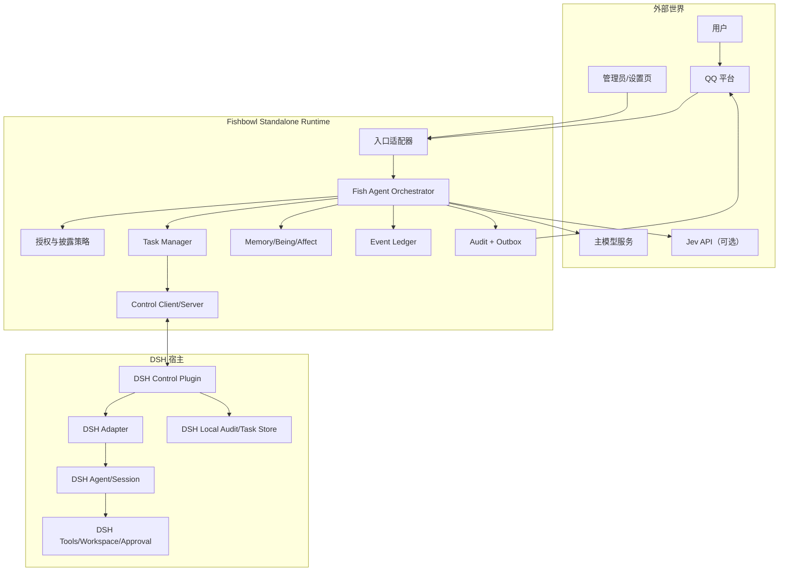

Fish 与 DSH 之间只暴露任务控制面，不暴露 `ctx`、私有文件、内部事件名称或具体 Agent 对象。插件是唯一了解 DSH 版本差异的组件。

## 3. 分层与模块划分

### 3.1 Fishbowl Runtime 模块

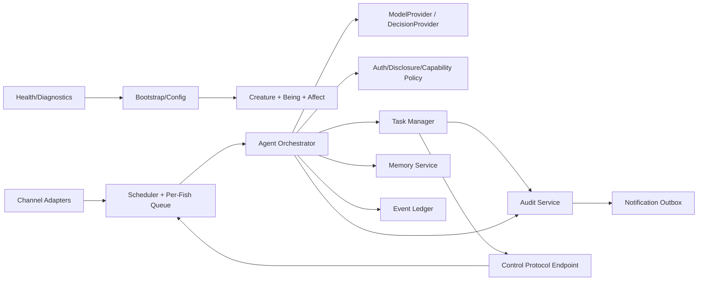

| 模块 | 责任 | 依赖边界 |
|---|---|---|
| Bootstrap/Config | 启动、关闭、配置加载、迁移、实例锁 | 不包含业务决策 |
| Channel Adapter | QQ/CLI/HTTP 等入口，统一身份和回复目标 | 不直接写账本 |
| Creature/Being/Affect | 鱼身份、情绪、人格与运行状态 | 不感知 DSH 私有 API |
| Agent Orchestrator | 上下文组装、主模型调用、能力选择、回合终止 | 不直接执行 DSH 工具 |
| ModelProvider | 主模型抽象、流式/取消/错误 | 只返回模型结果，不写业务状态 |
| DecisionProvider | Jev 等固定答案决策 | 不能越权或生成用户文本 |
| Policy | principal、鱼、能力、项目、披露和风险规则 | 程序硬规则优先于模型建议 |
| Task Manager | taskId、trace、提交、查询、取消、needs_input 续接 | 不解释 DSH 内部过程 |
| Queue/Scheduler | 同鱼串行、优先级、防饥饿、不同鱼并行 | 结果事件不可永久饿死 |
| Memory | 记忆写入、检索、来源和披露级别 | 不读取其他鱼存储 |
| Event Ledger | Fish 状态事实源、追加写入和重放 | Runtime 唯一写入入口 |
| Audit | 结构化审计和脱敏 | 不保存秘密或全量 DSH 中间日志 |
| Outbox | QQ/控制消息可靠发送和去重 | 发送状态独立于任务终态 |
| Control Endpoint | DSH Plugin 握手、消息解析、连接租约 | 不直接调用领域对象内部方法 |
| Health/Diagnostics | 连接、存储、队列、绑定和 unknown 诊断 | 不以在线替代任务完成 |

### 3.2 DSH Control Plugin 模块

| 模块 | 责任 |
|---|---|
| Connection Manager | 主动 WebSocket、认证、握手、重连、旧连接隔离 |
| Capability Registry | 报告插件版本、DSH 版本适配、能力、Schema、权限和限制 |
| Binding/Project Resolver | 校验 binding/project/principal，映射授权工作区和 session |
| Task Store | 请求摘要、状态、messageId、turn、结果和 outbox 持久化 |
| Dispatcher | 每 session 独占执行槽，任务排队和人工会话检测 |
| DSH Adapter | 将通用任务映射到 Agent/Session，订阅 claimed/session event |
| Result Extractor | 从关联回合最后合法结果提取结构化业务结果 |
| Cancellation Controller | 精确取消当前任务或安全移除待处理 inbox |
| Reconciler | 重启后核对 inbox/session/turn/result 证据 |
| Plugin Audit | 记录 DSH 内部执行和控制边界，不回传中间过程 |

## 4. 运行时数据流

### 4.1 普通 Fish 消息

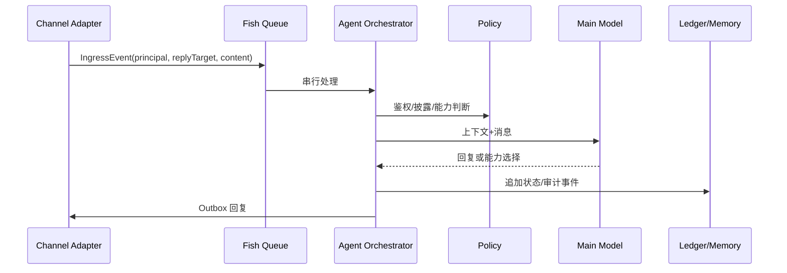

### 4.2 DSH 任务提交

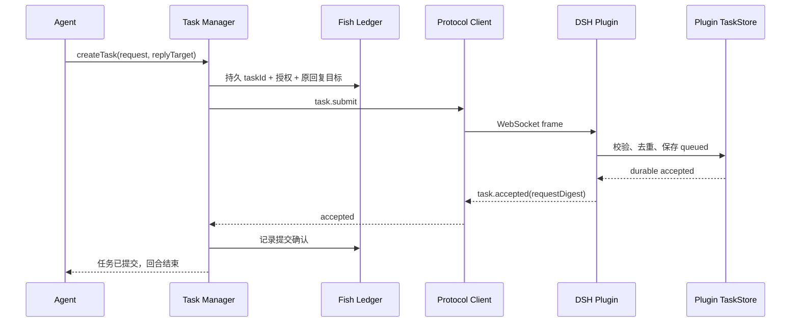

Fish 不等待 DSH 完成才能处理下一条用户消息。`task.accepted` 只证明插件持久接收，不证明 DSH 已开始或将成功。

### 4.3 DSH 内部执行与最终结果

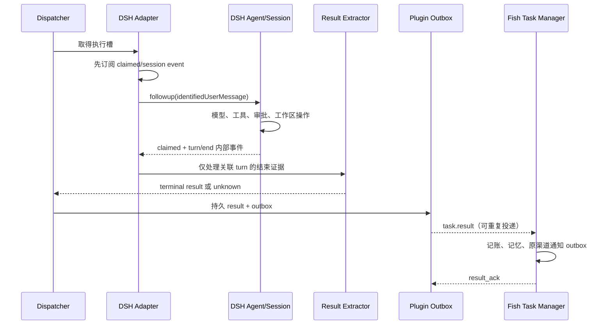

DSH 的 assistant 中间消息、工具调用和思考只在插件内部使用，Fish 不接收。`whenIdle()` 不能作为单任务完成信号；必须使用 messageId→claimed→turn→turn/end 的关联。

## 5. 任务协议实现设计

### 5.1 信封和连接

连接建立：DSH Plugin 主动连接 Fish Runtime。推荐本机 loopback WebSocket，远程使用 WSS；两者均须认证。握手为 `hello → welcome → ready`，协商精确协议版本、connectionId、bindingId、能力和限制。单个 binding 只保留一个有效连接；旧连接消息失效。

通用信封字段：`version/type/messageId/replyTo/connectionId/bindingId/taskId/traceId/sentAt/body`。`taskId` 是业务去重键，`messageId` 是传输消息键。未知类型、未知字段、重复 JSON 键、超限帧和非法路径拒绝。

### 5.2 Submit 和幂等

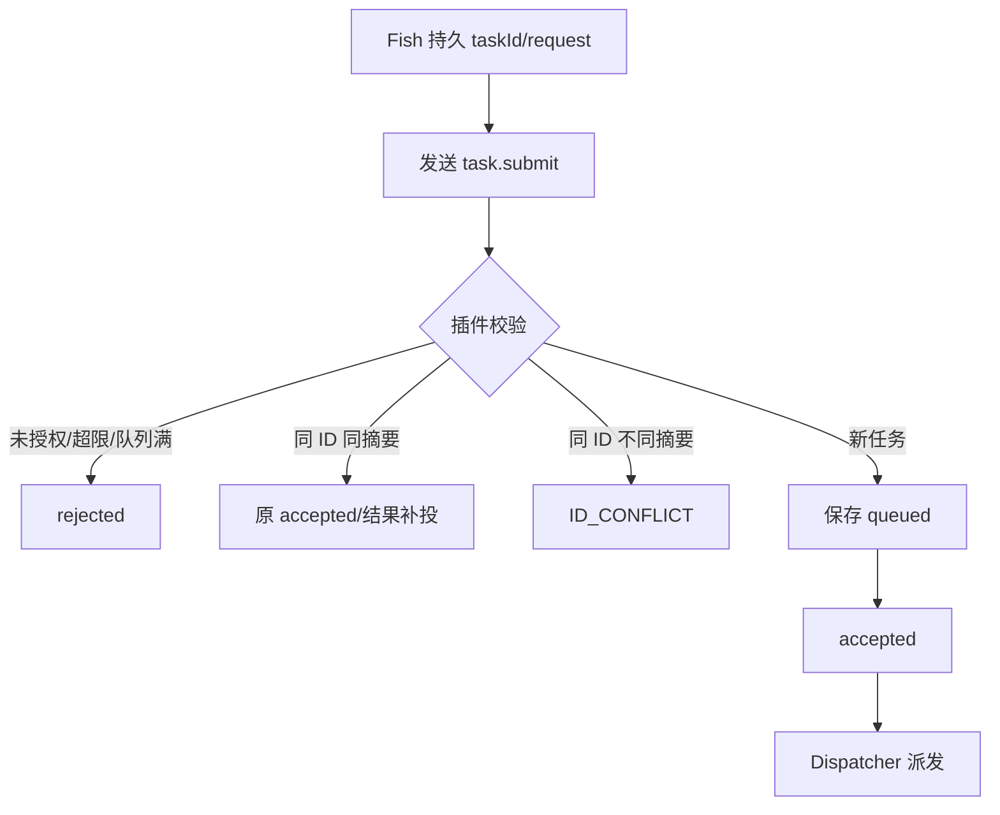

请求采用固定 Schema：`projectId/principalId/objective/constraints/acceptance/continuation`。项目授权不由 objective 中的路径决定。规范化请求使用固定字段顺序和 UTF-8 SHA-256，插件重新计算摘要，不信任调用者提交的 hash。

### 5.3 结果和 needs_input

结果包含 `resultId/status/summary/effects/artifacts/tests/error/questions`。业务状态固定为 `succeeded/failed/cancelled/needs_input`。代码任务必须报告修改文件、测试是否运行及结果；未运行测试明确为 `not_run`。结果不可被迟到的消息覆盖。

`needs_input` 的转换：

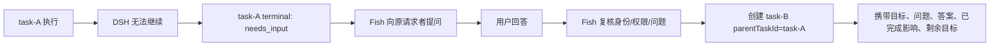

插件拒绝无法核对父任务、问题或影响的续接请求。task-A 不重新打开，task-B 不得假定副作用可回滚或重复执行。

## 6. 插件状态机和并发控制

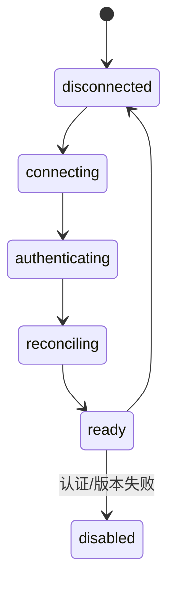

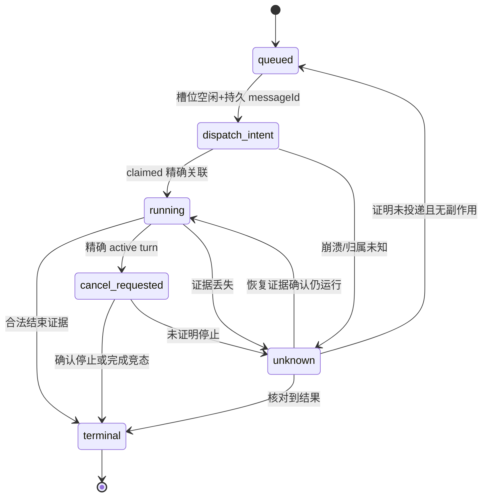

关键顺序：

1. Fish 先保存 taskId、权限、项目和回复目标。
2. 插件保存请求和 queued 后发送 accepted。
3. Dispatcher 保存 dispatch_intent 和唯一 messageId。
4. **在 followup 之前**注册 claimed/session event 监听，处理同步 claimed。
5. 调用 `agent.followup`；void 返回不作为接收或完成确认。
6. 只消费匹配的 messageId/turn；中间 assistant 消息不结算。
7. 关联 turn/end 和合法结果，保存 terminal/result/outbox 后释放槽位。

同一 DSH session 只有一个执行槽。人工回合存在时保留远程任务 queued；无法检测人工插入或归属时进入 unknown，冻结该绑定的新派发。运行中取消必须确认目标 active turn，不能无差别调用整个 Agent 的 cancel。

## 7. Fish 队列、调度和社交

每条鱼有独立队列和串行回合；不同鱼可并行。用户消息优先于鱼间消息，DSH result 事件不能被无限推迟。建议采用优先级队列加结果年龄提升（aging）：用户消息初始高优先级，鱼间消息较低，超过结果最大等待窗口后提升结果优先级。具体窗口属于实现参数，需压测验证。

鱼间交流服务负责可见名单、双方同意、轮次、每日次数/消息量、Token 预算、旁观和插话。它只通过 Fish Runtime 发送内部事件，不经过 DSH；双方各自记忆写入自己的交流副本。对方不可见的私密记忆永不自动进入交流上下文。

## 8. 记忆和事件账本

### 8.1 写入原则

Runtime 是唯一业务写入者。所有状态变化先产生追加事件，再由投影构建当前状态；外部回调只入队，不直接并发修改记忆或账本。事件包含 schemaVersion、eventId、traceId、actor、source、payloadDigest 和时间。

### 8.2 来源标记

DSH 结果记忆至少标记：`source=DSH`、`taskId`、`reportedStatus`、`verification=not_independently_verified`。Fish 不把 DSH 报告写成 Fish 亲自修改或验证。QQ 原文、用户回答和鱼间交流分别保存来源和披露级别。

### 8.3 重放和迁移

账本追加记录不可覆盖；尾部半写入在恢复时隔离。投影可重建，事件格式带版本。未来 Rust 实现只需消费相同版本事件并通过行为测试，不依赖 JavaScript 类序列化。

## 9. 授权、安全和隐私设计

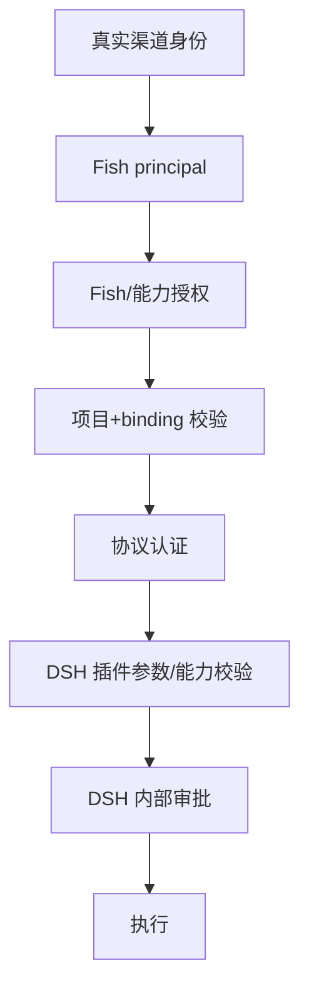

授权检查必须同时覆盖真实 principal、fishId、能力、projectId、bindingId 和配置白名单。Jev 风险判断只能辅助分流；无论 Jev 结果如何，程序硬规则都必须执行。内部审批失败返回明确错误及已完成影响，不转化为 Fish 侧无限问答。

本机连接限制 loopback/IPC，远程连接使用 WSS、证书校验、轮换和撤销。凭据放在受限配置或系统密钥存储，不放 URL、日志、模型上下文或任务 objective。产物引用只允许授权项目内相对路径，拒绝绝对路径和 `..`。

## 10. 持久化、Outbox 和恢复

### 10.1 Fish 端

Fish 侧将任务边界、回复目标、授权决定、提交确认、结果入站事实、记忆事件和通知 outbox 写入可恢复存储。DSH result_ack 只在结果事实和待办已保存后发送。QQ delivered 是独立状态，不能与 result_ack 混为一谈。

### 10.2 插件端

插件保存 requestDigest、admission、messageId、turn、resultId、outbox 和本地 DSH 关联。结果发送失败只保持 outbox pending，不改变业务终态。重启后先恢复账本、核对 session/inbox/turn，再开放新任务。

### 10.3 崩溃窗口

| 窗口 | 恢复策略 |
|---|---|
| queued 前 | 不发送 accepted；可信账本为空才可 not_found |
| accepted 后、dispatch 前 | 原 taskId 返回原记录，不重复入队 |
| dispatch_intent 后、claimed 前 | 核对 inbox/session；不能确定则 unknown |
| running 映射后 | 核对 turn/end；不创建新 followup |
| terminal 后、结果 ack 前 | 补投相同 resultId |
| Fish 已写结果、ack 丢失 | Fish 去重后重新 ack |
| QQ 发送确认丢失 | 通知 outbox 标记可能重复，按平台能力核对 |

无法证明未投递、无副作用时，unknown 冻结绑定并等待管理员或 DSH 证据。不能通过心跳、进程存活、idle 或“查不到最新消息”推断成功/失败。

## 11. 审计和可观测性

Fish 和 DSH 各自维护追加审计。Fish 记录入口、身份、授权、模型/工具编排、DSH 边界、任务状态、结果和通知；DSH 记录其内部 Agent、工具、审批、工作区和结果。公共字段为 eventId、traceId、parentId、taskId、bindingId、component、version、actor、target、status、error、duration、retry。

运维面板必须区分：

```text
连接状态 != 任务接收状态 != 执行知识状态 != 业务终态 != QQ 通知状态
```

健康检查输出至少包括 Runtime、存储、队列、DSH 连接、binding、unknown 任务、outbox 堆积和审计写入。指标和日志不包含模型密钥、Cookie、完整私聊或 DSH 内部思考。

## 12. 部署拓扑

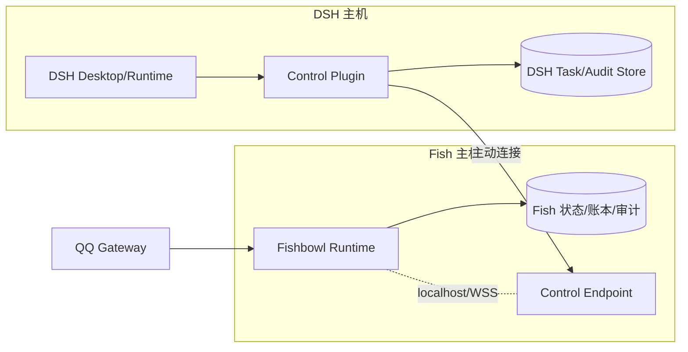

同机同用户可使用 loopback；同机不同用户需要明确系统权限、凭据隔离和工作区映射；远程部署必须 WSS 和认证，禁止默认公开高权限管理端口。首期不因每个 task 新建 DSH session，复用管理员绑定会话。

## 13. 技术实现路线

当前 Fish 主体使用 TypeScript/Node.js，新增核心代码统一 TypeScript，现有 JS 按需迁移。推荐目录按领域和端口组织：

```text
packages/
  runtime/          启动、生命周期、消息循环
  agent/            Fish Agent 编排
  model/            ModelProvider
  decision/         DecisionProvider（含可选 Jev）
  task/             任务边界、协议客户端、恢复
  policy/            授权、披露、风险
  memory/            记忆端口和投影
  ledger/            追加事件、重放、迁移
  channels/          QQ 等适配器
  social/            鱼间交流、预算、可见名单
  audit/             审计和脱敏
  adapter-dsh/       Fish 侧 DSH 能力适配
  protocol/          语言无关 Schema、编码、校验
```

DSH Plugin 继续使用 DSH 支持的 JS/TS 环境；所有 DSH 私有适配封装在插件。未来 Rust 迁移时优先替换无状态 protocol、ledger、task 和 provider 端口，再逐步替换 Runtime；通过版本化事件、协议测试和行为测试保持兼容，不提前维护双实现。

## 14. 测试策略

1. **协议单元测试**：Schema、未知字段、摘要、版本、路径和大小限制。
2. **状态机测试**：每个转换、重复事件、乱序、取消竞态和 unknown 恢复。
3. **故障注入**：每个持久点前后崩溃、accepted/result 丢失、旧连接、存储尾部损坏。
4. **DSH 适配隔离测试**：真实 rc.2 探针能力、同步 claimed、turn 关联和结果校验。
5. **桌面集成测试**：rc.5 插件激活、session 排他、人工输入、审批、运行取消和重启恢复。
6. **安全测试**：principal/project/binding 越权、凭据泄漏、路径穿越、重放和旧连接。
7. **渠道测试**：QQ 重复事件、限流、离线、发送确认丢失和原目标不串线。
8. **Jev 评估**：中文意图、路由、风险阈值、概率校准、不可用降级和成本。
9. **行为兼容测试**：未来 Rust 版本消费相同事件和协议向量，得到相同状态结果。

## 15. 分阶段交付

| 阶段 | 产物 | 进入条件 |
|---|---|---|
| 0 设计与证据 | SRS、总体设计、协议/状态机评审 | 用户确认设计边界 |
| 1 协议核心 | 语言无关 Schema、校验、TaskStore、状态机测试 | 故障转换测试通过 |
| 2 Fish Runtime 基础 | Runtime、队列、账本、审计、ModelProvider 端口 | 独立运行和重放通过 |
| 3 DSH Plugin 隔离适配 | 连接、能力发现、项目绑定、DSH 事件映射 | rc.5 桌面能力验证通过 |
| 4 最小闭环 | submit/accepted/result/query/cancel/needs_input | 首期验收矩阵通过 |
| 5 QQ 组合 | 原请求者通知、outbox、记忆和审计 | 渠道恢复测试通过 |
| 6 社交与设置 | 可见名单、鱼间多轮、预算、管理员设置 | 独立队列和披露测试通过 |
| 7 Jev 可选接入 | DecisionProvider、评估和降级 | 评估达到约定阈值 |
| 8 后续扩展 | MCP Gateway、更多 DSH 控制域、Rust 模块迁移 | 单独立项和兼容评审 |

## 16. 主要风险和决策门槛

| 风险 | 影响 | 门槛/应对 |
|---|---|---|
| DSH 桌面插件无法可靠排他 | 任务结果可能串线 | 无可靠机制则不宣称生产就绪 |
| 运行中 cancel 无同步保证 | 可能误取消人工任务 | 限制为安全排队取消或等待上游能力 |
| 结构化结果不稳定 | 无法判断业务成功 | 严格解析，非法即 RESULT_INVALID/unknown |
| 跨存储非原子 | 可能重复或未知副作用 | taskId 去重、核对、禁止盲重跑 |
| QQ 无恰好一次发送 | 用户可能收到重复通知 | outbox 去重并明确至少一次 |
| Jev 早期服务/中文效果不明 | 路由误判 | 可关闭、阈值、主模型/人工降级 |
| DSH API 版本变化 | 适配成本 | 版本能力发现和插件隔离 |

## 17. 文档和变更管理

SRS 是需求基线；总体设计解释模块和交互；task-protocol-design.md 是协议草案；dsh-control-state-machine.md 是插件本地状态草案；dsh-task-validation.md 只证明已实际验证的范围。任何改变以下边界的需求必须同时更新这些文档和 conversation-log：Fish 是否接收 DSH 中间过程、任务 unknown 语义、needs_input 是否新建任务、DSH session 所有权、Runtime 唯一写入者和 Fish/DSH Agent 独立性。
