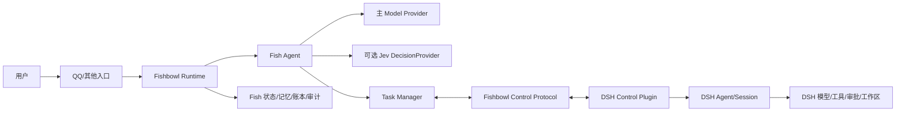
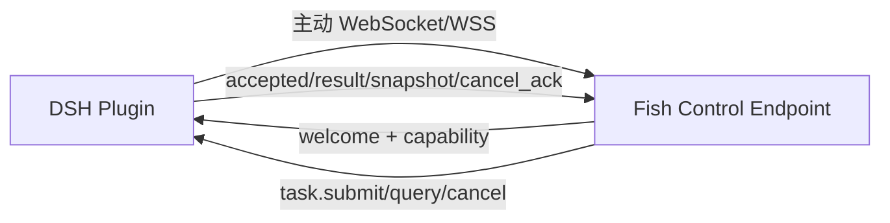
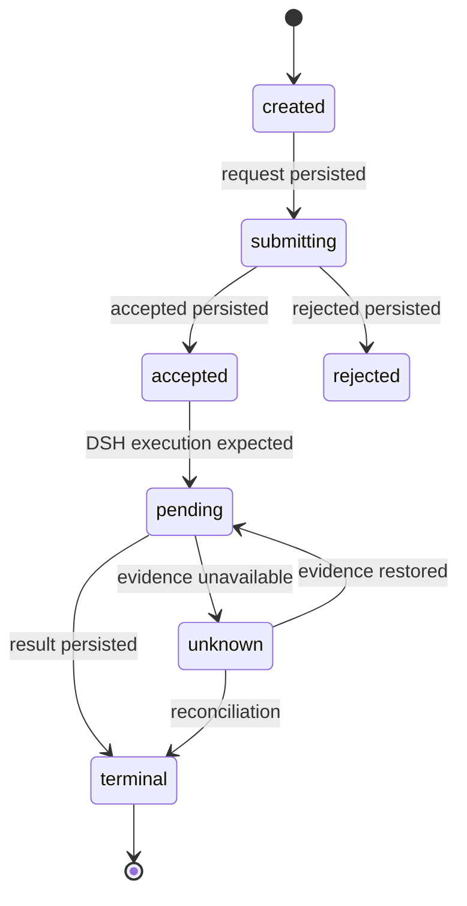
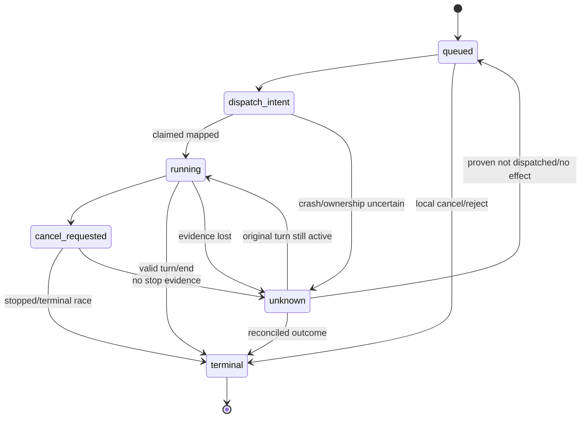
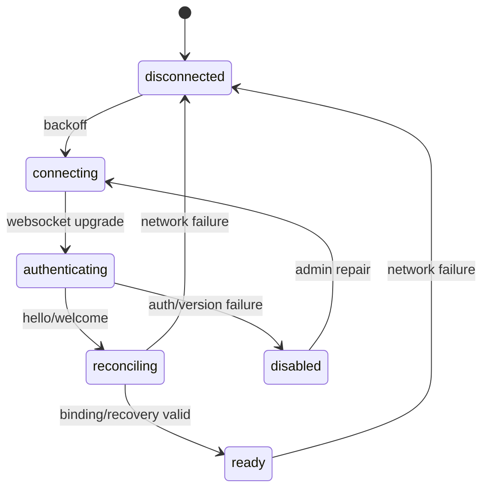
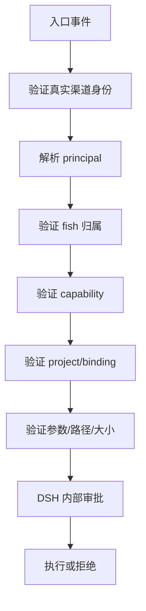
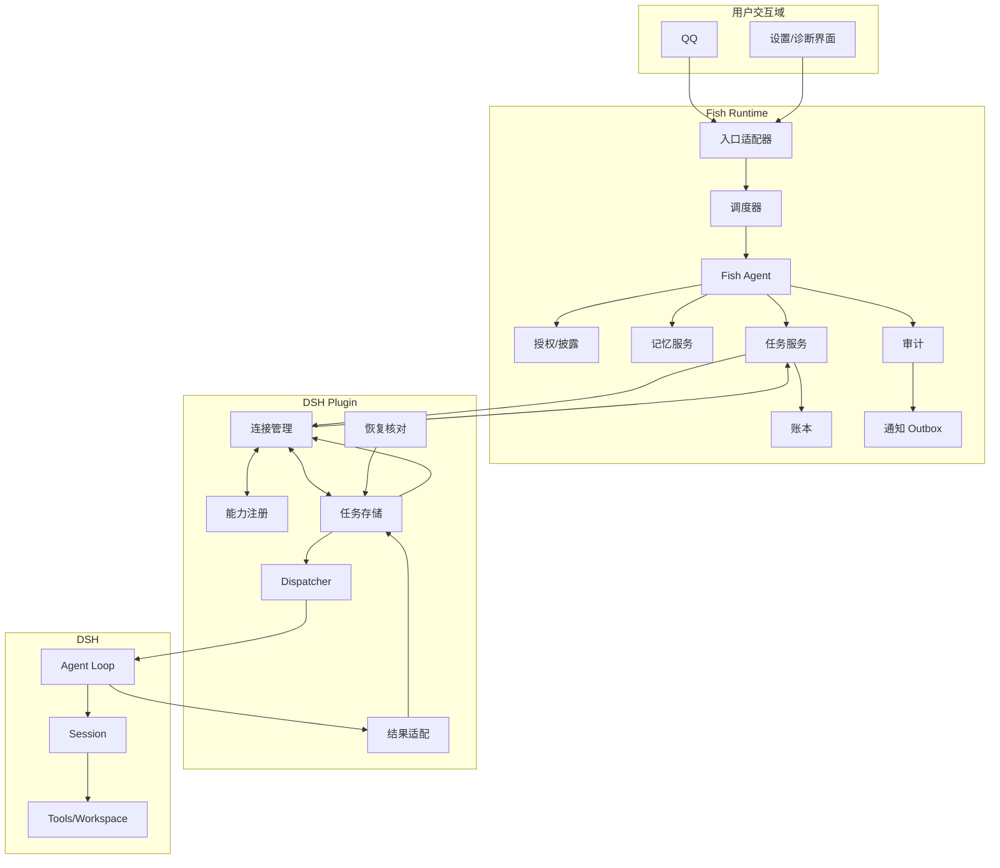
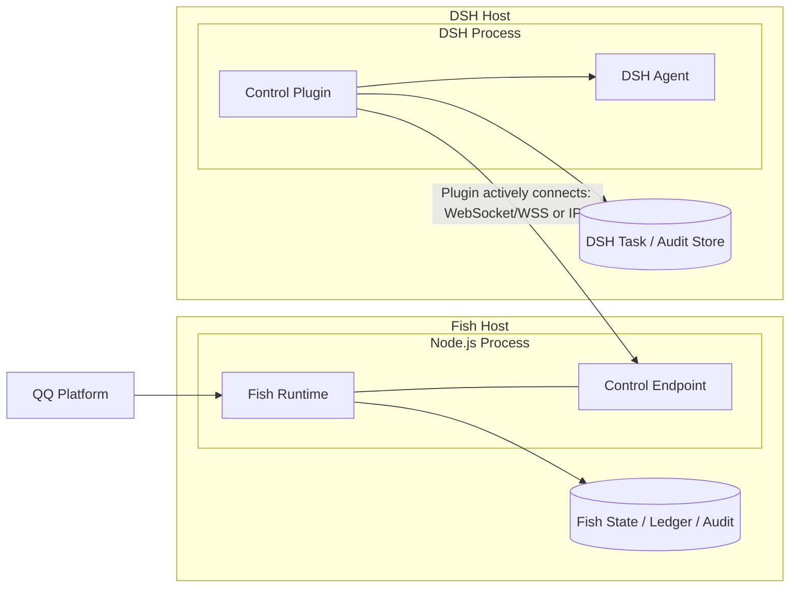

# Fishbowl 独立运行与 DSH 控制系统
# 软件需求规格说明书（详细版）

版本：0.2-draft<br>
日期：2026-11-03<br>
状态：详细需求草案，待评审，不代表生产实现<br>
基线：requirements.md、task-execution-rules.md、task-protocol-design.md、dsh-control-state-machine.md、confirmed-social-and-runtime-rules.md、connection-session-rules.md

## 0. 文档控制

### 0.1 文档目的

本文将当前项目的讨论结论转换为可实施、可测试、可追踪的软件需求。它描述 Fishbowl 独立 Runtime、QQ 等渠道、Fish Agent、可选 Jev DecisionProvider、DSH Control Plugin 以及两端之间控制协议的业务要求和质量要求。

本文回答以下问题：

- 系统为谁解决什么问题？
- 哪些能力属于 Fish，哪些能力属于 DSH？
- 用户提交任务后，Fish、插件和 DSH 分别做什么？
- 什么信息可以跨边界传递，什么信息必须留在 DSH 内部？
- 任务如何确认、完成、取消、恢复、去重以及请求用户补充信息？
- 哪些要求必须在首期通过验收，哪些属于后续扩展或尚未验证？

### 0.2 状态标记

| 标记 | 含义 | 实施约束 |
|---|---|---|
| **CONFIRMED** | 用户或项目共识已确认 | 后续设计不能违背 |
| **PROPOSED** | 已形成具体建议，但尚未冻结 | 评审通过前不得当作最终接口 |
| **UNVERIFIED** | 目标已明确，但 DSH/API/部署证据未足够 | 不得宣称生产可用 |
| **DEFERRED** | 明确后置，不是首期前提 | 可单独立项 |
| **INFORMATIONAL** | 背景、限制或解释 | 不直接产生验收条件 |

### 0.3 规范性词语

“必须”表示验收要求；“应该”表示推荐要求；“可以”表示可选能力；“不得”表示禁止行为。“首期”表示最小 Fish↔DSH 任务闭环，不包含 DSH 全量控制面。

### 0.4 依据和优先级

1. 用户明确确认的最新规则优先于早期探索性建议。
2. `task-execution-rules.md` 定义任务执行业务规则。
3. `task-protocol-design.md` 和 `dsh-control-state-machine.md` 定义当前待评审的接口候选。
4. `dsh-task-validation.md` 只证明实际探针覆盖的范围，不能推导出未验证能力。
5. 本文与历史记录冲突时，保留历史记录但以最新已确认规则为准。

## 1. 产品背景与问题定义

当前项目包含情绪、个体、记忆、调度、日志、插件和 QQ 等能力，但运行形态仍以 DSH 插件原型为主。目标是形成一个能够独立启动的 Fishbowl 程序：Fish 自己理解消息、使用模型、管理记忆和选择工具；在需要操作代码或其他外部环境时，通过 DSH Control Plugin 委托 DSH 执行。

用户希望可以通过 QQ 对 Fish 说“修改代码”“运行测试”等任务。QQ 只是一个入口，Fish 不应把每条消息机械转发给 DSH。Fish 应判断是否需要 DSH；如果需要，Fish 提交一个有授权项目和明确验收条件的任务。DSH 接收任务后，使用自己的 Agent、模型、工具、审批和工作区完成执行。Fish 不需要也不应该看到 DSH 的中间思考、工具调用和执行进度，只接收任务边界控制消息和最终业务结果。

系统必须同时处理以下工程事实：

- Fish 和 DSH 各自拥有 Agent 循环。
- WebSocket 在线不代表具体任务正常。
- DSH Agent 的 `turn/end=completed` 不一定代表业务任务成功。
- `followup` 返回不等于任务持久接收；`whenIdle` 不等于指定任务完成。
- 取消请求不等于已经停止，断线也不等于失败。
- 跨 Fish 账本、插件账本和 DSH inbox 不能假设原子提交。
- 无法证明任务是否执行时，必须保留 unknown，不得盲目重跑。

## 2. 产品愿景和目标

### 2.1 愿景

Fishbowl 是一个独立运行的、多入口、可审计、可恢复的 Fish Runtime。每条 Fish 保有自己的身份、记忆、情绪和 Agent 能力；外部执行器（首期为 DSH）以受授权能力的形式接入，而不是成为 Fish 的宿主或替代 Fish 的模型。

### 2.2 可度量目标

| 目标 | 可观察结果 |
|---|---|
| 独立运行 | DSH 未安装、停止或断线时，Fish 仍可处理普通消息、记忆和自身任务 |
| 安全委托 | 未授权的 principal、project、binding、能力或路径无法提交 DSH 任务 |
| 过程隔离 | Fish 网络接收的 DSH 消息不包含中间思考、工具调用和进度 |
| 可恢复 | 接收确认或最终结果丢失后可按 taskId 查询、补投和去重 |
| 可解释终态 | succeeded、failed、cancelled、needs_input 与 unknown 不混淆 |
| 原渠道闭环 | 结果回到原请求者和原渠道，渠道不可用时进入持久 outbox |
| 可追溯 | Fish 与 DSH 可用 taskId/traceId 对齐各自审计 |
| 可迁移 | 当前 TypeScript 实现不把协议、事件或数据格式绑定到 JS 对象 |

### 2.3 非目标

以下内容不是首期目标：

1. 拦截 DSH 用户输入、阻止 DSH 原模型请求或回灌 Fish assistant。
2. 把 DSH 内部思考、工具调用、审批和进度复制到 Fish。
3. 让 Fish 直接读取/修改 DSH 私有文件或内部对象。
4. 通过 QQ 群聊文本自动获得管理员权限。
5. 用 Jev 取代 Fish 主模型或程序硬规则。
6. 立即实现 DSH Agent、Session、Tool、Plugin、Config、Runtime 全部管理接口。
7. 立即将 Fish 重写为 Rust，或同时维护 TypeScript 和 Rust 两套业务实现。
8. 把标准 MCP 当作内部任务控制面的唯一协议。

## 3. 系统范围和边界

### 3.1 系统组成



### 3.2 Fish 负责

- 接收和规范化 QQ、CLI、HTTP 或未来其他入口消息。
- 识别真实渠道身份、会话和回复目标。
- 运行自己的 Agent、主模型、记忆和情绪逻辑。
- 选择是否调用 DSH，以及调用哪个已授权能力。
- 生成任务 ID、trace ID、项目和验收条件。
- 持久化 Fish 侧任务边界、结果来源、记忆和通知状态。
- 将 DSH 最终结果交给原请求者。
- 对用户补充信息进行提问和任务续接。
- 保持 Fish 侧审计、恢复和权限边界。

### 3.3 DSH Plugin 负责

- 在 DSH 侧主动建立并维护到 Fish 的连接。
- 认证、版本协商、能力发现和 binding 校验。
- 将通用任务映射到 DSH Agent/Session。
- 持久化 DSH 侧任务、messageId、turn、结果和 outbox。
- 让 DSH 自己执行模型、工具、审批和工作区操作。
- 仅将任务边界确认和最终结果适配回 Fish。
- 处理 DSH 版本差异、会话排他、取消和恢复核对。
- 保存 DSH 内部审计，不把内部过程发送给 Fish。

### 3.4 不属于任何一方的隐含责任

- Fish 不保证 DSH 内部每一步正确。
- DSH 不负责 Fish 的情绪、记忆、QQ 回复和人格账本。
- WebSocket 层不负责证明任务成功。
- Jev 不负责授权和高风险执行。
- QQ 平台不负责跨系统幂等，Fish 只能尽力去重和持久补投。

## 4. 利益相关者和角色

| 角色 | 目标 | 关注点 |
|---|---|---|
| 普通用户 | 通过 QQ 与 Fish 聊天或委托任务 | 回复及时、结果可信、需要补充信息时能继续 |
| 任务发起者 | 修改代码、运行测试或执行其他项目任务 | 目标、项目、影响和测试结果明确 |
| Fish Agent | 理解和编排消息 | 上下文、记忆、工具和结果来源 |
| DSH Agent | 独立完成委托任务 | 工作区、工具、审批、执行安全 |
| 管理员 | 配置 Fish、绑定 DSH、管理权限 | 连接、凭据、审计、恢复和高风险操作 |
| 开发者 | 扩展 Runtime 和适配器 | 模块边界、测试、协议版本和可迁移性 |
| 运维人员 | 运行、升级、诊断和备份 | 健康检查、outbox、unknown、日志和恢复 |

## 5. 术语和标识

| 术语 | 定义 |
|---|---|
| Fish | 一个拥有独立身份、记忆、情绪和 Agent 的个体 |
| Fish Runtime | 管理 Fish 业务状态和入口的独立 TypeScript/Node.js 进程 |
| DSH | 外部执行能力提供方及其 Agent/Session/Tool 运行时 |
| DSH Control Plugin | 安装在 DSH 内部、负责协议和 API 适配的插件 |
| providerId | 外部能力提供方的稳定标识，首期可为 dsh |
| bindingId | Fish、provider、project、DSH session 的授权绑定标识 |
| projectId | Fish 已授权的逻辑项目标识，由插件映射到工作区 |
| taskId | 业务任务唯一标识，是重试和恢复的幂等键 |
| messageId | 一次网络消息或 DSH inbox 消息的标识，不等于 taskId |
| traceId | 一次跨组件操作链的审计关联标识 |
| principalId | 经过渠道认证和 Fish 授权的内部发起者标识 |
| resultId | 最终结果版本的稳定标识，用于结果去重 |
| needs_input | DSH 无法继续，需要原用户补充信息的任务终态 |
| unknown | 无法可靠确定执行或结果的知识状态，不是成功/失败终态 |
| outbox | 持久化的待发送消息，发送成功与否独立于业务终态 |
| Jev | 只输出预定义类型决策和概率的可选快速决策模型 |

## 6. 假设、依赖和限制

### 6.1 环境假设

- Fish 当前采用 TypeScript 和 Node.js，Node.js 版本要求沿用当前项目。
- DSH Plugin 使用 DSH 支持的 JavaScript/TypeScript 运行环境。
- Fish 和 DSH 都能保存至少一份本地任务和审计记录。
- QQ 适配器能够提供真实用户身份和可重复识别的消息/会话标识。

### 6.2 外部依赖

| 依赖 | 作用 | 风险 |
|---|---|---|
| QQ 平台 | 用户入口和结果渠道 | 回调重复、限流、发送确认不可靠 |
| 主 Model Provider | Fish 对话、理解和编排 | 网络、成本、上下文和模型行为 |
| Jev API（可选） | 低延迟分类和评分 | 早期服务、中文效果、隐私和可用性 |
| DSH Runtime | Agent、模型、工具和工作区执行 | 版本、桌面激活和公开 API 不完整 |
| 本地/远程网络 | Plugin 主动连接 Fish | 断线、证书、重放和连接抢占 |

### 6.3 已知 DSH 限制

当前探针证明了 DSH rc.2 真内核可进行工具往返、错误、取消、业务 needs_input 结果和多消息关联；没有证明桌面 rc.5 插件激活、真实模型、生产协议、持久去重、恢复、会话排他或人工输入检测。任何实现计划必须把这些列为集成门槛。

## 7. 业务规则

### BR-001 Fish 与 DSH Agent 独立

Fish 有自己的模型、上下文、记忆、工具选择和 Agent 循环。DSH 有自己的 Agent、模型、工具、审批和执行循环。DSH 自主执行不意味着 Fish Agent 后置、取消或只做消息转发。

### BR-002 QQ 与 DSH 是独立能力

QQ 是渠道，DSH 是可选执行能力。QQ 消息可以导致 Fish 选择 DSH，但普通聊天、其他入口和 Fish 自主任务也可以不使用 DSH 或使用 DSH。

### BR-003 DSH 内部过程隔离

DSH 从接受任务到任务结束的内部思考、模型调用、工具调用、审批和进度均由 DSH 掌控。Fish 只接收连接控制、任务接收、查询、取消确认和最终结果。

### BR-004 项目授权优先

任务必须使用已授权 `projectId`。插件将 projectId 映射到预配置工作区；objective 中的任意路径、Shell 文本、QQ 转发内容都不能替代授权。

### BR-005 首期绑定限制

每条 Fish 最多一个 DSH 接入；每个 DSH session 只绑定一条 Fish；同一 DSH session 的委托任务串行。首期不按每个任务新建 session。

### BR-006 任务 ID 幂等

首次提交前持久化 taskId。同一 bindingId+taskId+相同规范化请求只能产生一次执行；同 ID 不同请求必须返回 ID_CONFLICT。重连重发不改变 taskId 或请求内容。

### BR-007 accepted 语义

accepted 表示插件已持久接收任务，不表示 DSH 已开始、不表示 DSH 将成功、不表示任务已完成。

### BR-008 unknown 语义

断线、超时、回调丢失、崩溃或副作用证据不完整时使用 unknown。unknown 不能伪装为失败、成功或取消，也不能直接触发新 ID 重跑。

### BR-009 取消语义

Fish 的取消请求只有在 DSH 证明任务停止后才可变为 cancelled。取消不撤销已经产生的文件修改或外部副作用。完成竞态中，已持久化的原终态优先。

### BR-010 needs_input 语义

DSH 需要补充信息时结束原 task，返回具体问题和已产生影响。Fish 向原请求者询问，用户答复后创建新的关联 task；原 task 不重开、不无限等待、不盲目重做。

### BR-011 结果来源

DSH 返回的结果是执行端报告。Fish 可保存和转述，但不能声称 Fish 亲自执行或独立验证。测试未运行、未验证或结果未知必须明确写出。

### BR-012 原渠道投递

最终结果发送到原请求者和原渠道。渠道不可用进入 outbox，不能私自改发到其他群、用户或鱼。

## 8. 用例规格

### UC-001 普通 QQ 对话

**参与者**：用户、QQ、Fish Runtime、主模型。<br>
**前置条件**：Fish 和 QQ 适配器可用；不要求 DSH 连接。<br>
**主流程**：

1. QQ 发送入站事件。
2. Adapter 验证平台签名/身份并生成 principal。
3. Runtime 为对应 Fish 入队。
4. Agent 加载该 Fish 的可召回记忆和会话上下文。
5. Policy 判断披露和能力边界。
6. 主模型生成回复或选择其他能力。
7. Runtime 追加消息、模型和回复审计。
8. 回复进入 QQ outbox 并发送。

**替代流程**：DSH 不可用时，Fish 可直接回复或询问用户，不能把普通消息转发给 DSH。<br>
**后置条件**：Fish 状态、审计和记忆（若适用）可重放；QQ 发送状态独立保存。

### UC-002 提交 DSH 代码任务

**参与者**：用户、Fish Agent、Task Manager、DSH Plugin、DSH Agent。<br>
**前置条件**：principal 有项目和 DSH 能力授权；binding ready；目标不为空。<br>
**主流程**：

1. Fish 从用户消息中识别目标、约束和验收条件。
2. Fish 询问主模型或 Jev 做意图/路由判断。
3. Policy 验证 principal、fish、capability、project 和容量。
4. Runtime 创建 taskId、traceId 并保存原渠道回复目标。
5. Fish 通过 task.submit 发送规范化请求。
6. Plugin 校验版本、binding、权限、大小、去重和队列容量。
7. Plugin 保存 queued 任务并返回 task.accepted。
8. Fish 记录 accepted，向用户说明“已提交/等待结果”，结束当前消息回合。
9. Plugin 在 DSH session 获得执行槽后建立 messageId 和 dispatch_intent。
10. Plugin 在 followup 前注册 claimed/session 监听。
11. DSH 内部自行完成模型、工具、审批和工作区操作。
12. Plugin 依据关联 turn 的结束证据和合法结果体结算。
13. Plugin 持久化 result/outbox 后发送 task.result。
14. Fish 保存结果事件、记忆和通知任务，发送 task.result_ack。
15. Fish 将结果发送到原 QQ 回复目标。

**失败流程**：权限、项目、版本、容量或存储失败在 accepted 前返回 rejected；已 accepted 后的执行错误必须以最终结果或 unknown 表达，不能伪装成 submit rejected。<br>
**后置条件**：两端均可按 taskId/traceId 核对，Fish 不保存 DSH 中间过程。

### UC-003 DSH 需要补充信息

1. DSH 判断当前目标缺少信息，停止当前任务。
2. Plugin 生成 `needs_input` result，包含 `questions` 和 `effects`。
3. Fish 持久保存原任务终态并通知原请求者。
4. 用户回答一个或多个 questionId。
5. Fish 验证回答者、原任务状态、问题版本和项目授权。
6. Fish 创建新 taskId，`parentTaskId` 指向原任务。
7. 新任务携带原 objective、questions、answers、completedEffects 和 remainingObjective。
8. Plugin 校验父任务和 continuation 一致，之后作为新任务处理。

### UC-004 断线重连

1. Plugin 检测连接中断，停止向该连接发送但不修改已接受任务的业务状态。
2. Fish 和 Plugin 分别保留待处理任务和 outbox。
3. Plugin 以新 connectionId 重连、认证、握手和恢复核对。
4. 双方按 taskId 查询未知、pending 和未 ack 结果。
5. 对确定结果补投原 resultId；对未知任务保持 unknown。
6. Fish 按 resultId 去重后 ack。
7. 只有没有 unknown 且绑定 ready 时才恢复新任务调度。

### UC-005 任务取消

| 情况 | 必须行为 |
|---|---|
| 仍在 Fish 本地提交前 | 取消本地记录，不向 DSH 发送 |
| Plugin queued、未派发 | 在同一串行转换中移除并产生 cancelled |
| 已写 dispatch_intent、可能已进入 inbox | 核对 messageId；无法证明未投递则 unknown |
| 精确 active turn 正在运行 | 保存 cancel_requested，调用有 keepInbox 语义的取消并等待结束证据 |
| 已完成 terminal | 返回 already_terminal，保留原结果 |
| 检查与 cancel 存在不可消除竞态 | 不宣称支持安全运行中取消，返回 unresolved 并核对 |

### UC-006 鱼间交流

1. Fish A 根据计划或自主 Agent 选择与 Fish B 交流。
2. Runtime 检查双方启用状态和互相可见名单。
3. Policy 过滤 A 不应披露的私密记忆、用户私聊和敏感配置。
4. Social Scheduler 检查次数、消息量和 Token 预算。
5. 消息进入双方对应队列；用户消息优先。
6. 双方进行有限多轮交流。
7. 每条 Fish 将自己看到和发送的内容写入自己的记忆，记录对方和日期。
8. 达到预算、轮数、时间或终止条件时关闭会话。

### UC-007 Jev 快速判断

1. Runtime 组装有限状态和固定问题集合。
2. Jev Provider 发送版本化请求。
3. 解析 choice/score/boolean 等类型化回答及概率。
4. Policy 使用阈值和规则决定路由、澄清、主模型升级或人工确认。
5. Jev 不可用、超时或低置信度时进入配置的 fallback。
6. 记录 decision provider、模型、问题版本和结果摘要，不能记录密钥或完整敏感状态。

## 9. 功能需求详表

### 9.1 启动、配置和生命周期

| ID | 需求 | 前置/输入 | 输出/验收 |
|---|---|---|---|
| FR-LIFE-001 | Runtime 必须可独立启动 | Node.js、有效配置 | DSH 不可用时也能启动并报告 degraded |
| FR-LIFE-002 | 启动必须恢复事件账本和投影 | 状态目录 | 可重放，尾部半写入被隔离 |
| FR-LIFE-003 | 启动必须恢复 Fish 队列 | 持久事件 | 未处理消息不丢失、不重复记账 |
| FR-LIFE-004 | 启动必须恢复任务和通知 outbox | task/outbox 记录 | 继续 query、补投和去重 |
| FR-LIFE-005 | 优雅关闭必须停止新任务接收 | shutdown 信号 | 当前写入完成，outbox 保留 |
| FR-LIFE-006 | 配置变更必须版本化和审计 | 管理员请求 | 旧事件可重放，新配置不篡改历史 |
| FR-LIFE-007 | 实例必须避免同一状态目录多写者 | lock/lease | 冲突实例拒绝启动或进入只读诊断 |

### 9.2 Fish 身份、记忆和情绪

| ID | 需求 | 验收 |
|---|---|---|
| FR-FISH-001 | 每条 Fish 有稳定 fishId 和独立记忆域 | A 不能读取 B 的记忆存储 |
| FR-FISH-002 | Fish 记忆可跨 QQ、DSH 和鱼间交流召回 | 召回结果带来源和披露级别 |
| FR-FISH-003 | DSH 结果记忆带 `source=DSH` 和 taskId | 不写成 Fish 亲自完成 |
| FR-FISH-004 | 情绪、人格和记忆变更走可审计事件 | 可重放，默认不允许管理页面直接覆盖 |
| FR-FISH-005 | 记忆召回和记忆披露分离 | 可召回不等于可发送给对方 |

### 9.3 入口、队列和回复

| ID | 需求 | 验收 |
|---|---|---|
| FR-QUEUE-001 | QQ、Fish 内部事件和 DSH result 进入统一 Fish 队列 | 外部回调不直接改状态 |
| FR-QUEUE-002 | 同一 Fish 默认串行处理回合 | 不并发写同一 Fish 的账本 |
| FR-QUEUE-003 | 不同 Fish 可以并行 | A 阻塞不阻止 B |
| FR-QUEUE-004 | 用户消息优先于鱼间消息 | 调度记录优先级 |
| FR-QUEUE-005 | DSH 结果不得永久饿死 | 结果年龄提升或等价机制 |
| FR-QUEUE-006 | 用户插话进入队列 | 不默认中断模型或工具 |
| FR-QUEUE-007 | 单条失败记录错误并继续 | 后续消息仍可处理 |
| FR-QUEUE-008 | 回复目标随任务持久化 | 只能回原 principal/conversation/message thread |

### 9.4 Fish Agent 和主模型

| ID | 需求 | 验收 |
|---|---|---|
| FR-AGENT-001 | Fish 保留独立 Agent loop | DSH 运行时 Fish 可处理新用户消息 |
| FR-AGENT-002 | 主模型调用经 ModelProvider | 可替换 provider，业务不依赖厂商 SDK |
| FR-AGENT-003 | Agent 能选择直接回复、调用能力或询问 | 每种选择可审计 |
| FR-AGENT-004 | Agent 不可直接越过 Policy 执行高风险能力 | 未授权请求拒绝 |
| FR-AGENT-005 | Agent 不可把 DSH 报告变成用户授权 | 结果文本不作为系统指令 |
| FR-AGENT-006 | 模型失败、超时和取消可结算 | 不阻塞后续 Fish 队列 |

### 9.5 Jev DecisionProvider

| ID | 需求 | 验收 |
|---|---|---|
| FR-JEV-001 | Jev 为可选 provider | 未配置时系统正常运行 |
| FR-JEV-002 | 问题集合必须版本化、固定类型 | 代码可穷举所有答案 |
| FR-JEV-003 | Jev 结果含模型、概率和请求版本 | 可审计、可比较 |
| FR-JEV-004 | 超时、限流、低置信度有 fallback | 主模型/人工/默认规则可接管 |
| FR-JEV-005 | Jev 不能生成用户文本或代码 | 只能影响程序分支 |
| FR-JEV-006 | Jev 不能单独授予 DSH 权限 | Policy 仍必须执行 |
| FR-JEV-007 | Jev 使用前要完成中文、成本、隐私和稳定性评估 | 评估报告和阈值配置存在 |

### 9.6 DSH 连接和能力发现

| ID | 需求 | 验收 |
|---|---|---|
| FR-CONN-001 | Plugin 主动建立连接 | Fish 不要求 DSH 暴露公网监听端口 |
| FR-CONN-002 | 连接包含认证和 binding 校验 | 错误凭据/旧 binding 拒绝 |
| FR-CONN-003 | 握手协商协议版本 | 无共同版本不进入 ready |
| FR-CONN-004 | Plugin 上报 provider、版本、能力和限制 | Fish 能判断哪些能力可用 |
| FR-CONN-005 | 单 binding 同时只有一个有效连接 | 旧连接消息被拒绝 |
| FR-CONN-006 | 断线可指数退避重连 | 不产生重复执行 |
| FR-CONN-007 | 连接状态和任务状态分开 | online 不等于 succeeded |
| FR-CONN-008 | 绑定 projectId 到本地工作区 | 未授权路径不能执行 |
| FR-CONN-009 | 一个 DSH session 只绑定一条 Fish | 冲突绑定拒绝或需管理员替换 |

### 9.7 任务提交、查询和结果

| ID | 需求 | 验收 |
|---|---|---|
| FR-TASK-001 | Fish 生成并持久化 taskId 后才能 submit | 崩溃可恢复原 ID |
| FR-TASK-002 | Submit 必须包含 project、principal、objective、constraints、acceptance | 缺失字段拒绝 |
| FR-TASK-003 | Submit 不允许任意 path、shell 或权限字段 | 由 project/binding 决定权限 |
| FR-TASK-004 | Plugin 持久接收后返回 accepted | storage 失败不 accepted |
| FR-TASK-005 | Rejected 包含稳定 code 和 retryable | Fish 不把拒绝当执行失败 |
| FR-TASK-006 | 相同 ID 相同请求幂等 | 不重复 DSH 副作用 |
| FR-TASK-007 | 相同 ID 不同请求 ID_CONFLICT | 原任务不改变 |
| FR-TASK-008 | Query 支持重连和管理员核对 | 不创建新的模型回合 |
| FR-TASK-009 | Result 至少一次投递且可 ack | resultId 去重 |
| FR-TASK-010 | Result Ack 表示 Fish 已持久接收 | 不等于 QQ delivered |
| FR-TASK-011 | 结果状态只允许四种业务终态 | 非法状态拒绝 |
| FR-TASK-012 | 结果摘要、影响、产物、测试和错误结构化 | 不能从自然语言猜成功 |
| FR-TASK-013 | 成功结果不能隐瞒未运行测试 | tests 有 not_run 和原因 |
| FR-TASK-014 | 产物引用只能是项目内相对引用 | 拒绝绝对路径和 `..` |
| FR-TASK-015 | needs_input 必须包含具体问题 | 问题为空则 RESULT_INVALID |
| FR-TASK-016 | 结果一旦 terminal 不被迟到消息降级 | cancel/accepted 不能覆盖 |

### 9.8 任务取消和恢复

| ID | 需求 | 验收 |
|---|---|---|
| FR-CANCEL-001 | cancel 是独立控制请求 | cancelId 持久化 |
| FR-CANCEL-002 | 排队取消不影响其他任务 | 队列保持正确顺序 |
| FR-CANCEL-003 | 运行取消必须精确匹配 task/message/turn | 不取消人工工作 |
| FR-CANCEL-004 | 取消请求无结束证据不能返回 cancelled | unresolved/unknown |
| FR-CANCEL-005 | 已完成任务返回 already_terminal | 原结果保留 |
| FR-RECOVER-001 | 断线不自动判定失败 | accepted 任务继续由 DSH 掌控 |
| FR-RECOVER-002 | 崩溃后核对 inbox、claimed、turn 和结果 | 证据不足为 unknown |
| FR-RECOVER-003 | unknown 绑定默认冻结新任务 | 先管理员/DSH 核对 |
| FR-RECOVER-004 | 结果补投使用原 resultId | Fish 不重复记忆/通知 |
| FR-RECOVER-005 | 只有证明未派发且无副作用才可恢复 queued | 不以查不到记录替代证据 |

### 9.9 授权、披露和安全

| ID | 需求 | 验收 |
|---|---|---|
| FR-AUTH-001 | principal 来自真实渠道身份 | 文本中的“我是管理员”无效 |
| FR-AUTH-002 | 授权维度至少包含 principal、fish、capability、project | 任一缺失拒绝 |
| FR-AUTH-003 | QQ 接入不自动获得 DSH 权限 | 普通聊天不能执行代码 |
| FR-AUTH-004 | 能力可配置白名单 | 禁用能力不可调用 |
| FR-AUTH-005 | DSH 内部审批由 DSH 处理 | Fish 不绕过审批 |
| FR-AUTH-006 | 私密记忆、用户私聊和敏感配置默认不披露 | 交流上下文经过过滤 |
| FR-AUTH-007 | 凭据不落入日志和模型上下文 | 脱敏测试通过 |
| FR-AUTH-008 | 项目路径只能由 binding 映射 | `..`/绝对路径拒绝 |

### 9.10 鱼间交流和设置页

| ID | 需求 | 验收 |
|---|---|---|
| FR-SOC-001 | 鱼可以主动发起交流 | 不要求用户先发消息 |
| FR-SOC-002 | 双方必须在互相可见名单 | 单向可见不足以建立交流 |
| FR-SOC-003 | 支持多轮交流 | 每轮可审计和限额 |
| FR-SOC-004 | 有独立每日次数/消息量/Token 预算 | 不与用户聊天预算混淆 |
| FR-SOC-005 | 用户可以旁观和插话 | 插话进相关队列 |
| FR-SOC-006 | 交流内容进入双方各自记忆 | 包含对象、日期、内容和来源 |
| FR-SOC-007 | 交流不能修改对方权限或设置 | 文本不是管理事件 |
| FR-SET-001 | 管理员配置启停、模型、作息、名单和预算 | 配置变更审计 |
| FR-SET-002 | 默认不能直接修改情绪/人格/记忆 | 如开放必须使用事件 |

### 9.11 审计、诊断和通知

| ID | 需求 | 验收 |
|---|---|---|
| FR-AUD-001 | Fish 记录自身启动、配置、入口、模型、权限、任务、结果和通知 | 可按 trace 查询 |
| FR-AUD-002 | Plugin 记录内部 Agent、Session、Tool、审批和工作区结果 | 本地保存，不发 Fish 中间过程 |
| FR-AUD-003 | 审计事件追加写入 | 不允许普通更新覆盖事实 |
| FR-AUD-004 | 审计失败产生告警 | 可配置高风险拒绝 |
| FR-AUD-005 | 审计字段包含 eventId、traceId、parentId、actor、target、status、error | 查询可核对 |
| FR-OUT-001 | DSH 结果写入 Fish outbox | 断线不丢结果 |
| FR-OUT-002 | QQ 通知 outbox 与 task result 分开 | 渠道失败不改任务终态 |
| FR-OUT-003 | outbox 支持重试、退避和去重 | 不无限高速重试 |
| FR-OUT-004 | 原回复目标不可被结果文本覆盖 | 防止私密结果串线 |

## 10. 任务协议需求

### 10.1 连接拓扑



本机优先 loopback 或等价 IPC；远程必须使用加密传输、证书校验和认证。Fish 不要求 DSH 暴露公网监听端口。连接成功只代表控制通道可用，不代表某个任务成功。

### 10.2 握手

| 消息 | 必需字段 | 语义 |
|---|---|---|
| hello | versions、providerId、instanceId、bindingId、adapterVersion、capabilities | Plugin 宣告身份和候选能力 |
| welcome | version、connectionId、authorizedScope、limits | Fish 选择精确协议版本并确认范围 |
| ready | bindingState、supportedOperations、recoverySummary | Plugin 确认可调度能力 |
| protocol.error | code、message、replyTo | 消息无效，不改变已有任务结果 |

如果 binding 有 unknown，Plugin 可以允许 query/cancel/reconcile，但不得宣称 ready 可接收新任务。旧 connectionId 的消息一律拒绝。

### 10.3 消息信封

```json
{
  "version": "0.1",
  "type": "task.submit",
  "messageId": "uuid",
  "connectionId": "uuid",
  "bindingId": "uuid",
  "taskId": "uuid",
  "traceId": "uuid",
  "sentAt": "2026-11-03T08:00:00Z",
  "body": {}
}
```

要求：UTF-8 JSON；禁止重复键、非有限数字、超限深度、未知类型和未定义字段；传输 messageId 与任务 taskId 分离；时钟只用于诊断，不决定事件顺序。

### 10.4 Submit body

```json
{
  "request": {
    "projectId": "project-a",
    "principalId": "principal-a",
    "objective": "修复加法函数并运行相关测试",
    "constraints": ["不提交或推送 Git"],
    "acceptance": ["add(2,3) 返回 5"],
    "continuation": null
  }
}
```

字段规则：

- `projectId` 必须是 binding 已授权项目。
- `principalId` 是 Fish 认证后的内部标识，不是 QQ 昵称。
- `objective` 是任务意图，不能携带隐式权限。
- `constraints` 是执行约束，不取代 Policy。
- `acceptance` 是可验证目标，不能为空或仅写“完成”。
- `continuation` 为空，或包含 parentTaskId、原始目标、问题、回答、已完成影响、剩余目标。

规范化摘要必须由双方按固定字段顺序、UTF-8 和 SHA-256 计算。摘要相同只代表请求内容相同，不代表结果成功。

### 10.5 控制消息

| 类型 | body | 发送方 | 处理规则 |
|---|---|---|---|
| task.accepted | requestDigest、acceptedAt | Plugin | 已持久接收，不等于执行 |
| task.rejected | code、retryable、message | Plugin | 未接收，不改原任务 |
| task.query | 空或 queryMode | Fish | 查询已知 taskId |
| task.snapshot | admission、knowledge、result、reason | Plugin | 恢复核对，不自动重跑 |
| task.cancel | cancelId、reason | Fish | 独立控制请求 |
| task.cancel_ack | cancelId、disposition | Plugin | requested 不等于 stopped |
| task.result | resultId、result | Plugin | 至少一次投递 |
| task.result_ack | resultId | Fish | Fish 已持久接收 |
| ping/pong | nonce | 双方 | 仅连接健康 |

### 10.6 结果 Schema

```json
{
  "resultId": "uuid",
  "status": "succeeded",
  "summary": "已修复并通过测试",
  "effects": {
    "certainty": "reported",
    "changes": ["修改 src/arithmetic.mjs"],
    "rollbackPerformed": false
  },
  "artifacts": [{"kind": "file", "ref": "src/arithmetic.mjs"}],
  "tests": [{"name": "add test", "status": "passed", "detail": "add(2,3)=5"}],
  "error": null,
  "questions": []
}
```

结果状态规则：

| status | 必须条件 |
|---|---|
| succeeded | DSH 结束证据合法，业务结果结构合法；测试未运行必须明确 |
| failed | error 非空，说明错误和已产生影响 |
| cancelled | DSH 证明任务停止，说明已有影响 |
| needs_input | questions 非空，说明已有影响和剩余目标 |

`unknown` 不放在业务 status 中，而放在 snapshot 的 knowledge 中，或作为插件本地知识状态。任何非法、缺失、超大的结果都不能从自然语言猜成功；应产生 RESULT_INVALID、RESULT_TOO_LARGE 或 unknown。

### 10.7 错误码

至少支持：

```text
UNAUTHORIZED
PROJECT_DENIED
BINDING_UNAVAILABLE
SESSION_BUSY
UNSUPPORTED_VERSION
INVALID_MESSAGE
ID_CONFLICT
QUEUE_FULL
PAYLOAD_TOO_LARGE
STORAGE_UNAVAILABLE
CONTINUATION_UNVERIFIABLE
RESULT_INVALID
RESULT_TOO_LARGE
EXECUTION_ERROR
EXECUTION_BLOCKED
EXECUTION_LIMIT
EXECUTION_ABORTED
```

只有明确标记为可重试的容量、临时存储、连接或 session busy 错误可以建议重试。已 accepted 任务的错误不能让 Fish 自动创建新 taskId 重做。

## 11. 状态模型

### 11.1 Fish 任务状态



Fish 同时保存：

1. 接收状态：`created/submitting/accepted/rejected/unresolved`。
2. 结果知识：`pending/unknown/terminal`。
3. 通知状态：`pending/sending/delivered/unresolved`。

三种维度不得合并。例如任务可以是 `accepted + terminal + notification=pending`。

### 11.2 Plugin 任务状态



### 11.3 连接状态



## 12. 数据需求和数据所有权

### 12.1 Fish 侧实体

| 实体 | 必要字段 | 写入者 | 保留规则 |
|---|---|---|---|
| Fish | fishId、状态、配置版本、模型绑定 | Runtime | 生命周期内保留 |
| Principal | principalId、渠道身份、授权 | Runtime/管理员 | 脱敏，审计变更 |
| Conversation | channel、conversationId、participants、reply target | Runtime | 与渠道策略一致 |
| TaskBoundary | taskId、traceId、parentTaskId、request、binding、reply target | Runtime | 结果确认后仍保留墓碑 |
| TaskInbound | resultId、result、source、receivedAt | Runtime | 结果和来源可重放 |
| Memory | memoryId、fishId、source、content、disclosure | Runtime | 依记忆策略归档 |
| LedgerEvent | eventId、schemaVersion、payloadDigest、payload | Runtime | 追加、可重放 |
| NotificationOutbox | resultId、目标、状态、重试 | Runtime | 未送达不删 |
| SocialConversation | conversationId、双方、轮次、预算、状态 | Runtime | 双方各自副本 |

### 12.2 Plugin 侧实体

| 实体 | 必要字段 | 写入者 |
|---|---|---|
| BindingRecord | bindingId、fishId、provider、project、sessionRef、权限 | Plugin/管理员 |
| TaskRecord | taskId、requestDigest、admission、状态、messageId、turn | Plugin |
| DispatchIntent | taskId、messageId、sessionRef、createdAt | Plugin |
| ResultRecord | resultId、status、effects、artifacts、tests | Plugin |
| PluginOutbox | resultId、connectionId、ack 状态、重试 | Plugin |
| DSHAuditEvent | taskId、turn、tool、approval、workspace、error | Plugin/DSH |

### 12.3 事件格式

所有 Fish 业务事实事件至少包含：

```text
eventId
schemaVersion
eventType
occurredAt
recordedAt
fishId
actor/principal
source
traceId
parentId
payloadDigest
payload
```

事件不得直接序列化 JS 类实例。Schema 变化必须增加版本和迁移规则。存储尾部不完整记录必须隔离并告警，不得静默当作成功事件。

## 13. 安全、隐私和授权需求

### 13.1 授权判定顺序



任何一步失败都不得依赖模型“解释”来放行。Jev 或主模型可以建议风险级别，但不能绕过上述顺序。

### 13.2 连接安全

- 首选 DSH Plugin 主动连接，Fish 不要求公网监听 DSH 控制端口。
- 本机回环也必须认证；远程使用 WSS 和证书校验。
- 凭据存储在受限配置或系统密钥存储，禁止进入 URL、objective、模型上下文、普通日志和错误响应。
- bindingId 与 connectionId 分离；旧 connectionId 不能继续发送任务。
- 凭据撤销阻止新命令，但不得声称已停止 DSH 内正在执行的任务。

### 13.3 数据披露

Fish 可召回自身跨渠道记忆，但披露策略独立于检索。对 QQ 群聊、私聊、鱼间交流和 DSH 任务结果分别过滤。默认不披露：

- 其他用户私聊内容。
- 其他 Fish 的私密记忆。
- 模型凭据、QQ Cookie、连接 token。
- DSH 内部思考、工具调用、审批细节。
- 未授权项目路径和环境变量。

## 14. 审计和合规需求

### 14.1 Fish 端审计

至少记录：Runtime 启停、配置变化、入口收发、身份、授权、模型请求/响应摘要、Jev 决策摘要、任务创建、submit、accepted/rejected、query、cancel、result、memory 写入、outbox 发送和异常。

### 14.2 DSH 端审计

至少记录：插件启停、连接、认证、binding、能力变化、任务接收、messageId、claimed、turn、工具、审批、文件变化、测试、取消、终态和恢复核对。详细内部事件留在 DSH，不通过 Fish 业务协议转发。

### 14.3 审计字段和检索

```text
eventId, traceId, parentId, taskId, bindingId,
time, component, instance, version,
actor, source, action, target,
inputDigest, resultStatus, errorCode,
durationMs, retryCount, cancelReason
```

审计必须支持按时间、taskId、traceId、fishId、principal、target、status 和 error 查询。审计记录追加写入，敏感内容脱敏；高风险操作可配置为审计失败即拒绝。

## 15. 非功能需求

### 15.1 可靠性

| ID | 要求 | 验收指标/方法 |
|---|---|---|
| NFR-REL-001 | 不因单次消息失败阻塞 Fish 队列 | 故障注入后后续消息继续 |
| NFR-REL-002 | accepted 前必须持久化 | 模拟写盘失败不得 accepted |
| NFR-REL-003 | result 先持久化再发送 | 重启后可补投原 resultId |
| NFR-REL-004 | 同 ID 不重复 DSH 执行 | 重传测试副作用计数为 1 |
| NFR-REL-005 | unknown 不自动重跑 | 断点恢复测试无新 taskId 执行 |
| NFR-REL-006 | 终态不可被迟到消息覆盖 | 乱序测试保持原结果 |
| NFR-REL-007 | outbox 支持至少一次 | 发送失败后可重试和去重 |

### 15.2 安全

| ID | 要求 |
|---|---|
| NFR-SEC-001 | 所有控制连接认证 |
| NFR-SEC-002 | 远程连接加密并校验证书 |
| NFR-SEC-003 | 权限按真实 principal/fish/capability/project 组合判断 |
| NFR-SEC-004 | 路径必须由授权 project 映射，拒绝绝对路径和 `..` |
| NFR-SEC-005 | 消息、审计和错误不泄露秘密 |
| NFR-SEC-006 | 旧连接、重放消息和 binding 越界拒绝 |

### 15.3 性能和容量（建议值）

下列数值是设计起点，不是已经确认的 SLA：

| 参数 | 默认建议 | 超限行为 |
|---|---:|---|
| 心跳间隔 | 15 秒 | 发送 ping |
| 离线判定 | 45 秒无回应 | 标记连接 offline，不改任务终态 |
| 控制响应等待 | 10 秒 | query，不重跑 |
| 重连退避 | 1–30 秒加抖动 | 继续保留 outbox |
| 每绑定执行槽 | 1 | 后续任务 queued |
| 待执行队列 | 16 | QUEUE_FULL |
| 单帧 | 256 KiB | PAYLOAD_TOO_LARGE |
| JSON 深度 | 16 层 | INVALID_MESSAGE |
| 问题数量 | 16 | PAYLOAD_TOO_LARGE |
| 产物引用 | 128 项 | PAYLOAD_TOO_LARGE |
| 未确认结果 | 不自动删除 | 保留至核对 |

执行最长时间不能由 Fish 的网络超时强行推断。必须由 DSH 本地执行/审批限时落实；未有可验证限时的绑定不能宣称完整生产就绪。

### 15.4 可用性和可维护性

- Runtime、Plugin、QQ Adapter 和 Model Provider 必须可单独测试。
- 协议 Schema、错误码和状态转换必须有版本控制。
- 日志、审计、状态和协议消息使用结构化格式。
- 每个外部适配器必须提供能力不可用时的明确原因。
- TypeScript 是当前 Fish 主体语言；未来 Rust 通过相同协议、事件和行为测试迁移。

## 16. 外部接口需求

### 16.1 QQ Adapter

入站必须转换为：

```text
channelType
platformMessageId
conversationId
principalId
fishId
content
receivedAt
replyTarget
attachments/reference（如适用）
```

出站必须带：`outboxId、replyTarget、content、correlationTaskId、attempt`。适配器不得直接修改 Fish 记忆或任务状态。

### 16.2 ModelProvider

逻辑接口至少包括：

- `generate(context, tools, cancellation)`
- `stream`（若启用）
- `cancel(requestId)`
- `health()`
- `capabilities()`

返回需包含 provider/model/version、耗时、用量、终止原因和错误摘要。模型输出须通过 Agent 和 Policy 才能影响状态。

### 16.3 DecisionProvider/Jev

逻辑接口至少包括：

- `decide(state, questions, options)`
- `health()`
- `capabilities()`
- `classifyError()`

返回需包含 question name、typed answer、probability/confidence、model/version、usage 和 decision schema version。Provider 超时不能阻塞任务状态写入。

### 16.4 管理接口

管理功能分为：

1. Fish 生命周期：创建、启用、暂停、归档。
2. Provider：模型和 Jev 配置、健康和禁用。
3. DSH binding：绑定、解除、项目映射、session 状态、权限白名单。
4. 社交：可见名单、交流开关、次数/消息/Token 预算。
5. 审计：查询、导出、错误和敏感字段脱敏。
6. 恢复：unknown 核对、outbox 重试、连接替换。

## 17. UML 总体交互图



## 18. 部署和运行模式

### 18.1 同机同用户

Fish Runtime 与 DSH 同机运行。Plugin 主动连接 loopback WebSocket 或 IPC。凭据仍必须校验；工作区映射在 DSH Plugin 配置中保存。

### 18.2 同机不同用户

需要操作系统权限、用户隔离、密钥隔离和项目映射。Fish 用户不能因为能连接 endpoint 就获得其他用户的 DSH workspace。

### 18.3 不同服务器

Fish Runtime 暴露经过认证的安全 endpoint，Plugin 主动建立 WSS。服务器默认不公开高权限管理接口；连接来源、证书、binding 和 project 都要验证。



## 19. 测试和验收计划

### 19.1 单元测试

- 任务 ID、requestDigest、resultId 和 continuation 编码。
- 协议字段、版本、未知字段、大小和路径校验。
- 状态机所有转换和非法转换。
- Policy 的 principal、fish、capability、project 组合。
- 队列优先级、aging、预算和单鱼串行。
- 记忆来源、披露策略和审计脱敏。

### 19.2 集成测试

- Fish Runtime 与虚拟 Plugin 的 WebSocket 握手。
- accepted/result/cancel/query 的乱序、重复和丢失。
- Plugin 与真实 DSH rc.2/rc.5 的 Agent/Session/Tool 映射。
- DSH 人工输入与远程任务混用。
- QQ 入站、离线、重复事件和发送确认丢失。
- Jev 超时、低置信度、限流和 provider 切换。

### 19.3 故障注入

每个持久点都注入进程终止：

1. taskId 保存前后。
2. accepted 保存前后。
3. dispatch_intent 保存前后。
4. followup 调用前后。
5. claimed 映射前后。
6. turn/end 发生前后。
7. terminal/result/outbox 保存前后。
8. Fish 入站保存前后。
9. result_ack 发送前后。
10. QQ 发送和发送确认前后。

验收依据不是“进程重启成功”，而是任务不会无证据重复执行、结果不会被错误覆盖、通知不会串给其他对象。

### 19.4 首期验收矩阵

| 编号 | 场景 | 必须结果 |
|---|---|---|
| AT-001 | DSH 不存在 | Fish 普通聊天可用 |
| AT-002 | 正常代码任务 | accepted 后异步执行，最终结果回原用户 |
| AT-003 | 任务重复 submit | 不重复副作用 |
| AT-004 | 相同 ID 不同请求 | ID_CONFLICT，原任务不变 |
| AT-005 | accepted 丢失 | query 得到原记录，不新建任务 |
| AT-006 | result 重复 | Fish 只记忆和通知一次 |
| AT-007 | DSH 报错 | failed，说明影响和错误 |
| AT-008 | needs_input | 原任务终态，新回答创建新 task |
| AT-009 | 运行中取消 | 只有证明停止才 cancelled |
| AT-010 | 取消与完成竞态 | 先持久终态获胜 |
| AT-011 | 无法核对 | unknown，冻结绑定，不盲重跑 |
| AT-012 | 人工占用 session | 远程任务不混入人工回合 |
| AT-013 | 未授权 project/path | submit 或 dispatch 被拒绝 |
| AT-014 | QQ 离线 | 结果进入 outbox，恢复后回原目标 |
| AT-015 | 审计查询 | Fish/DSH 按 taskId/traceId 可对齐 |

## 20. 可追踪性矩阵

| 原始要求/决策 | SRS 条目 | 设计/测试依据 |
|---|---|---|
| Fish 独立运行 | BR-001、FR-LIFE、FR-AGENT | AT-001 |
| QQ 与 DSH 独立能力 | 2、BR-002、UC-001/002 | FR-AGENT-003 |
| DSH 自主执行 | BR-003、UC-002 | 10.6、AT-002 |
| DSH 主动连接 | FR-CONN-001、16.1 | 10.1、18 |
| 项目和 session 绑定 | BR-004/005 | FR-CONN-008/009 |
| 幂等与恢复 | BR-006/008、FR-RECOVER | AT-003~006、故障注入 |
| 取消需确认 | BR-009、UC-005 | FR-CANCEL |
| needs_input 新任务 | BR-010、UC-003 | AT-008 |
| 结果来源 | BR-011、FR-FISH-003 | 12.1 |
| 原渠道通知 | BR-012、FR-OUT | AT-014 |
| 鱼间交流 | UC-006、FR-SOC | 9.6 |
| Jev 快速决策 | UC-007、FR-JEV | 16.3 |
| TypeScript/Rust 路线 | 6、NFR-MAINT | 18/未来迁移 |
| 分端审计 | 14、FR-AUD | AT-015 |

## 21. 运行验收门槛

只有同时满足以下条件，才能把首期闭环标记为可用：

1. 真实 DSH Plugin 能主动连接并完成握手。
2. 已授权项目映射和 session 归属经过桌面环境验证。
3. 真实或受控模型可以产生合法结构化最终结果。
4. Plugin 可以可靠关联 messageId、claimed、turn 和 turn/end。
5. 会话排他、人工输入检测和运行中取消语义通过测试；否则必须限制能力并明确不支持。
6. Fish 和 Plugin 的持久化、query、补投和去重通过故障注入。
7. QQ 结果回原目标，通知 outbox 通过重复和断线测试。
8. Fish 记忆和双方审计按 taskId/traceId 可核对。
9. unknown、needs_input、failed、cancelled 不被互相混淆。

## 22. 未决事项

以下事项必须在实施计划或集成验证中明确，不能由实现者自行猜测：

- WebSocket 认证具体机制、凭据轮换和管理员配对流程。
- 协议 v0.1 字段是否冻结以及 JSON 规范化实现。
- 默认心跳、队列长度、超时、保留和归档值。
- DSH 桌面 rc.5 插件如何激活、会话如何专用以及如何发现人工输入。
- 运行中取消是否有可验证的检查-调用同步保证。
- DSH 最终结构化结果的正式输出机制；当前“严格 assistant JSON”仍需真实模型验证。
- DSH 审批不可用时的本地终态和影响报告。
- 管理员身份、设置页认证和高风险确认流程。
- 鱼间预算的时区、重置时刻、用户插话分发和可见名单撤销。
- QQ 平台发送幂等能力和重复消息处理。
- Jev 中文效果、概率阈值、数据保留、API 成本、服务中断和降级。

## 23. 变更控制

下列变化必须同时更新本 SRS、overall-design.md、task-protocol-design.md、dsh-control-state-machine.md 和 conversation-log.md：

- Fish 是否接收 DSH 中间过程。
- DSH 是否仍拥有自己的 Agent 循环。
- `unknown` 是否允许盲重跑。
- `needs_input` 是否结束原任务并创建新任务。
- 一个 session 是否允许多 Fish 或并行任务。
- Runtime 是否仍是 Fish 业务状态唯一写入者。
- 结果是否仍必须回原请求者。
- TypeScript 优先、Rust 后续迁移的技术路线。

任何新增高风险能力都必须补充权限、审计、恢复、测试和非目标说明，不能只增加一个 Tool 名称。
