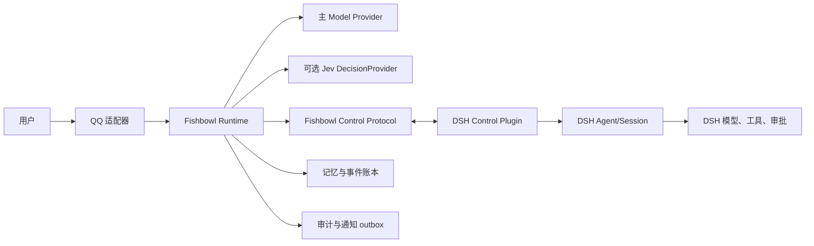
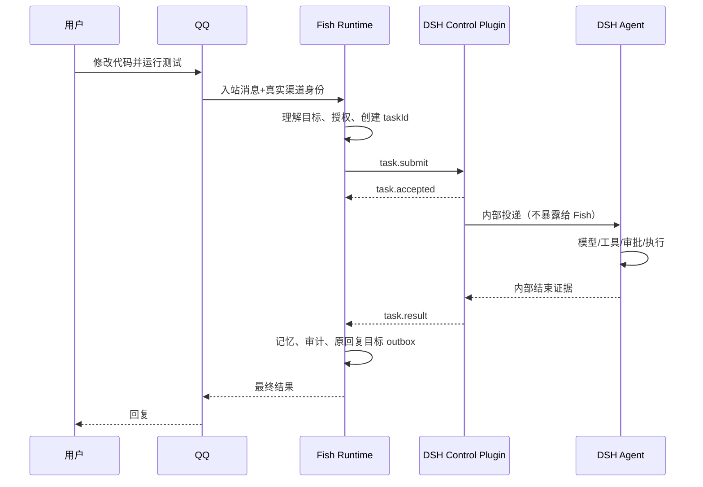
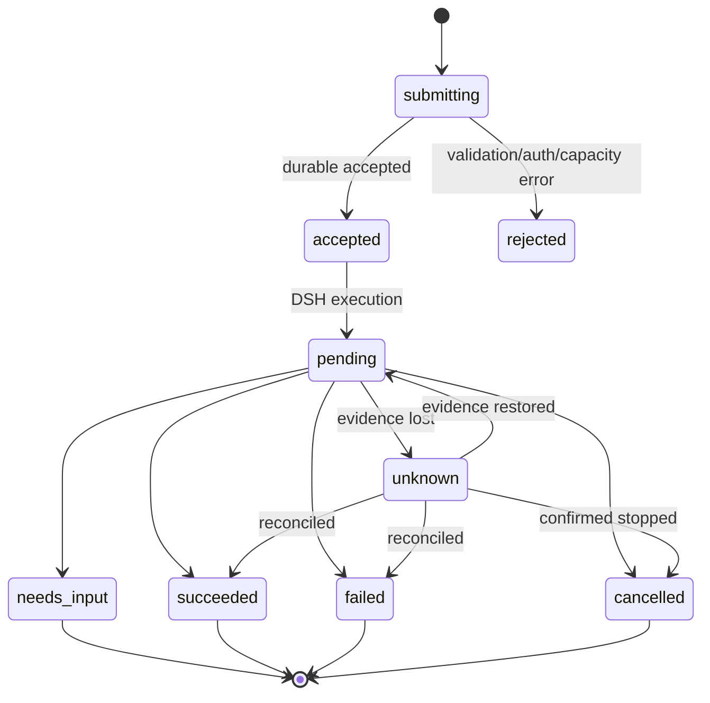

# Fishbowl 独立运行与 DSH 控制系统
# 软件需求规格说明书（SRS）

版本：0.1-draft  
日期：2026-11-03  
状态：需求基线草案，待评审；未代表生产实现  
适用范围：Fishbowl Standalone Runtime、QQ 等消息入口、DSH Control Plugin、Fishbowl Control Protocol

> 本文汇总当前项目所有已确认需求、任务执行规则、连接规则、社交规则、DSH 验证结果以及 Jev 扩展方向。协议字段、认证参数、默认限额和桌面 DSH 集成仍需评审与验证。与历史文档冲突时，已确认的 [task-execution-rules.md](task-execution-rules.md)、[confirmed-social-and-runtime-rules.md](confirmed-social-and-runtime-rules.md) 和架构决策优先。

## 1. 文档目的与阅读方式

本 SRS 定义 Fishbowl 要解决的问题、系统边界、功能和质量要求、外部接口、数据所有权、异常语义、验收条件和未决风险。它是后续总体设计、分阶段实施计划、测试计划和变更评审的共同基线。

需求状态使用以下标记：

| 标记 | 含义 |
|---|---|
| 已确认 | 用户或项目共识已经确认，设计必须遵守 |
| 草案 | 已提出具体方案，但还需设计评审或集成验证 |
| 未验证 | 文档规定了目标，但当前 DSH/API/环境证据不足 |
| 后续 | 不属于首期闭环，可在基础能力稳定后实现 |

本文不把 DSH 内部 Agent 的思考、工具调用、审批步骤或进度流纳入 Fishbowl 的业务协议，也不把网络超时解释为 DSH 已停止。

## 2. 产品概述

Fishbowl 是一个可脱离 DSH 独立运行的 Fish Runtime。Fish 拥有自己的个体、模型、上下文、记忆、情绪、事件账本、入口和任务编排能力；DSH 是按需连接的外部代码执行能力。QQ 是 Fish 的独立消息渠道，两者是可组合能力，不是固定转发管道。

典型但非唯一的组合场景是：用户通过 QQ 要求修改代码，Fish 理解任务、确认授权项目并选择 DSH；插件将任务交给 DSH；DSH 自主完成所有内部工作；Fish 只接收控制确认和最终结果，再向原 QQ 请求者回复并记录来源。

## 3. 目标、范围与非目标

### 3.1 产品目标

1. Fish 在没有 DSH 时仍能启动并运行自身能力。
2. Fish 能按需调用 DSH 完成代码或其他受授权执行任务。
3. DSH 从接收任务到结束完全由 DSH 自己掌控，Fish 不接收中间过程。
4. 任务、结果、授权、审计、记忆和通知在断线、重启、重复消息下保持可核对。
5. Fish 能通过 QQ、其他入口或自主任务使用同一个 DSH 能力，而不把 QQ 固定成唯一路径。
6. 未来可用 Jev 加速固定答案空间的决策，同时不破坏主模型和程序硬规则边界。

### 3.2 首期范围

- Fishbowl Runtime 独立启动、配置、状态、日志、健康检查和消息队列。
- Fish 自身 Agent 循环、Model Provider 接口、记忆、事件账本和审计边界。
- QQ 消息适配器的接收、回复目标保存和结果补投边界。
- DSH Control Plugin 主动连接 Fishbowl 的能力发现、认证、项目绑定和最小任务协议。
- 任务提交、接收确认、查询、取消确认、最终结果、needs_input、幂等和恢复。
- 每鱼一个 DSH 接入、每 DSH 会话一条鱼、同一 DSH 会话内任务串行。
- DSH 结果进入 Fish 事件队列、记忆和原渠道通知。
- Fish 与 DSH 分端审计、任务 ID/trace 关联和敏感数据脱敏。

### 3.3 非目标

- 首期拦截 DSH 用户输入、阻止 DSH 原模型请求或向 DSH 回灌 Fish assistant。
- Fish 订阅或保存 DSH 思考、工具调用、审批细节和执行进度。
- 用 Fish 模型替代 DSH 自己的 Agent、模型或工具。
- 通过消息中的任意路径获得工作区权限。
- 首期实现 DSH 全部 Agent/Session/Tool/Plugin/Config/Runtime 管理操作。
- 立即把核心程序改写为 Rust，或同时维护 TypeScript/Rust 双实现。
- 让 Jev 生成文本、代码、开放式对话或单独完成权限判定。
- 以标准 MCP 替代 Fishbowl 内部完整控制协议。

## 4. 用户、系统角色和责任边界

| 角色 | 主要责任 | 不应拥有的隐含权限 |
|---|---|---|
| 原请求用户 | 通过 QQ/其他入口提交任务、回答 needs_input、查看结果 | 不能仅凭群消息获得 DSH 管理权 |
| Fish Agent | 理解消息、选择能力、编排任务、回复用户 | 不负责 DSH 内部步骤和工具执行 |
| Fish Runtime | 状态、账本、队列、授权边界、持久化、恢复、审计 | 不直接读写 DSH 私有文件 |
| DSH Control Plugin | 主动连接、协议适配、任务账本、会话排他、结果适配 | 不写 Fish 业务账本、不管理 QQ |
| DSH Agent/Session | 模型、工具、审批、代码执行和内部结束判定 | 不直接修改 Fish 状态 |
| 管理员 | 配置绑定、能力白名单、运行开关、审计查看、恢复核对 | 默认不能直接修改 Fish 内在记忆/人格 |
| Jev DecisionProvider | 固定选项分类、评分、路由和风险预筛选 | 不生成回复、不单独授权高风险操作 |

## 5. 使用场景与用例

### UC-01 独立聊天

触发：用户通过 QQ 发送普通问题。  
结果：Fish 自己理解并回复；没有 DSH 连接也不影响该用例。  
约束：QQ 消息不会自动转发到 DSH。

### UC-02 QQ 委托代码任务

### UC-03 DSH 需要补充信息

DSH 以 `needs_input` 结束原任务，返回问题和已产生影响；Fish 向原请求者询问。用户答复后，Fish 创建新的关联任务，携带原目标、问题、答复、已完成影响和剩余目标。原任务不重新打开，不无限等待，不盲目重做副作用。

### UC-04 断线与恢复

连接断开不改变 DSH 已接受任务的执行状态。Fish 或插件重启后以原 taskId 查询、补投和去重；无法确定是否执行或是否完成时标记 unknown，先核对，不自动新建任务重跑。

### UC-05 取消竞态

Fish 发出取消不等于取消成功。排队任务可在插件本地移除；运行任务必须精确匹配 DSH message/turn，等待结束证据后才能返回 cancelled。若任务先完成，原结果获胜；无法证明停止则保持 unresolved/unknown。

### UC-06 鱼间交流

多条 Fish 可按互相可见名单主动发起多轮交流。每条鱼独立记忆和预算，用户可旁观、插话；用户消息优先于鱼间消息。鱼间消息不能读取对方私密记忆，也不能成为权限或配置指令。

### UC-07 Jev 快速决策

Fish 将用户消息和可用上下文发送给 Jev，询问预定义的意图、路由或风险问题；Jev 返回类型化答案和概率。程序根据阈值选择主模型、DSH、澄清或人工确认。Jev 不生成用户可见文本。

## 6. 功能需求

### 6.1 Runtime 与个体

| ID | 需求 | 验收要点 | 状态 |
|---|---|---|---|
| FR-RUN-001 | Runtime 可独立启动/停止 | DSH 缺失或断线时自身消息和状态能力仍可用 | 已确认 |
| FR-RUN-002 | 每条鱼拥有独立身份、情绪、记忆和账本 | 一条鱼不可直接读取另一条鱼记忆 | 已确认 |
| FR-RUN-003 | Runtime 是 Fish 业务状态唯一写入者 | QQ、DSH、CLI 不直接并发写同一本账 | 已确认 |
| FR-RUN-004 | 配置、状态、日志、健康检查可管理 | 启停、配置变更和故障有审计 | 已确认 |
| FR-RUN-005 | 同鱼消息按队列串行处理 | 单条失败不阻塞后续消息 | 已确认 |
| FR-RUN-006 | 用户消息优先于鱼间消息，结果事件不饿死 | 结果最终进入队列并被处理 | 草案 |
| FR-RUN-007 | 不同鱼可独立运行 | 一条鱼阻塞不锁住所有鱼 | 已确认 |

### 6.2 入口与 QQ

| ID | 需求 | 验收要点 | 状态 |
|---|---|---|---|
| FR-CH-001 | 保存真实渠道身份、会话和回复目标 | 结果只能回原请求者/原渠道 | 已确认 |
| FR-CH-002 | QQ 消息可直接触发 Fish 对话 | 不强制调用 DSH | 已确认 |
| FR-CH-003 | 结果通知支持持久 outbox | 渠道离线时恢复后补投 | 已确认 |
| FR-CH-004 | 通知去重与至少一次语义明确 | resultId+目标去重；不声称跨 QQ 恰好一次 | 草案 |
| FR-CH-005 | 群聊、转发和 @ 不自动升级权限 | 权限基于真实 principal | 已确认 |

### 6.3 Agent、模型与 Jev

| ID | 需求 | 验收要点 | 状态 |
|---|---|---|---|
| FR-AI-001 | Fish 保留自己的 Agent 循环 | DSH 自主执行不取消 Fish Agent | 已确认 |
| FR-AI-002 | 主模型由统一 Provider 接口接入 | 可替换服务而不改变业务层 | 已确认 |
| FR-AI-003 | Agent 选择是否调用 DSH | 普通聊天不自动提交任务 | 已确认 |
| FR-AI-004 | Jev 可选且可关闭 | 不可用时主模型/规则仍可工作 | 草案 |
| FR-AI-005 | Jev 仅返回预定义决策 | 不把自然语言或概率当成授权事实 | 草案 |
| FR-AI-006 | 高风险决定必须经过程序规则/人工确认 | Jev 不能单独授权 | 已确认 |

### 6.4 DSH 连接和能力发现

| ID | 需求 | 验收要点 | 状态 |
|---|---|---|---|
| FR-DSH-001 | DSH Plugin 主动连接 Fish Runtime | 首选持久 WebSocket；本地可用等价 IPC | 已确认 |
| FR-DSH-002 | 握手协商协议和能力 | 无共同版本或必要能力则拒绝 | 草案 |
| FR-DSH-003 | 连接按 fish/provider/binding 隔离 | 首期一鱼一个 DSH 接入 | 已确认 |
| FR-DSH-004 | 一个 DSH session 只绑定一条鱼 | 绑定切换需管理员操作和新 bindingId | 已确认 |
| FR-DSH-005 | 项目 ID 映射本地工作区 | 任意路径不能成为授权依据 | 已确认 |
| FR-DSH-006 | 报告能力、Schema、权限和不可用原因 | Fish 依能力发现编排 | 已确认 |
| FR-DSH-007 | DSH 版本差异只存在插件适配层 | Fish 核心不依赖 DSH 私有对象 | 已确认 |

### 6.5 任务协议与执行

| ID | 需求 | 验收要点 | 状态 |
|---|---|---|---|
| FR-TASK-001 | Submit 包含 taskId、traceId、principal、project 和目标 | Fish 在发送前持久化 taskId | 已确认 |
| FR-TASK-002 | 插件持久接收后返回 accepted/rejected | accepted 不等于开始或成功 | 草案 |
| FR-TASK-003 | 同 `(bindingId, taskId)` 幂等 | 同内容返回原记录；不同内容 ID_CONFLICT | 草案 |
| FR-TASK-004 | 任务可 query | 断线恢复不新建 ID | 已确认 |
| FR-TASK-005 | 任务可 cancel | 必须等待 DSH 取消确认，不撤销已完成副作用 | 已确认 |
| FR-TASK-006 | 结果包含 succeeded/failed/cancelled/needs_input | completed 回合不自动等于成功 | 已确认 |
| FR-TASK-007 | 结果 unknown 与终态分离 | 不明时阻止盲重跑 | 已确认 |
| FR-TASK-008 | DSH 内部过程不通过 Fish 协议发送 | Fish 只接收边界控制和最终结果 | 已确认 |
| FR-TASK-009 | 结果可查询、重投、去重确认 | result_ack 表示 Fish 持久接收，不表示 QQ 已送达 | 草案 |
| FR-TASK-010 | needs_input 生成新关联任务 | 原任务终态保留，续接任务带完整上下文 | 已确认 |
| FR-TASK-011 | 同一 DSH session 任务串行 | 不默认打断当前任务或人工工作 | 已确认 |
| FR-TASK-012 | 结构化结果严格校验 | 非法结果不能猜测成功 | 草案 |

### 6.6 授权、审批和安全

| ID | 需求 | 验收要点 | 状态 |
|---|---|---|---|
| FR-SEC-001 | 认证连接和身份 | 凭据不放 URL、提示词或普通日志 | 草案 |
| FR-SEC-002 | 按 principal、fish、能力、project 授权 | QQ 接入本身不授予 DSH 权限 | 已确认 |
| FR-SEC-003 | 项目和参数白名单 | 任意路径、群转发文本不提升权限 | 已确认 |
| FR-SEC-004 | DSH 内部审批由 DSH 负责 | 审批失败返回明确错误，不通过 Fish 绕过 | 已确认 |
| FR-SEC-005 | 敏感数据按披露策略过滤 | 不自动公开私聊、私密记忆和凭据 | 已确认 |
| FR-SEC-006 | 审计失败策略可配置 | 高风险操作可选择拒绝执行 | 草案 |

### 6.7 记忆、鱼间交流和设置

| ID | 需求 | 验收要点 | 状态 |
|---|---|---|---|
| FR-MEM-001 | 鱼可召回自身跨渠道记忆 | QQ、DSH、鱼间交流记忆归同一鱼 | 已确认 |
| FR-MEM-002 | DSH 结果记忆标记来源和状态 | 不声称 Fish 亲自执行或验证 | 已确认 |
| FR-SOC-001 | 鱼可按名单主动交流 | 双方在可见名单中才可交流 | 已确认 |
| FR-SOC-002 | 鱼间交流支持多轮和独立预算 | 次数、消息量、Token 上限可配置 | 已确认/细节草案 |
| FR-SOC-003 | 用户可旁观和插话 | 插话进队列，不默认打断工具或模型 | 已确认 |
| FR-SOC-004 | 鱼间消息进入双方各自记忆 | 记录对象、日期、内容 | 已确认 |
| FR-SET-001 | 管理员可配置运行状态、模型、作息、名单、预算 | 设置变更有审计 | 已确认 |
| FR-SET-002 | 默认不能直接改情绪、记忆、人格 | 允许修正时必须成为可重放事件 | 已确认 |

### 6.8 审计和运维

| ID | 需求 | 验收要点 | 状态 |
|---|---|---|---|
| FR-AUD-001 | Fish 保存任务边界和自身编排审计 | 可从入口追踪到结果和通知 | 已确认 |
| FR-AUD-002 | DSH 保存内部执行审计 | 按 taskId/traceId 跨端核对，不回传过程 | 已确认 |
| FR-AUD-003 | 审计追加写入并可查询 | 事件有 eventId、traceId、parentId、来源和结果 | 已确认 |
| FR-OPS-001 | 健康检查区分连接、存储、队列和执行未知 | 在线不等于任务正常 | 草案 |
| FR-OPS-002 | 配置、绑定和凭据变更可追溯 | 敏感值不明文记录 | 已确认 |

## 7. 外部接口需求

### 7.1 Fishbowl Control Protocol（草案）

首期建议使用由 DSH Plugin 主动建立的持久 WebSocket。握手后使用版本化 JSON 信封，核心类型如下：

| 类型 | 方向 | 目的 |
|---|---|---|
| `hello/welcome/ready` | 双向 | 认证、版本、绑定和能力协商 |
| `task.submit` | Fish→插件 | 持久提交任务 |
| `task.accepted/rejected` | 插件→Fish | 接收或拒绝确认 |
| `task.query/snapshot` | 双向 | 恢复查询和状态核对 |
| `task.cancel/cancel_ack` | 双向 | 请求及确认取消 |
| `task.result/result_ack` | 双向 | 最终结果和持久接收确认 |
| `ping/pong` | 双向 | 连接存活 |
| `protocol.error` | 双向 | 消息错误，不改变业务结果 |

任务键为 `(bindingId, taskId)`；消息 `messageId` 只用于传输，不用于任务去重。结果业务状态为 `succeeded/failed/cancelled/needs_input`，知识状态可为 `pending/unknown/terminal`。详细字段和编码规则见 [task-protocol-design.md](task-protocol-design.md)。

### 7.2 QQ 接口

QQ 适配器必须把平台事件转为 Fish 内部入口事件，包含真实 principal、channel、conversation、messageId、回复目标和时间。发送结果使用 Fish outbox；渠道不可用、发送确认丢失或平台限流时，不把 DSH 任务改为失败。

### 7.3 Model Provider 接口

主模型接口至少支持上下文输入、工具意图/调用、取消、超时、错误和模型来源记录。模型输出不能直接写 Fish 账本，必须经过 Agent 编排和规则校验。

### 7.4 Jev DecisionProvider 接口

Jev 适配器输入版本化 `state` 和预定义 `questions`，输出类型化 answers、概率、模型版本和用量。接口必须可关闭、可超时、可降级；Jev 不可用时不得阻塞普通聊天或破坏程序硬规则。

### 7.5 管理接口

管理接口提供鱼状态、DSH 绑定、能力白名单、项目映射、可见名单、预算、审计检索、健康状态和人工核对。高风险操作需管理员身份、审计和明确确认。

## 8. 数据需求

### 8.1 核心实体

| 实体 | 关键字段 | 所有者 |
|---|---|---|
| Fish | fishId、状态、配置版本、模型绑定 | Fish Runtime |
| Principal | principalId、渠道身份、授权范围 | Fish Runtime/管理员 |
| Binding | bindingId、fishId、providerId、projectId、sessionRef、状态 | 双端关联，Fish 保存业务绑定，插件保存执行绑定 |
| Task | taskId、traceId、parentTaskId、requestDigest、状态、原回复目标 | Fish 保存任务边界；插件保存执行记录 |
| TaskResult | resultId、业务状态、summary、effects、artifacts、tests、questions | DSH 生成，Fish/插件各自持久保存副本 |
| Memory | memoryId、fishId、来源、披露级别、内容摘要 | Fish Runtime |
| AuditEvent | eventId、traceId、parentId、actor、target、状态、摘要 | 各端分开保存 |
| OutboxItem | resultId/messageId、目标、状态、重试次数 | Fish 或插件按出站边界持有 |
| SocialConversation | conversationId、双方、轮次、预算、状态 | Fish Runtime |

### 8.2 任务终态和未知

`unknown` 是知识状态，不是业务成功或失败；原任务不能通过重试直接覆盖。`needs_input` 是本次任务终态，后续答复创建新的 `parentTaskId` 关联任务。

## 9. 非功能需求

### 9.1 可靠性和一致性

- NFR-REL-001：任务 ID 在首次提交前持久化。
- NFR-REL-002：插件先保存请求和队列项再返回 accepted。
- NFR-REL-003：结果先保存终态和 outbox 再发送；Fish 保存入站事实后才 result_ack。
- NFR-REL-004：断线、响应丢失和超时不得触发盲目新 ID 重跑。
- NFR-REL-005：同一绑定 unknown 时默认冻结新任务，先核对。
- NFR-REL-006：重复请求、重复结果和乱序消息必须可去重。
- NFR-REL-007：跨 Fish 账本、插件账本和 DSH inbox 不承诺无条件跨存储恰好一次执行。

### 9.2 安全

- NFR-SEC-001：本机回环也必须认证；远程使用加密传输和证书校验。
- NFR-SEC-002：凭据不得进入 URL、模型上下文、审计明文或错误回显。
- NFR-SEC-003：权限基于真实渠道身份、fish、能力和项目。
- NFR-SEC-004：工作区映射由配置授权，拒绝绝对路径、`..` 和未授权项目。
- NFR-SEC-005：敏感记忆、QQ 私聊和凭据遵守披露策略。

### 9.3 可观测性

- NFR-OBS-001：跨端使用 taskId、traceId 和 connectionId 关联。
- NFR-OBS-002：连接在线、任务 accepted、任务 pending、任务 terminal、结果 ack、QQ delivered 分开显示。
- NFR-OBS-003：DSH 中间事件不进入 Fish 业务日志；Fish 可记录边界事件和错误摘要。
- NFR-OBS-004：健康检查不能以 Agent idle 或 WebSocket 在线替代任务结算证据。

### 9.4 性能和容量（建议值，待评审）

| 项目 | 建议值 | 备注 |
|---|---:|---|
| 心跳/离线判定 | 15s / 45s | 只标记连接，不改变任务结果 |
| 控制响应等待 | 10s | 超时后 query，不重跑 |
| 重连退避 | 1–30s+抖动 | 结果补投也限速 |
| 每绑定执行槽 | 1 | 同 DSH session 串行 |
| 待执行队列 | 16 | 满则 QUEUE_FULL |
| 单帧 | 256 KiB | 大产物使用后续方案 |
| 结果保留 | 未 ack 不删；建议 30 天归档 | 绑定墓碑需保留 |

### 9.5 可维护性与迁移

- NFR-MAINT-001：新增核心代码使用 TypeScript/Node.js，现有 JavaScript 按需迁移。
- NFR-MAINT-002：协议和持久数据格式不依赖 TypeScript 类实例，带版本号。
- NFR-MAINT-003：模型、存储、网络、时钟使用接口隔离。
- NFR-MAINT-004：保留行为测试，未来 Rust 迁移逐模块重写并验证兼容。

## 10. 审计要求

Fish 端至少记录启动/停止、配置、入口消息、权限、模型调用、工具选择、DSH 提交/确认/取消/结果、记忆写入、通知 outbox 和错误。DSH 端记录其内部 Agent、Session、Tool、审批、文件变化和最终结算。双方不得以复制全部中间日志来实现追踪，使用任务 ID/traceId 关联即可。

每条审计事件至少包含 `eventId/traceId/parentId/time/component/version/actor/action/target/inputDigest/result/error/duration/retry/cancelReason`。敏感值脱敏；审计写入失败需要告警，高风险操作可拒绝执行。

## 11. 验收与测试需求

### 11.1 首期验收矩阵

| 类别 | 必须通过 |
|---|---|
| 独立运行 | DSH 不可用时 QQ/普通 Fish 能力正常 |
| 正常委托 | Fish 提交任务，DSH 自主执行，Fish 只收到 accepted/result |
| 结果 | succeeded/failed/cancelled/needs_input 严格区分 |
| 幂等 | 相同 ID 同请求不重复执行；不同请求 ID_CONFLICT |
| 恢复 | accepted/result 丢失、断线、两端重启可 query/补投/核对 |
| unknown | 不确定时不当作失败/成功，不盲重跑 |
| 取消 | 排队、运行、完成竞态不误取消人工任务 |
| 会话 | 人工输入与远程任务不混淆；同一 session 任务串行 |
| 安全 | 未授权 principal、项目、路径和旧连接均被拒绝 |
| 通知 | 结果回原请求者；渠道不可用时持久补投 |
| 记忆审计 | 结果注明 DSH 来源，两端审计可按 taskId 核对 |

### 11.2 当前证据限制

CLI rc.2 加脚本模型已验证工具往返、错误、取消、needs_input 结果信封和两消息关联；桌面 rc.5 仅完成静态核对。真实模型、桌面插件激活、网络协议、持久去重、恢复、会话排他和 QQ 组合用例尚未全部通过，详见 [dsh-task-validation.md](dsh-task-validation.md)。

## 12. 追踪矩阵

| 需求来源 | SRS 覆盖 |
|---|---|
| 独立运行与语言路线 | FR-RUN、NFR-MAINT、总体设计 Runtime |
| DSH 任务规则 | FR-TASK、NFR-REL、任务状态图 |
| 连接与会话规则 | FR-DSH、FR-RUN、部署与绑定设计 |
| QQ 与社交规则 | FR-CH、FR-SOC、队列和记忆设计 |
| 审计要求 | FR-AUD、NFR-OBS、安全设计 |
| Jev 决策 | FR-AI-004~006、Jev 接口 |
| DSH 可行性验证 | 11.2、总体设计验证门槛 |

## 13. 未决事项和变更规则

以下事项仍需评审或实测：WebSocket 认证细节、默认超时和保留周期、桌面 DSH 会话排他、运行中取消同步保证、人工输入检测、结构化最终结果生成、管理员身份、鱼间预算重置时区、QQ 平台幂等能力、Jev 中文准确率和隐私策略。未决事项不能被实现者自行解释为更宽权限或更强可靠性；任何改变“DSH 内部过程不回传”“unknown 不盲重跑”“needs_input 新建任务”的变更，必须更新 SRS、架构决策和验收矩阵。
